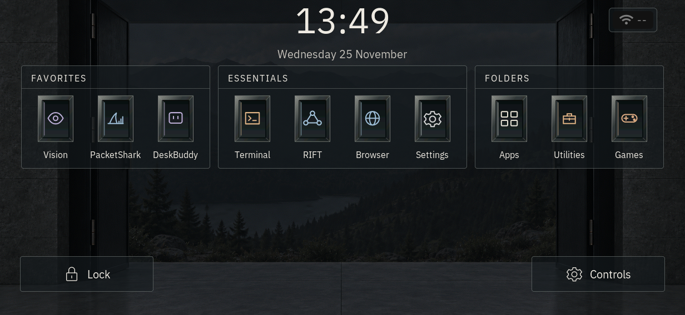
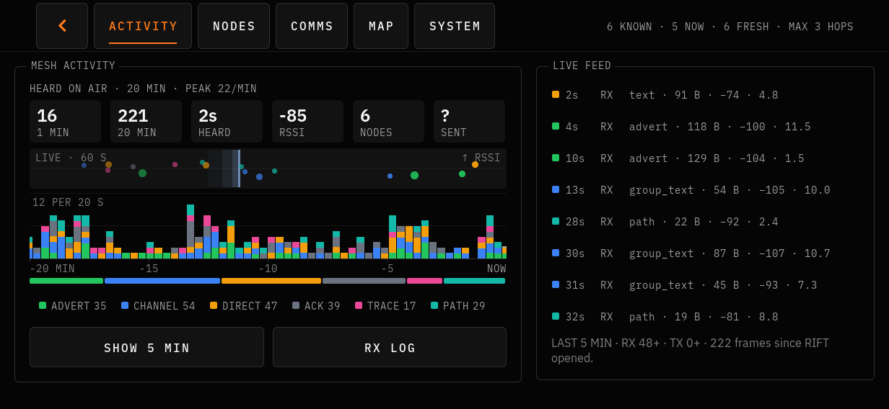
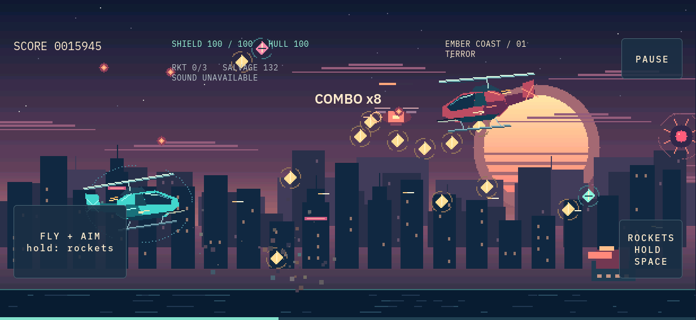
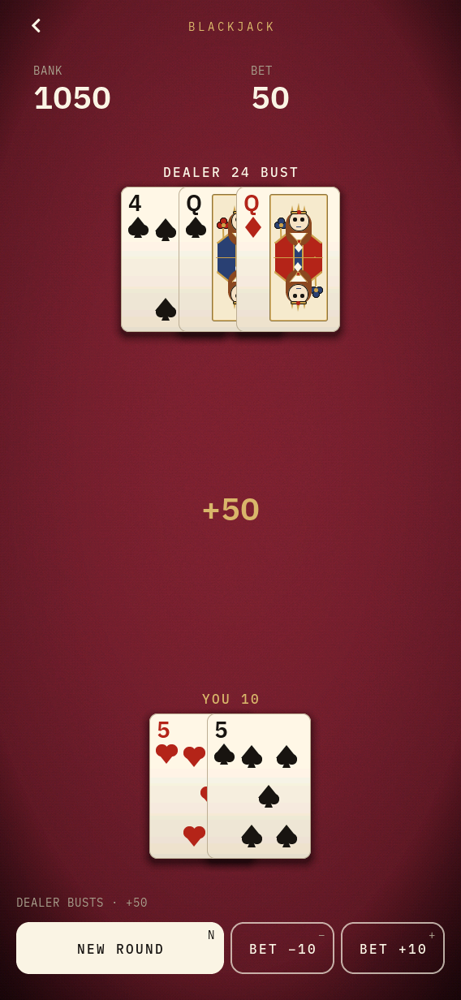
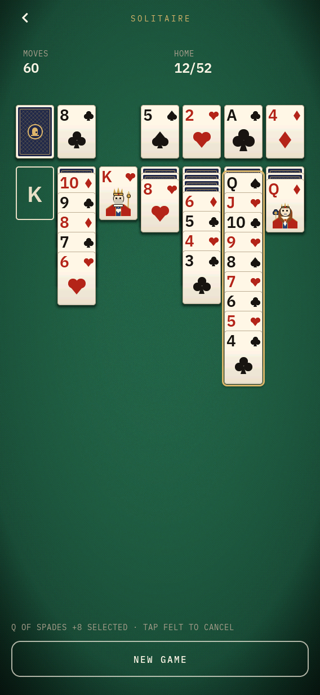
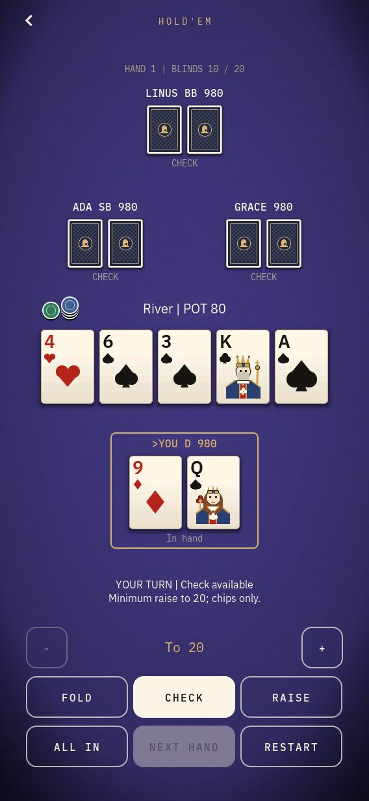
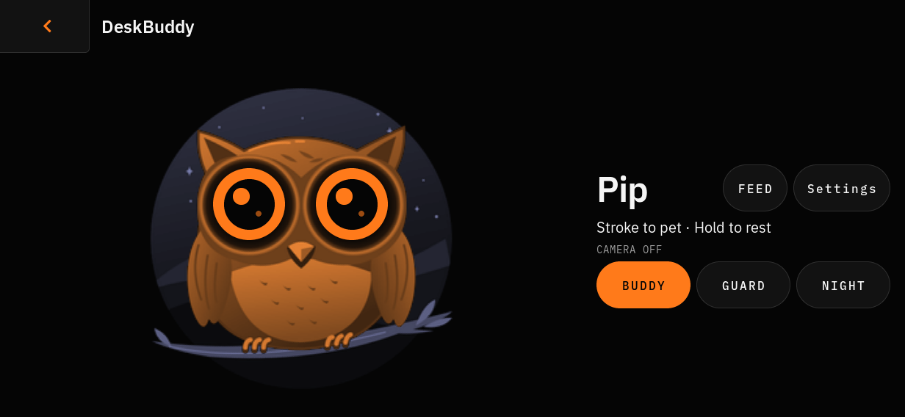
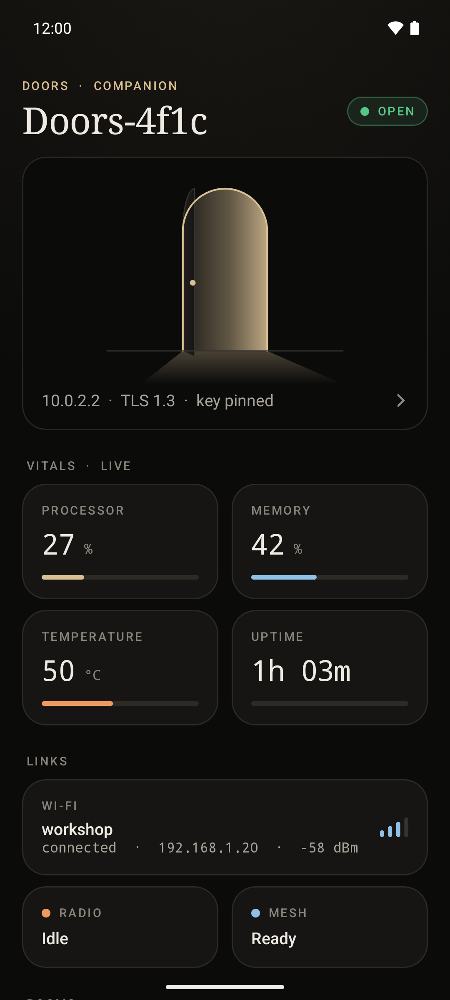
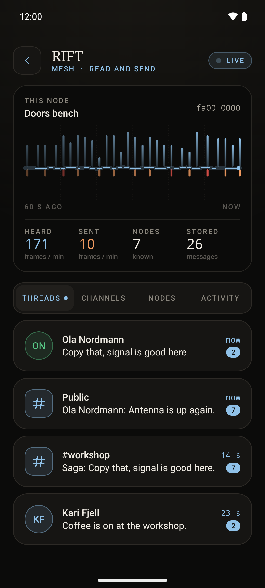
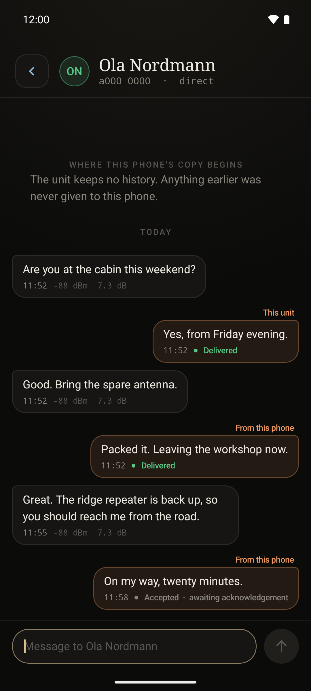

# DOORS

*Open. Explore. Connect.*

DOORS is a complete Linux environment for the
[LILYGO T-Display K230](docs/hardware/T-DISPLAY-K230.md), a handheld RISC-V
computer with a 4.1-inch AMOLED touchscreen, a LoRa radio, a camera, a
neural-network accelerator (KPU) and an optional keyboard base. It gives that
hardware a real operating environment: a shell driven by touch and keys, the
apps that run inside it, and system services that own the radio, the network
and the hardware. Mesh messaging, on-device object detection, network
analysis, games and a root Linux terminal all run on the device itself.

**[Download DOORS 0.5.0](https://github.com/KrakenSaten/K230/releases/download/v0.5.0/doors-0.5.0-tdisplay-k230-b37b644a.img.gz)** (122 MB card image)
· [Install guide](docs/GETTING_STARTED.md)
· [Release notes](docs/releases/v0.5.0.md)
· [Roadmap](docs/ROADMAP.md)

The launcher in the Carbon theme, one of seven. SDL simulator capture of the 0.5.0 shell at the panel's native 1232 × 568.

## What's new in 0.5.0

<!-- Keep this section short and near the download links. On each release,
replace this summary, keep the Highlights screenshots current, and move older
news to docs/releases/HISTORY.md. Use real captures; label simulator or fixture
data and use stable image paths. A feature merged after the latest release is
marked as master-only until an image ships it. -->

Released 24 November 2026.

- **PacketShark** joins the image: a receive-only network analyzer for
  Ethernet and Wi-Fi.
- **Games Hub**, a poster wall for every game, and the **Lamplight** tables
  for Blackjack, Poker and Solitaire.
- **RIFT Activity**: the mesh traffic the radio hears, live, and message
  banners anywhere in DOORS.
- **DeskBuddy 2.0**: Pip, a touch-responsive owl with an optional voice.
- **Zabbix**, redesigned as a card-based monitoring console.

The DOORS Companion Android app and Fleet over the local network are in the
source but not active in the image ([Status](#status)).
[Full release notes](docs/releases/v0.5.0.md) ·
[Earlier releases](docs/releases/HISTORY.md)

## Highlights

### RIFT · mesh messaging over LoRa

RIFT is DOORS' MeshCore messenger: direct messages with delivery
acknowledgement, channels, a node list, a map and the radio's own status.
ACTIVITY shows the traffic the radio hears, frame by frame, as a live signal
scope, twenty minutes of stacked bars by packet type and a live feed; MAP's
TRAFFIC mode draws the paths the heard packets took. MeshCore runs as its own
service on top of DOORS' SX1262 radio service, and stays off until you set it
up.

SDL simulator capture with synthetic nodes and traffic from the project's test service (`tests/fake-meshcored`); no radio traffic was recorded.
[RIFT guide](docs/apps/RIFT.md)

### PacketShark · network analysis in your pocket

A packet analyzer for Ethernet and the unit's Wi-Fi link. LIVE shows packets
and throughput with a 60-second graph stacked by protocol; PACKETS lists,
filters and sorts the capture; INSPECT decodes one packet layer by layer,
down to its bytes. Signals flag DNS failures, TCP resets, retransmissions and
connections that got no reply. The diagnosis pairs DNS queries with their
answers and follows TCP handshakes, and a network overview lists the devices,
DHCP exchanges and ARP pairs it saw, with findings and the evidence for each.
A stopped capture saves to a standard `.pcap` file for Wireshark.
PacketShark is receive-only: it never transmits or injects, and on Wi-Fi it
sees the unit's own link (no monitor mode).

SDL simulator capture after one minute on the capture helper's synthetic source (SYNTH0, 400 packets per second, documentation addresses only).
[PacketShark guide](docs/apps/PACKETSHARK.md)

### Vision · object detection on the KPU

Vision runs object detection on the K230's KPU over the live camera picture:
boxes, classes and confidence, persistent track ids, and a counting line for
traffic in each direction. The image ships DOORS' own experimental detector,
R0 · Beta, for cars, trucks, buses, motorcycles, bicycles and people; it
drives DETECT, TRACK and TRAFFIC beside COLOR, EDGE and LINE TRACE. GENERAL 80,
GENERAL 365, SEGMENT, INSTANCES, FACE, READ and RECOGNIZE appear when their
model files are installed; those weights are not part of DOORS.
[Vision guide](docs/apps/VISION.md)

### Games

**Games** opens a poster wall. RotorTerror, an original helicopter arcade
game, and Relay Nine lead; Fleet, Radar, Timber, Solitaire, Blackjack, Poker
and 2048 are one tap away. Fleet is a naval battle against the device or
another DOORS unit over LoRa, with chat between shots.

  
  

Blackjack, Poker (Texas Hold'em against three computer players) and
Solitaire share the Lamplight table: illustrated court cards, motion and a
full-screen felt.

  
  
  

Games Hub and the three card tables: SDL simulator captures, Carbon theme; the card tables show each game's fixed review deal. RotorTerror: LVGL host-test capture with scripted input.
[Games Hub](docs/design/games-hub/README.md) · [RotorTerror](docs/apps/ROTORTERROR.md) · [Relay Nine](docs/apps/RELAY_NINE.md) · [Blackjack](docs/apps/PGBLACKJACK.md) · [Poker](docs/apps/POKER.md) · [Solitaire](docs/apps/PGSOLITAIRE.md)

### DeskBuddy · Pip

DeskBuddy turns the unit into a desk companion. Pip, an owl on a perch,
answers touch: stroke to pet, hold to rest, tap to wake, drag a biscuit to
its beak. With the camera on, Pip notices people at the desk; GUARD notes who
came by while you were away, with an optional chime, and NIGHT is a calm
bedside clock. The character voice is off unless you choose it.

  

SDL simulator capture, Carbon theme, with camera presence switched off.
[DeskBuddy guide](docs/apps/DESKBUDDY.md)

### DOORS Companion for Android · in development

The DOORS Companion app pairs an Android phone with one unit over the local
network: an authenticated TLS 1.3 session to the unit's pinned key, with no
cloud service or account. It shows the unit's vitals, keeps the RIFT message
history on the phone and sends messages through the unit's radio; PacketShark
and a live Vision picture have run against a unit carrying a test build of
the gateway. **It does not work with 0.5.0 yet:** the image does not include
the unit's gateway service, `gatewayd`, and no APK is published
([Status](#status)).

  
  
  

Android emulator captures of the app against the reference `gatewayd` and the fake services of the host test harness; unit, people and traffic are the harness's own.
[Companion app](android/doors-companion/README.md) · [Gateway](docs/services/GATEWAYD.md)

## All apps

- **Communication**: RIFT, Wave (short text messages sent as sound) and
  Radio (the LoRa radio's status).
- **Network and system**: PacketShark, Browser, Zabbix (read-only), Terminal,
  Files (the card and USB drives) and Settings (Wi-Fi, display, seven themes,
  three text sizes, rotation and System status).
- **Camera and media**: Vision, Camera, Photo, Video, MP3 and Recorder.
- **Everyday**: DeskBuddy, Clock, Calendar, Calculator and Notes.
- **Games**: RotorTerror, Relay Nine, Fleet, Radar, Timber, Solitaire,
  Blackjack, Poker and 2048.

DOORS runs in landscape and portrait; Timber and Poker play upright only.
Each app has a guide in [docs/apps/](docs/apps/).

## Status

**Doors 0.5.0** (tag `v0.5.0`, 24 November 2026) is the current release.
Everything above is in its image unless marked otherwise; the
[release notes](docs/releases/v0.5.0.md) list what was validated and the
known limitations.

**In the source, not in the image**

- The DOORS Companion app and its unit service `gatewayd`; shipping the
  gateway waits on the open security items in
  [issue #172](https://github.com/KrakenSaten/K230/issues/172).
- Fleet over the local network (the `peerd` peer service), tested end to end
  on the host. On a 0.5.0 card Fleet plays over the mesh.
- Library, an offline-collection prototype (opt-in build).
- The optional Vision models: their weights are neither included nor
  published ([MODEL_LICENSES.md](MODEL_LICENSES.md)).

**Preview only**: the Games Hub's Multiplayer Lobby poster reads COMING SOON;
there is no linked play behind it yet.

**Planned**, in priority order: DOORS' own trained Vision model (ongoing),
DeskBuddy, RIFT, further Vision work, new and improved games, and
PacketShark. See the [roadmap](docs/ROADMAP.md) and the
[known issues](docs/KNOWN_ISSUES.md).

## Install

1. Download
   [`doors-0.5.0-tdisplay-k230-b37b644a.img.gz`](https://github.com/KrakenSaten/K230/releases/download/v0.5.0/doors-0.5.0-tdisplay-k230-b37b644a.img.gz)
   and check its SHA-256:
   `514658c6250c2f635608451a89df6bc4f1f48f972c2621453ad8c7e8de70ee3e`
   ([all checksums](https://github.com/KrakenSaten/K230/releases/download/v0.5.0/SHA256SUMS.txt)).
2. Write it, still compressed, to a microSD card larger than 763 MB with
   balenaEtcher or Rufus.
3. Insert the card into the K230 and power it on.

The LoRa radio is off on a fresh card. Connect an antenna first, then set it
up from **Controls**; DOORS uses the MeshCore EU profile (869.618 MHz). The
"Source code" archives GitHub adds to every release are source, not a card
image. The [install guide](docs/GETTING_STARTED.md) covers each step, Wi-Fi,
RIFT and troubleshooting.

## Hardware

Built for the **LILYGO T-Display K230**
([hardware baseline](docs/hardware/T-DISPLAY-K230.md)):

- Kendryte K230 (RISC-V) with its KPU AI accelerator, 1 GB RAM
- 4.1-inch AMOLED touchscreen, 568 × 1232
- SX1262 LoRa radio and GC2093 camera
- Wi-Fi, USB-C and microSD; DOORS runs from the card
- optional keyboard base with F-keys

A [3D-printable desk stand](hardware/stand) holds the unit upright
([STL](https://raw.githubusercontent.com/KrakenSaten/K230/master/hardware/stand/k230-desk-stand.stl)).

The hardware is LILYGO's. DOORS is an independent project built for it and
is not affiliated with LILYGO. **Thank you, LILYGO ♥**

## Development

DOORS is meant to be explored and built on. The Terminal is a real Linux
shell with root access. Apps are C modules hosted by the shell, on LVGL 9
and DOORS' own theme engine; services own the hardware and talk over
`pocketipc` with documented contracts. The shell also runs as an SDL
simulator on a PC, which is where most screenshots here come from, and
`make test` runs the native test suite. The image is built with Buildroot on
LILYGO's BSP ([ADR-001](docs/decisions/ADR-001-pocketos-base.md)).

> Root access gives you full control of the system, including the ability to
> break it. Know what a command does before you run it.

- [Get started](docs/GETTING_STARTED.md): install a released image
- [Architecture](docs/ARCHITECTURE.md): layers, IPC, services, the shell and
  the repository layout
- [Build environment](docs/BUILD_ENVIRONMENT.md): host, toolchain, pinned
  SDK, and the build, flash and test commands
- [API contracts](docs/api/) and [decisions (ADRs)](docs/decisions/README.md)
- [Known issues](docs/KNOWN_ISSUES.md) and
  [release history](docs/releases/HISTORY.md)
- [Contributing](CONTRIBUTING.md): Apache-2.0, DCO sign-off, source headers

## Licence

DOORS' own code is licensed under the **Apache License 2.0**: see
[LICENSE](LICENSE) and [NOTICE](NOTICE)
([ADR-013](docs/decisions/ADR-013-licence-apache-2.md)). Not everything in this
repository or in an image is Apache-2.0:

- Third-party components keep their own licences
  ([THIRD_PARTY_LICENSES.md](THIRD_PARTY_LICENSES.md); the texts the image
  ships are in [THIRD_PARTY_NOTICES.txt](THIRD_PARTY_NOTICES.txt)).
- Vision's R0 detector model is Apache-2.0, while the data it was trained on
  keeps its own terms; every model is documented in
  [MODEL_LICENSES.md](MODEL_LICENSES.md).
- The Doors mark, lockups and boot splash are not Apache-2.0: they may be
  redistributed unmodified as part of Doors
  ([docs/licensing/BRAND.md](docs/licensing/BRAND.md)).
- A DOORS image is a whole Linux system and is not Apache-2.0 as a whole:
  the kernel, U-Boot, BusyBox, the Buildroot packages and the vendor packages
  keep their own licences.

Doors 0.5.0, like 0.3.5 to 0.4.0, is published on the product owner's
decision with some third-party questions still open: the vendor's KPU
runtime modules and ISP server, the toolchain's source, LILYGO's files, and
the points about R0's training data in MODEL_LICENSES.md.
[docs/licensing/APACHE_2_READINESS.md](docs/licensing/APACHE_2_READINESS.md)
§14 lists the platform ones.

## Name

DOORS was called PocketOS through v0.0.9. Release history, hardware records
and many identifiers (`pos_*`, the `pos-*` helpers, `pocketui`,
`/var/lib/pocketos`, `POCKETOS_*`) keep the old name on purpose;
[ADR-005](docs/decisions/ADR-005-product-name-doors.md) says which, and when
they may change. The CLI is `doors`, with `pos` as its permanent alias.
