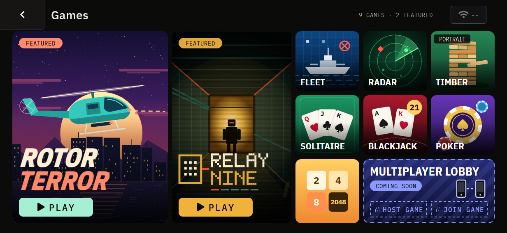
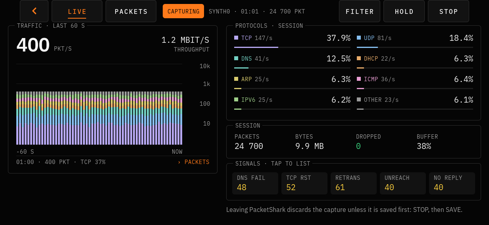
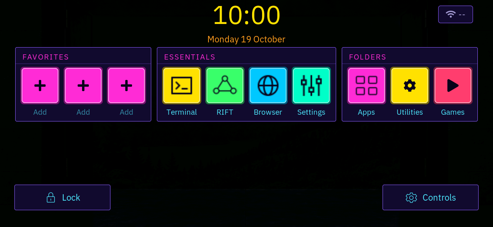

# DOORS

**Open. Explore. Connect.**

A complete Linux environment for the LILYGO T-Display K230.

DOORS turns the K230 into a small Linux platform for communication, local AI,
tools, games and experimentation — built around its touchscreen, keyboard,
LoRa radio, camera and hardware AI acceleration.

- **[Download DOORS v0.5.0 (.img.gz)](https://github.com/KrakenSaten/K230/releases/download/v0.5.0/doors-0.5.0-tdisplay-k230-b37b644a.img.gz)**: the ready-to-flash
  microSD card image (122 MB). Write it to a card as it is; GitHub's
  "Source code" archives on the release page are source, not an image.
- **[Installation guide](docs/GETTING_STARTED.md)**: check the download,
  write the card, first boot, Wi-Fi and RIFT. No development tools needed.
- **[3D-print a desk stand](https://github.com/KrakenSaten/K230/tree/master/hardware/stand)**: a printable stand for the
  K230; [download the STL](https://raw.githubusercontent.com/KrakenSaten/K230/master/hardware/stand/k230-desk-stand.stl).
- **[Release notes and checksums](https://github.com/KrakenSaten/K230/releases/tag/v0.5.0)**: what v0.5.0 contains, the
  SHA-256 checksums
  ([SHA256SUMS.txt](https://github.com/KrakenSaten/K230/releases/download/v0.5.0/SHA256SUMS.txt)),
  and the licence, notices and attribution files.
- **[Roadmap](docs/ROADMAP.md)**: what DOORS is working on next, in
  priority order.

## What's new

<!-- Keep this section near the download links. On each release, replace the
latest-release summary, retain a small curated screenshot gallery, and move
older news to docs/releases/HISTORY.md. Use real captures; label
simulator/fixture data and link to stable image paths or commit SHAs. A
feature merged after the latest release is marked as master-only until an
image ships it. -->

### v0.5.0 · 24 November 2026

- **PacketShark**, new in the image: a receive-only network analyzer for
  Ethernet and Wi-Fi, with DNS and TCP diagnosis and a network overview of
  devices, DHCP and ARP.
- **Games Hub** and **Lamplight card tables**: a poster wall for every game,
  and illustrated, animated tables for Blackjack, Poker and Solitaire.
- **RIFT Activity**: the mesh traffic the radio hears, live, and message
  banners anywhere in DOORS.
- **DeskBuddy 2.0**: Pip, a touch-responsive owl, with an optional voice.
- **Zabbix**: a card-based monitoring console.
- **In source, not active in the image:** the DOORS Companion Android app
  and its gateway, and Fleet over the local network.

The image includes the experimental **R0 · Beta** detector only; no optional
model weights are included. See the
[full v0.5.0 release notes](docs/releases/v0.5.0.md) for validation and
known limitations.

### Games Hub · Your games, your arcade

**New in v0.5.0.** **Games** on the launcher now
opens a poster wall instead of a page of icons. RotorTerror and Relay Nine
lead as large featured posters with their own **PLAY** buttons; Fleet,
Radar, Timber, Solitaire, Blackjack, Poker and 2048 each have a colourful
poster of their own. One tap on any poster starts the game, so all nine
games are a tap away. The wall is laid out for both portrait and landscape,
and keeps its own palette and artwork in every theme.

The **Multiplayer Lobby** poster reserves a place for linked play between
devices. It is a **preview only**: it always reads COMING SOON, HOST GAME
and JOIN GAME are disabled, and there is no multiplayer, networking or
discovery behind it yet.

Blackjack, Poker and Solitaire now share the **Lamplight** table:
illustrated court cards, motion, a full-screen table and serif headlines
([Blackjack](docs/apps/PGBLACKJACK.md) · [Poker](docs/apps/POKER.md) ·
[Solitaire](docs/apps/PGSOLITAIRE.md)).



*Actual SDL simulator capture of the shell on `master`, Carbon theme.*
[Portrait view](docs/apps/games-hub/hub-portrait-carbon.png)
· [Design and implementation record](docs/design/games-hub/README.md)

### RIFT Activity · watch the mesh come alive

**New in v0.5.0.** RIFT's ACTIVITY tab shows the
MeshCore traffic the radio hears, frame by frame. A live scope plots the last
minute's frames by signal strength, size and type. Under it, sixty stacked
bars cover the last 20 or 5 minutes in packet-type colours: adverts, channel
and direct messages, acks, paths, traces and more. Six figures, a per-type
legend (tap a type to show it alone) and a live feed with size, RSSI and SNR
show at a glance how busy the mesh is and what it carries. Once RIFT has
been opened, new messages also raise a banner wherever you are in DOORS.


*Actual SDL simulator capture of the shell on `master`, Carbon theme, with
synthetic nodes and MeshCore traffic from the project's test service
(`tests/fake-meshcored`); no radio traffic was recorded.*
[Activity guide](docs/apps/RIFT.md#heard-on-air-live)
· [RIFT guide](docs/apps/RIFT.md)

### PacketShark · network analysis in your pocket

**New in v0.5.0.** A packet analyzer for the K230's Ethernet port and its
Wi-Fi link, under **Apps → PacketShark**:

- **LIVE**: packets and throughput per second, a 60-second traffic graph
  stacked by protocol, and the share of TCP, UDP, DNS, DHCP, ARP, ICMP and
  IPv6.
- **PACKETS**: the captured list, filtered by protocol, host or port and
  sorted by time or length.
- **INSPECT**: one packet decoded layer by layer, its fields, and its stored
  bytes in hex.
- **Signals** for common network issues: DNS failures, TCP resets,
  retransmissions, unreachable hosts and connections with no reply.
- **SAVE** writes a stopped capture to a standard `.pcap` file for Wireshark
  or tcpdump.
- **Diagnosis**: DNS queries paired with their answers and TCP connections
  followed through handshake, resets and retransmissions.
- **Network overview**: the devices seen, DHCP exchanges, servers and
  leases, ARP pairs and conflicts, and findings with their evidence.

PacketShark is receive-only: it never transmits or injects packets. On
Wi-Fi it sees the unit's own link only (managed mode; no monitor mode).



*Actual SDL simulator capture of the app on `master`, Carbon theme, after
one minute on the real capture helper's synthetic source (SYNTH0, a steady
400 packets per second). The source generates only documentation addresses
and locally administered MACs, and nothing touches a network.*
[PacketShark guide](docs/apps/PACKETSHARK.md)

### Neon · give DOORS an Arcade look

An optional system-wide theme with an indigo background, violet frames,
yellow clocks, magenta headings and colourful app-family tiles. Choose
**Settings → Appearance → Neon**. The original Doors theme remains the
default. Neon has been available since **v0.3.8**.



*Actual SDL simulator capture of the shipped Arcade theme.*
[Portrait view](docs/design/neon/arcade-selected/screens/launcher-portrait-normal.png)
· [Theme gallery](docs/design/neon/arcade-selected/README.md)

### RotorTerror · an original helicopter arcade game

Fly the Kestrel across Ember Coast, Violet Ridge and Ion City. The cannon
fires automatically and guided rockets steer toward enemies ahead; collect
salvage, chain kills into combos and face a heavy gunship every third wave.
Open **Games → RotorTerror → LAUNCH**. New in v0.4.0.


*Actual LVGL host-test capture with scripted input, not concept art or a
device photograph.*
[Game guide](docs/apps/ROTORTERROR.md)

Also in the image: [Relay Nine](docs/apps/RELAY_NINE.md), rebuilt for the
Arcade Neon look in v0.4.0, and RIFT's
[MAP TRAFFIC](docs/apps/rift/TRAFFIC.md) view of observed paths (since
v0.3.9). MeshCore radio operation is **disabled by default** in a fresh
image: [set up RIFT](docs/GETTING_STARTED.md).

[Previous releases](docs/releases/HISTORY.md)
· [What's planned next](docs/ROADMAP.md)


## What is DOORS?

DOORS is the user environment for the T-Display K230: a shell with a
launcher, lock screen and status bar, apps that run inside it, and system
services that own the radio, network and hardware. It runs on the K230's
Linux (Buildroot, based on LILYGO's BSP, ADR-001) and is an independent
project: not LILYGO software and not affiliated with LILYGO.

The aim is to make the hardware useful beyond vendor demos — for mesh
communication, local AI, everyday tools, games and further development.

## Highlights

- **RIFT** — MeshCore messaging: direct messages with delivery acknowledgement,
  channels (Public included), nodes, a map and the radio's own status.
  MAP's [TRAFFIC mode](docs/apps/rift/TRAFFIC.md) (since 0.3.9) is a local,
  read-only analysis of the packets heard and their observed paths.
- **MeshCore integration** — `meshcored`, the MeshCore protocol service on the
  SX1262 radio; disabled in the image and enabled per unit
  ([docs/services/MESHCORED.md](docs/services/MESHCORED.md)).
- **Fleet** — naval battle, solo against the device or multiplayer between two
  DOORS devices over LoRa, with chat between shots.
- **Wave** — short text messages sent and received as sound.
- **Vision** — camera and KPU: COLOR, EDGE and LINE TRACE; DETECT, TRACK and
  TRAFFIC (vehicles counted across a line) with DOORS' own detector,
  R0 · Beta, an experimental detector for car, truck, bus, motorcycle,
  bicycle and person that can miss vehicles. With model files that are not
  part of the image: the GENERAL 80 and GENERAL 365 detectors, SEGMENT and
  INSTANCES (since 0.4.0), and FACE, READ and RECOGNIZE
  ([docs/apps/VISION.md](docs/apps/VISION.md)).
- **DeskBuddy** — a desk companion with BUDDY, GUARD and NIGHT modes.
- **Terminal** — a real Linux shell with a kept session.
- **Files** — the card and USB drives.
- **Camera and Photo**, **MP3**, **Video** and **Recorder**.
- **Browser**, a read-only **Zabbix** viewer, **Radio**, **Clock**, **Calendar**,
  **Calculator** and **Notes**.
- **Settings** — Wi-Fi, display, seven themes (Neon among them), three text
  sizes and rotation; **System** status lives there too.
- **Games** — [RotorTerror](docs/apps/ROTORTERROR.md),
  [Relay Nine](docs/apps/RELAY_NINE.md), Fleet, Radar, Timber, Solitaire,
  Blackjack, [Poker](docs/apps/POKER.md) and 2048. On `master`, the
  [Games Hub](docs/design/games-hub/README.md) poster wall launches them.
- Landscape and portrait (Timber is portrait-only).

Feature status per release is under [Status](#status) below.

## Hardware

Built for the **LILYGO T-Display K230**
([docs/hardware/T-DISPLAY-K230.md](docs/hardware/T-DISPLAY-K230.md)):

- Kendryte K230, RISC-V, Linux; 1 GB RAM
- 4.1" AMOLED, 568 × 1232, touchscreen
- physical keyboard with F-keys (keyboard base)
- GC2093 camera
- SX1262 LoRa radio
- K230 KPU (AI accelerator)
- Wi-Fi, USB-C, microSD storage

> Hardware by LILYGO. DOORS is an independent project built for the T-Display K230.
> The product photos and the LILYGO logo in the poster are LILYGO's.

**Thank you, LILYGO ♥**

## Development

DOORS is meant to be explored and built on. The Terminal is a real Linux
shell with root access on the device. Apps are C modules hosted by the shell
(`apps/`), and services talk over `pocketipc` with documented APIs
([docs/api/](docs/api/)). The shell also runs as an SDL simulator on a PC,
and `make test` runs the native test suite. Host, toolchain and build
commands: [docs/BUILD_ENVIRONMENT.md](docs/BUILD_ENVIRONMENT.md).

> Root access gives you full control of the system — including the ability to
> break it. Know what a command does before running it.

## Licence

DOORS' own code is licensed under the Apache License, Version 2.0: see
[LICENSE](LICENSE) and [NOTICE](NOTICE) (ADR-013). Third-party components
keep their own licences ([THIRD_PARTY_LICENSES.md](THIRD_PARTY_LICENSES.md);
the texts the image ships are in
[THIRD_PARTY_NOTICES.txt](THIRD_PARTY_NOTICES.txt)), and the Vision models are
documented separately in [MODEL_LICENSES.md](MODEL_LICENSES.md). The Doors
mark, lockups and boot splash are not Apache-2.0: they may be redistributed
unmodified as part of Doors ([docs/licensing/BRAND.md](docs/licensing/BRAND.md)).

A DOORS image is a whole Linux system and is **not** Apache-2.0 as a whole:
the kernel, U-Boot, BusyBox, the Buildroot packages and the vendor packages
keep their own licences. Not everything in this repository is Apache-2.0
either. Vision's R0 detector model is Apache-2.0 too, while the data it was
trained on keeps its own terms (MODEL_LICENSES.md). Doors 0.5.0, like 0.3.5
to 0.4.0, is published on the product owner's decision with some third-party
questions still open (the vendor's KPU runtime modules and ISP server, the
toolchain's source, LILYGO's files, and the points about R0's training data
in MODEL_LICENSES.md);
[docs/licensing/APACHE_2_READINESS.md](docs/licensing/APACHE_2_READINESS.md)
§14 lists the platform ones.

## Repository

Doors was previously known as PocketOS through v0.0.9. Release history,
hardware records and many identifiers (`pos_*`, the `pos-*` helpers,
`pocketui`, `/var/lib/pocketos`, `POCKETOS_*`) keep the old name on
purpose; which ones, and when they may change, is in
[ADR-005](docs/decisions/ADR-005-product-name-doors.md). The CLI is `doors`,
with `pos` as its permanent alias.

### Layout

```text
AGENTS.md                  Rules for AI agents working here
Makefile                   First-party build (called by the Buildroot package)
VERSION                    Doors version
LICENSE                    Apache License 2.0, the licence of Doors' own code (ADR-013); NOTICE beside it
THIRD_PARTY_LICENSES.md    Inventory of third-party material and how each licence sits with Apache-2.0
MODEL_LICENSES.md          Licence status of every Vision model
CONTRIBUTING.md            Contributions: Apache-2.0, DCO sign-off, source headers
THIRD_PARTY_NOTICES.txt    Notices for third-party material in Doors binaries and LVGL (generated; installed in /usr/share/doors/, linked from /usr/share/pocketos/)
third_party/notices/       Sources of those notices: the component list and verbatim licence texts
apps/                      In-process apps: radio (radiod client), system, fleet (PocketFleet), radar (PocketRadar), timber (PocketTimber), notes (PocketNotes), clock (PocketClock), calendar (PocketCalendar), calculator (PocketCalculator), settings (Wi-Fi, brightness, appearance), rift (mesh client for meshcored), files (file explorer), solitaire, blackjack and 2048 (Pocket Games, docs/apps/PG*.md), poker, rotorterror (RotorTerror), neon-outpost (Relay Nine; the internal id keeps its first name), deskbuddy (DeskBuddy, docs/apps/DESKBUDDY.md) and deskbuddy_vision (its Vision provider), terminal, vision, browser, camera, photo, video, mp3, recorder, wave, zabbix, library (opt-in prototype, not in the image) (docs/apps/)
ui/pocketui/               Theme engine (pos_theme), shared role styles (pos_styles), widgets, fonts/
ui/shell/                  Shell: status cluster, launcher, app host; SDL simulator or DRM target (CMake)
core/pocketipc/            IPC library and server helper: length-prefixed JSON over Unix sockets
core/pocketlog/            Structured logging, rotation and crash reports
core/pocketsys.c           System facts (identity, resources, storage, network) behind system.*
services/radiod/           Radio service: policy, stats, IPC; backends mock and sx1262 (RadioLib)
services/sysd/             System service: system.info and system.status over pocketipc (read-only), plus the supervisor state reader
services/netd/             Network service: wifi.* over pocketipc (wpa_supplicant and udhcpc owned by netd, root-only credential store)
services/meshcored/        MeshCore protocol service: mesh.* over pocketipc, on top of radiod's radio.*; owns no radio (`make ENABLE_MESHCORED=1 meshcored`, disabled in the image)
protocols/meshcore/        The portable MeshCore protocol core, `libmeshcore.a` (`make meshcore-core`)
hardware/stand/            3D-printable desk stand (k230-desk-stand.stl)
tests/                     Native unit tests (`make test`), shell tests (tests/*_shell_test.sh, need the CMake shell); tests/hw/ needs boards
docs/
  GETTING_STARTED.md       Install a released image: download, write the card, first boot, Wi-Fi, RIFT
  ARCHITECTURE.md          How the layers, IPC, services and shell fit together
  apps/                    One guide per app (Vision, RIFT, Relay Nine, RotorTerror, DeskBuddy, ...) with its captures
  ROADMAP.md               Current priorities, ongoing and planned work; ROADMAP_HISTORY.md for earlier phases
  releases/                Release notes per version (v0.0.10 on) and HISTORY.md for the earlier releases
  KNOWN_ISSUES.md          Open hardware, licensing, build and software issues
  api/                     Public API contracts: pocketipc v0, radio.* v0, mesh.* v0, shell.* v0, system.* v0, wifi.* v0 (network.md)
  services/MESHCORED.md    The MeshCore service: ownership, persistence, safety and how to enable it on a unit
  design/                  Design System v0.1 (normative), themes.json, feasibility review, shots/
  BUILD_ENVIRONMENT.md     Host, toolchain, SDK commits, build/flash/test commands
  LICENSING.md             Licence register for vendor and third-party code (Doors itself: Apache-2.0)
  licensing/                Apache-2.0 readiness audit and its blockers, B1 artwork questions, asset inventory, public-source exclusions
  decisions/               ADRs (ADR-001 base platform: Accepted; ADR-002 app model: Accepted; ADR-003 Wi-Fi credentials: Accepted for the post-v0.0.9 milestone; ADR-004 audio ownership: Accepted for the audio milestone as a narrow exception for Wave; ADR-005 product name Doors: Accepted for Phases 1, 2 and 3; ADR-013 licence, Apache-2.0: Accepted; all fifteen and their status: docs/decisions/README.md)
  hardware/T-DISPLAY-K230.md  Hardware baseline with evidence classification
  hardware/FIRST_BOOT.md   Day-one runbook: flash, console, hwcheck, PocketOS image, link test
  hardware/BRINGUP_CHECKLIST.md  Bench checklist for the first physical session (image, hash, checksum, tests)
platforms/k230/            Defconfig, Buildroot package and apply/build scripts (ADR-001)
tools/pos/                 `doors` CLI (`pos` is the same binary under its old name): system, hardware, network, radio, wifi, logs, app, shell
tools/supervise/           `pos-supervise`: restart with backoff and crash-loop detection
tools/design/              Generators: theme table from themes.json, LVGL fonts from IBM Plex
tools/hwcheck/             `pos-hwcheck`: first-boot hardware inventory script
tools/legal/               `gen_notices.sh`: generates and verifies THIRD_PARTY_NOTICES.txt
tools/meshcore-frame/      `meshcore-frame`: host-side MeshCore wire frames, built and parsed with the real protocol and crypto (`make meshcore-frame`)
vendor/                    Read-only reference clones (git-ignored)
  T-Display-K230/          LILYGO BSP + LVGL launcher, pinned (see platforms/k230/vendor_bsp_commit.txt)
    k230_linux_sdk/        Kendryte K230 Linux SDK submodule, pinned
  T-Display-K230_canmv_rt/ LILYGO RT-Smart firmware, schematic, datasheets
  RIFT/                    MeshCore protocol source, pinned (protocols/meshcore, tools/meshcore-frame)
  Crypto/                  rweather/arduinolibs, the crypto MeshCore uses, pinned (same two)
```

`vendor/` is reference material only. Nothing in it is edited in place.

## Status

**Doors 0.5.0** (tag `v0.5.0`, 2026-11-24) is the current release:
**[download the image](https://github.com/KrakenSaten/K230/releases/download/v0.5.0/doors-0.5.0-tdisplay-k230-b37b644a.img.gz)**
([release page](https://github.com/KrakenSaten/K230/releases/tag/v0.5.0)),
then follow [Get started](docs/GETTING_STARTED.md). It is everything merged
since 0.4.0, summarised under [What's new](#whats-new) above; the image is
built from a clean SDK output. Release notes:
[docs/releases/v0.5.0.md](docs/releases/v0.5.0.md).

**Doors 0.4.0** (tag `v0.4.0`, 2026-11-15) was the previous release:
everything merged since 0.3.9 - Vision redesigned around the picture with
SEGMENT, INSTANCES and an optional GENERAL 365 (weights not part of Doors),
Relay Nine in Arcade Neon, RotorTerror, RIFT usability and safer radio
setup. Release notes: [docs/releases/v0.4.0.md](docs/releases/v0.4.0.md).

Earlier releases, from v0.3.9 back to the first PocketOS images:
[docs/releases/HISTORY.md](docs/releases/HISTORY.md).

The K230 SD image is built by `platforms/k230` (see
[docs/BUILD_ENVIRONMENT.md](docs/BUILD_ENVIRONMENT.md) and
[docs/hardware/FIRST_BOOT.md](docs/hardware/FIRST_BOOT.md)).
