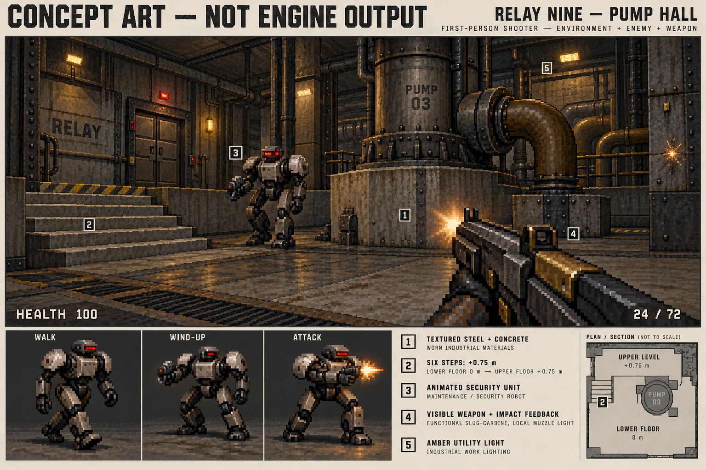

<!-- Copyright (c) 2026 PocketOS authors. SPDX-License-Identifier: Apache-2.0 -->
# Next FPS implementation: Relay Nine

**Approved design baseline, 2026-10-22, commit `0a6e482`.** The owner authorized
implementation on the existing draft PR #104. See [the actual implementation,
rendered captures, resolved technical details and validation](RELAY_NINE.md).
The assessment and proposed budgets below are historical design evidence;
they are not implementation measurements. The concept remains concept artwork.

**Recommendation:** an original industrial science-fiction FPS using a small
first-party **sector/portal software renderer with floor and ceiling heights**,
animated directional sprites and a visible carbine. Keep the pure simulation /
renderer / Doors integration boundary. Replace the grid world and renderer;
recolouring or decorating them cannot deliver this design. Add true held-action
input and a bounded audio-effects service on existing `pocketaudio`.

## One visual direction

**Relay Nine: a failing industrial pumping and communications station.** Pale
stained concrete, olive-gray painted steel, rivets, service panels, heavy doors,
bolted pumps and pipework. Warm off-white/amber utility lamps, sparse red warning
lamps and a few green status lamps; colored light supports navigation rather
than covering everything in glowing outlines. Strong material textures and
readable silhouettes take priority over particles, bloom or visual noise.



**This is generated concept artwork, not an implemented scene, screenshot,
performance demonstration, final texture atlas or promised pixel fidelity.**
Its labels specify steel/concrete, six stairs rising 0.75 m, a security unit,
weapon feedback and amber lighting. The small diagram inside the artwork is an
illustration of that room; the level plan below is authoritative for this proposal. Decorative
rails would use masked surfaces; the raised gallery and machinery bases are
solid below, with no accessible space underneath. No dynamic shadow system,
reflections, bloom or full 3D machinery is implied by the concept.

Production specification:

- Begin at 320×200 internal RGB565, uniformly scaled inside the existing Doors
  content geometry. Keep a 256×160 diagnostic mode. These are proposed budgets,
  not measured device capabilities. Industrial texture detail must read at the
  lower resolution; no geometry simplification to a flat maze if cost is high.
- Original 64×64 indexed steel, concrete, grating and door textures, with
  authored material IDs and bounded light lookup tables. Textured horizontal
  floors/ceilings and vertical walls; sector brightness and a few amber/red
  palette variants, plus short local weapon-light lookup changes. No real-time
  per-pixel light/shadow simulation in the first level.
- **Security unit:** recognizable articulated two-legged maintenance robot,
  broad ceramic shoulder plates, narrow optic and arm-mounted tool weapon.
  Four walk frames, two wind-up/discharge frames, one hit frame and three death
  frames, in eight directions; 64×64 maximum frame cells. Attacks have a clear
  ~350 ms wind-up and discharge cue, not unexplained periodic HP subtraction.
- **Clamp scavenger:** low, six-legged maintenance machine, wide gripping jaw;
  scuttling walk, lunge, hit and collapse animations. Its silhouette and motion
  distinguish it from the upright ranged unit independently of color.
- One original visible slug carbine: 24-round magazine, manual reload, 4 shots/s
  starting tuning. A small muzzle sprite, ~60 ms receiver recoil, short recovery,
  material-specific impact sprite, enemy hit reaction and distinct shot/impact/
  empty/reload sounds. Reduced motion removes recoil/bob and keeps static flash,
  impact, hit feedback and audio. No full-screen strobe or compulsory shake.
- Game materials, sprite palette and game HUD artwork are independent of
  `pos_theme` and Doors theme selection. Theme/text-size preferences still apply
  to shell chrome, menus, controls and readable HUD text sizing. Switching the
  Doors theme must not recolor the world or enemies. Pause/help retain the
  established accessible UI rather than redesigning the shell.

## Bounded assessment and reuse decision

Assessment scope: existing `apps/neon-outpost/*`, its focused tests and directly
relevant shell/PocketUI input, geometry/display, audio and accepted ADRs. No
engine implementation, new test execution, toolchain installation or device
access was performed for this assessment. Earlier prototype results remain
baseline evidence only; they do not validate this proposed engine.

| Existing part / evidence | Decision for the next implementation |
| --- | --- |
| `neon.c`: fixed 10 ms steps, capped catch-up, terminal-state guards; health/ammo clamping and pickup single-use | Retain these policies and small independent routines. Retune combat and introduce explicit weapon/enemy animation events. Keep the input-driven deterministic test method. |
| `neon_app.c`: LVGL lifetime, image descriptor/buffer cleanup, focus/lock/screen-off pause, Back/Home, aspect-preserving geometry | Reuse integration pattern and cleanup tests. Replace the button grid/pulse controller. Extend lifetime management for input subscription and audio session. Keep the prototype source intact until implementation is authorized. |
| `neon.h`: `char map[16*12]`, XY actors, no floor/ceiling height | Replace world/entity schema with sectors, edges, portals, feet Z, height, support sector and animation state. A material field on this grid is insufficient. |
| `neon_cast`, square-grid collision, planar hitscan/LOS | Replace with segment/sector traversal and shared height-aware collision/ray queries. Preserve invariant tests, not the old algorithms or expected map fixtures. |
| Grid BFS in `navigate()` | Replace with a directed sector/portal navigation graph respecting width, step height, headroom and doors. Reuse the bounded-queue approach. |
| `neon_render.c`: one wall depth per column, constant floor/ceiling, procedural diamonds/triangles, box weapon | Replace renderer, geometry projection, visibility, enemy/weapon art and animation. A single depth for an entire column cannot correctly show an enemy above a low ledge while hiding its legs. |
| Existing launcher registration, CMake/host simulator and architecture/licensing conventions | Retain. Do not add SDL/OpenGL as device assumptions, change the shell layout, or import another engine. Registration/name can change only with the later game implementation. |
| Current end-to-end run and captures | Preserve as prototype history. Build new fixtures around stairs, doors and occlusion; do not present the old captures as proof of the new direction. |

## Geometry and renderer

Use a hand-authored, validated list of **non-overlapping convex XY sectors**.
Each has a floor Z, ceiling Z, floor/ceiling material and light level. Ordered
wall segments are either solid or connect to one neighboring sector through a
portal. Concave rooms are decomposed offline into a small number of convex
sectors. A checked text format and deterministic asset conversion suffice; no
engine editor, general map compiler, BSP implementation or dependency is needed.

**Visible height differences are real geometry:** a lower room at Z=0 looks
into a higher room at Z=0.75; the floor-height difference produces a textured
lower wall/riser. Six narrow sectors with 0.125 m rises form actual steps, not a
painted ramp. Solid raised plinths/alcoves provide platforms. Ceiling changes
produce upper wall bands. **Room-over-room is excluded:** at each walkable XY
position there is one floor/ceiling interval. No bridge with a traversable
corridor beneath it, stacked rooms, slopes or arbitrary mesh geometry is needed.

Rendering pipeline, written from elementary projection/plane/segment math:

1. Transform and near-clip visible wall edges. Traverse visible portals from the
   camera sector with screen-space clip windows. A neighbor is visible only
   through the overlap of the sectors' vertical openings and the current door
   opening. Track processed coverage; a loop in the map must not recurse forever
   or incorrectly discard a second visible window into a sector.
2. Draw perspective-correct textured wall columns, including lower/upper bands,
   and horizontal floor/ceiling spans clipped to each sector/window. Use fixed
   point or incremental reciprocals in hot loops only after correctness checks;
   use a simple floating-point reference in host tests. No copied engine code.
3. Write **per-pixel depth** for opaque surfaces. This, together with portal
   clipping, handles low walls, steps, machinery occlusion and door gaps. A
   16-bit reciprocal-depth buffer with explicit near/far bounds and defined
   equal-depth behavior is the starting design; validate quantization at stairs
   and long corridors against the reference. Upgrade its precision if required.
4. Project masked billboard sprites from their world feet Z and physical height,
   choose directional animation frames, then depth-test every nontransparent
   texel. Depth-write opaque sprite texels so intersecting actors are stable;
   keep the first delivery free of semitransparent smoke. Railings/fences use
   masked vertical surfaces with the same depth rules. Draw the first-person
   weapon/HUD last in view space.
5. Shared simulation geometry controls rendering, solid machinery, doors,
   visibility and shots. A vertical door has a timed opening height; actors
   require clearance and rays use the same open interval. No decorative door
   that the simulation treats as fully open at the start of its animation.

Starting hard limits: 96 sectors including stairs, 512 directed edges, 16
active enemies, 48 pickups/effect sprites combined, 256 portal-window work
entries/frame, 8 MB combined working buffers/art/audio budget. Cull by view,
clip and distance. A work-limit hit is counted, fails fixture acceptance and
stops traversal safely; it must never silently become a hole or remove collision.
Validate the one level's worst views within these limits rather than increasing
limits indefinitely. Two color buffers plus one 16-bit depth buffer at 320×200
cost 384,000 bytes (~375 KiB), excluding assets and LVGL/display buffers.

Movement uses a swept upright cylinder, feet Z and sector support; proposed
height 1.65 m, eye 1.45 m, radius 0.22 m, maximum step 0.20 m. Enforce portal
width, wall sliding and ceiling clearance throughout a displacement. Walking
up/down stairs updates support and eye height; gravity handles allowed drops
without tunneling. First level needs no jump. Collision remains solid if drawing
is culled. Bounded sector-graph navigation follows the same passability rules;
continuous steering advances through portal centers rather than aiming at an
unreachable player's XY coordinate.

Yaw-only aiming is sufficient for this first delivery: use a narrow, documented
vertical aim-assist cone to select a visible target at a different elevation,
then trace a **3D** hitscan segment to it through portal openings. Walls, risers,
ceilings, closed doors and nearer targets still block the shot. No firing
through a platform or invisible target merely because its XY bearing matches.
This targeting rule needs tests and play tuning, not an unbounded lock-on.

## Actual input support and proposed controls

Source evidence, rather than assumptions about the board:

- **VERIFIED by source:** `pos_input.c/.h` intentionally sends one discrete
  press/release pair per logical key. Its "raw" target exposes modifiers and
  special keys; it does **not** expose physical held-key state. Ordinary key-up
  is discarded in `pos_keymap_event()`. The existing prototype also calls
  `release()` before each new pulse, replacing the previous action.
- **VERIFIED by source:** `kbd_tca8418` receives press/release FIFO bytes;
  `shell_kbd.c` polls at 15 ms with an INT gate, 20 ms in fallback, handles
  overflow and disconnection. The physical controller can deliver overlapping
  key events; reliable rollover for the exact movement/fire chords is **not
  verified** by this assessment. Its finite FIFO and matrix ghosting/rollover
  must not be equated with an unlimited held-key keyboard.
- **VERIFIED by source:** the adopted SDL keyboard also buffers key-down/text
  and synthesizes releases; it ignores SDL_KEYUP. SDL itself has down/up events,
  but the current Doors app path loses that information. No generic USB keyboard
  game-state interface is established by these files.
- **VERIFIED by source:** `platform_drm.c` creates a pointer using LVGL evdev.
  The pinned `lv_evdev.c` delivers one `data->point` / `data->state` to ordinary
  widgets, even where optional multi-point gesture machinery exists. Current
  app code cannot identify two independently held fingers. Hardware multi-touch
  capability is not proof of a usable app multi-touch API. No dual-stick scheme
  is proposed on that assumption.

**Keyboard:** W/S forward/back, A/D strafe, Left/Right turn, Space hold-fire,
F use, R reload, Esc/P pause. Restart is an explicit pause/death-menu action.
Normalize diagonal speed and combine movement, turn and fire independently.

Implement an **opt-in game-action subscription** beside the existing text stream:
logical key down/up plus source-loss/reset, gated by the same focused object,
redirected group, lock and screen state. Extend source adapters where releases
still exist, before they are discarded; do not bypass the shell or open hardware
in the app. Map a key at down time and remember that mapping until up; coalesce
the Space bar's two contacts. Keep text composition, letter picker, modifiers
and reserved Back/Home/power shortcuts on their established path. This is a
source-to-`pos_input` integration change, not a promise that the current app API
already supports held actions. For SDL, register a first-party `SDL_AddEventWatch` adapter in the existing
platform backend to observe down/up/focus-loss without consuming events or
editing `vendor/`; unregister it with `SDL_DelEventWatch`. The installed SDL2
header documents that this callback may run on another thread, so it must only
feed a bounded synchronized queue, with no LVGL/game callbacks there. Drain and
apply the queue on the shell thread. No new thread is created by the game.

Maintain a per-source held-action bitset; clear it and pause on focus loss,
overflow, unplug, provider failure, lock, screen-off or close. After loss,
require release/repress rather than reviving stale holds. Test down/up ordering,
key rollover fixtures, repeat suppression and reserved actions before wiring the
game. Later physical chord checks use W + Left + Space and A + Right + Space;
no device access is part of this proposal.

**Single-pointer touch:** two clearly labelled pads, each at least 160×128
logical pixels on the normal panel layout:

| Pad / control | Behavior from one finger |
| --- | --- |
| MOVE + TURN | Drag up/down from a fixed central neutral point for forward/back speed; left/right for yaw rate. A dead zone allows standing still. Both axes combine. |
| FIRE + MOVE + TURN | Same axes; holding anywhere in this pad also holds the trigger. Its center fires while stationary; drag combines moving, turning and shooting. |
| USE / RELOAD / PAUSE | Separate ≥64×64 targets; stop and tap when required. |

Choose pad semantics at touch-down and retain pointer capture until release or
press-lost; sliding between pads never latches firing or movement. Release
clears all pad actions. No second finger, auto-target firing or persistent
movement toggle is needed. Combat-pad fire is explicitly requested by the
player's hold and follows cooldown/ammo rules even while turning. Touch does
not need simultaneous strafe; keyboard does support it through the new path.
Place pads below the view in portrait, in a side control area in landscape/HDMI;
keep the world aspect ratio and Large-text HUD clear. Prove diagonal pad motion,
release, drag-off and interrupted presses in the M1 rendered scene.

## Audio: supported foundation and required work

`core/pocketaudio/pocketaudio.h` exposes 48 kHz mono signed-16-bit playback;
`pocketaudio_write()` accepts at most 960 frames (20 ms), with bounded waits up to
200 ms. Its default playback buffer is four periods (80 ms). It already handles
exclusive `audio.lock`, board routing, amplifier, system volume, peak ceiling,
close and recovery after abnormal death. The header and accepted audio ADRs
record speaker-path validation on unit A; **no new hardware verification was
performed here**. The device's underlying wire format is handled by its backend.

RIFT's `rift_sound_helper.c` starts `pos-record play` per WAV, refuses another
sound while one plays and uses process/socket lifetime plus recovery. That is
appropriate to occasional notifications, not repeated gunfire, hit and enemy
sounds that need overlap. Current Neon has no audio calls. ALSA support exists;
"the hardware cannot do sound" would be an incorrect explanation.

**Recommend a minimal `audio.*` effects service on existing `pocketaudio`,**
demand-started for the foreground session and terminated when that session
closes. One hardware owner/process, no shell audio work, no per-shot spawning,
no microphone, music player, cross-app mixing or permanently running daemon.
Four software effect voices mix into one playback stream; preload a bounded
sample bank (≤2 MiB). A bounded command queue (32 events, timestamp/session ID,
expiry) drops stale/low-priority sounds rather than delaying shots. Clamp the
mix, apply volume/ceiling through pocketaudio, and reserve priority for player
shot/critical feedback. Do not send sample streams over JSON.

Session open returns READY / BUSY / UNAVAILABLE; pause drops voices and closes
PCM/lock, resume reacquires. Client EOF, shell death or watchdog ends playback
and releases the route; recovery reuses pocketaudio's write-ahead record.
Game visuals continue with an explicit unavailable/busy indicator on failure,
but **normal-path sound is an acceptance requirement**, not an optional silent
fallback used to call the redesign finished.

ADR-002 assigns hardware to services; ADR-004 explicitly calls for reconsidering
`audiod` when mixing is needed. This small foreground effects service follows
that direction. ADR-010's existing helper exceptions remain scoped to their
named clients. Its exact demand-start/session lifecycle needs a **new proposed
audio ADR/API record** in the implementation milestone; this document does not
amend accepted decisions or treat them as already approving an unspecified new
helper. No alternate architecture decision is being delegated to the owner here.

Start with the existing audio buffer policy and measure command-to-sample onset
and underruns. An 80 ms queue and 200 ms fault wait are not a low-latency promise.
Target ≤100 ms normal-path audible onset in the initial slice, aiming lower;
report measured tails. If insufficient, add an explicitly bounded, validated
latency option for this service in pocketaudio, without changing Wave/Recorder
buffer defaults. Physical speaker onset remains a later local measurement.

Original sound bank: synthesized mechanical shot transient/tail, empty click,
reload, metal/concrete impacts, robot wind-up/discharge and door motor. Keep
recipe parameters, deterministic seeds, clipping/peak checks and exported PCM
hashes. Do not reuse RIFT's notification tones as gunfire or import game sounds.

## One level: Pump Station 9

Target 4–6 minutes on an initial careful run; one exit objective, nine enemies,
one weapon. This is authored encounter flow, not a procedural campaign. Plan
is schematic, with disjoint room/corridor footprints and no crossing tunnels.
Each `S6` is six 0.125 m steps; `S12` is twelve such steps. Doors/short links have
matching floor levels and sufficient headroom. Heights are relative meters.

```text
                       NORTH
   [C UPPER GALLERY] --D1-- [D COMPRESSOR] --S6 up--> [E RELAY CONTROL]
         +0.75                 +0.75                      +1.50
       G, H, A                 2x S, A                    G, SWITCH K
          ^                                                   |
        S6 up                                             S12 down
          |                                                   v
   [B PUMP HALL, 0.00] <--D2 shortcut (opened by K)-- [J RETURN, 0.00]
       G + 2x S, A                                         S, H
          ^                                                   |
          | D0                                             D3 (K)
   [A SERVICE LOCK, 0.00]                              [F EXIT LOCK, 0.00]
       START, gun, G                                        EXIT
```

`G` upright security unit, `S` clamp scavenger, `H` health, `A` ammo.

| Space | Size / encounter and purpose |
| --- | --- |
| A Service Lock | ~5×6 m, ceiling 2.8 m. Safe weapon pickup/start bay and one guard beyond cover; establish movement/use/fire with a visible retreat. D0 leads to B. |
| B Pump Hall | ~12×10 m, ceiling 5 m. Solid central pump plinth splits sight lines; one guard and two scavengers stagger activation, not three unseen simultaneous hits. West S6 rises to C; the upper gallery overlooks only B's edge, without a floor underneath it. Ammo in cover. |
| C Upper Gallery | ~3×9 m, floor +0.75, ceiling 3.5 m absolute. Guard telegraphed through a low opening; health and ammo reward reaching height. D1 is a use door. |
| D Compressor Room | ~8×7 m at +0.75, ceiling 4 m absolute. Two scavengers emerge around solid compressor bays. Ammo before the next climb; east S6 reaches E. |
| E Relay Control | ~6×6 m at +1.50, ceiling 4.2 m absolute. One guard beside the relay console, with cover and a retreat down the stairs. K restores the exit lock and opens shortcut D2. Clear sign/sound shows the return route. |
| J Return Corridor | ~3 m wide, S12 descends beside E in its own footprint to 0.00; one visible scavenger and health. D2 returns to B for missed supplies; D3 leads directly to F. |
| F Exit Lock | ~4×5 m, floor 0.00. Exit panel/door visibly changes after K; use to win. No surprise final encounter after supplies are exhausted. |

Starting tuning: 100 health, magazine 24 + reserve 24; three 24-round ammo
pickups (B/C/D) and two 30-health pickups (C/J). Guards take four carbine hits,
scavengers two: 26 perfect hits for all nine, versus 48 starting rounds and
optional extra supplies. Reload consumes reserve, never duplicates ammo. Tune
for imperfect touch aim and retreat, not the deterministic driver's accuracy.
Door/switch state, direct-path hints, enemies' vertical sight lines and an
optional backtrack must remain consistent after pause. Leaving still abandons
the run; no campaign persistence is needed.

## K230 uncertainties and the measuring slice

**Hardware context, from the repository, not newly measured:** the baseline
reports one Linux-visible C908 hart, substantial CMA reservation and a DRM
panel path with significant staging/rotation cost. Treat those recorded device
observations as such; neither the other core, NPU nor a GPU/OpenGL driver is a
rendering resource established for this game. No toolchain is installed here.

The current host's ~0.103 ms flat-grid renderer result excludes LVGL scaling and
flush. It cannot predict sector rendering, textured floor spans, many sprite
texels, input latency, audio contention, HDMI bandwidth or K230 frame rate.

| Uncertainty | Measure in the small real scene, not a static mockup |
| --- | --- |
| Portal traversal/overdraw and depth bandwidth | Deterministic camera path, low ledge with an enemy partially hidden, stair view and door-gap view; count windows, wall/floor/sprite pixels, depth rejects and cap hits; per-stage monotonic CPU times. |
| CPU cost of texture lookup/division/cache | Compare 320×200 and 256×160 with identical geometry/inputs; wall/floor/sprite timings and full-frame p50/p95/p99. Optimize reciprocals/spans only against reference output. |
| LVGL scale, image cache, DRM staging and flush | Time engine render, upload/invalidation and actual display flush separately, portrait/landscape/established HDMI modes. A render-only FPS counter is insufficient. |
| Input responsiveness and controller backlog | Timestamp source-down, action state, simulation step and first changed frame; count FIFO/queue overflow. Exercise simultaneous W/Left/Space and held-touch axes; local physical latency/rollover remains unverified until that session. |
| Audio while rendering | Timestamp command/voice start/output position, measure xruns, dropped/expired voices and normal onset; compare audio enabled/disabled. Later local speaker-onset measurement is separate from software timestamps. |
| Memory/long runs/thermal scheduling | Fixed-buffer high-water mark and bounded counters over a five-minute loop; reset/open/close checks, no accumulating resources. Later local tests use existing temperature/CPU observations without claiming thermal behavior now. |

Proposed local target, **not a result**: at least 25 displayed frames/s in the
slice's bounded worst views with audio on, p95 full-frame cost ≤40 ms, no input
starvation, no portal cap hits and no persistent xruns. First try resolution,
span/texture/depth optimization and fewer decorative surfaces; keep actual
stairs and correct occlusion. Record a failed budget honestly rather than
calling a host capture proof or quietly reverting to a flat grid. Any later
device session is outside this documentation task and requires its own existing
local workflow; no device access or deployment is authorized/performed here.

## Bounded implementation plan (not started)

1. **Real measuring slice — first milestone.** One pump-room pair joined by an
   actual six-step stair, +0.75 m gallery, low occluder and animated door. One
   original animated guard and one visible carbine with actual shot/impact audio.
   Walk, turn and fire together through the held-key path and single-pointer
   combat pad. Render textured walls/floors, partially occluded enemies and
   weapon feedback in production LVGL. Add audio API/ADR proposal, bounded
   foreground service and source input adapters as part of this slice; do not
   defer them behind a silent/text-input-only demonstration. No full level art
   set, second enemy or UI redesign in this milestone. Deliver a recorded
   input-driven encounter and **engine-rendered** captures, clearly separate
   from the concept. Host acceptance: stair/headroom/wall/door collision, vertical
   shot occlusion, animation/event synchronization, combined-input release and
   audio file/fake-backend tests with timing counters. Device timing is reported
   as pending unless a later authorized local check actually happens.
2. **One complete level.** Author A–F/J within the hard caps; add the scavenger,
   relay objective, return route, pickups, reload, death/victory/restart and the
   remaining sound/animation bank. Directed nav tests cover stairs, ledges and
   doors. A deterministic full run must use production logic without teleport,
   cheats or injected victory; separately play/tune the one-finger route.
3. **Finish and focused validation.** Atlas/provenance inventory, reduced-motion
   feedback, Small/Medium/Large at all supported layouts, source loss/overflow,
   repeated close/reopen with audio recovery, sanitizer checks and one bounded
   final review. Record host timing separately from the smallest later pinned
   target compile and physical input/audio/frame-time check. No broad repository
   sweep, SDK upgrades, merge, release or deployment added to this plan.

The first milestone is the go/no-go technical evidence for completing this
specific level. It must demonstrate geometry, movement, enemy, weapon **and
sound together**, not just new colors, a portal wireframe or a concept image.

## Concept provenance and evidence index

Concept: `neon-outpost/proposal/relay-nine-concept.png`, generated on 2026-10-22
with ChatGPT's image-generation tool for this proposal, without reference images
or external game assets. Prompt: an original worn steel/concrete pump hall,
solid +0.75 m gallery and six steps, maintenance security robot walk/wind-up/
attack studies, visible original carbine, restrained amber lamps and numbered
material/height/feedback labels, explicitly headed **CONCEPT ART — NOT ENGINE
OUTPUT**; exclude neon grids and copied Doom/Wolfenstein material. The text of
this specification records the intended visual requirements; generated small
print/proportions are not a geometry contract.

SHA-256: `7423319eca737255e3058e8ef6ceff80392a128a485d81e8c1f0c8ac87c4099f`.
The image is classified **OWNER-AI-RASTER**, with the repository's generated-art
Apache-2.0 treatment to the extent rights subsist. An explicit inventory entry
precedes `docs/apps/*` so it is not mislabeled CAPTURE. No generated concept
pixel is automatically accepted as a licensed production texture/sprite atlas;
production code, procedural recipes, source art, exports and sound hashes get
individual provenance records. No imported Doom code, maps, names or assets.

Source anchors inspected (paths relative to repository root):

- [Prototype simulation](../../apps/neon-outpost/neon.c), [schema](../../apps/neon-outpost/neon.h), [renderer](../../apps/neon-outpost/neon_render.c), [app](../../apps/neon-outpost/neon_app.c).
- [Logical input contract](../../ui/pocketui/pos_input.h), [key translation](../../ui/pocketui/pos_keymap.c), [keyboard integration](../../ui/shell/shell_kbd.c), [FIFO contract](../../ui/shell/kbd_tca8418.h).
- [DRM integration](../../ui/shell/platform_drm.c), [SDL integration](../../ui/shell/platform_sdl.c), pinned LVGL `src/drivers/evdev/lv_evdev.c` and `src/drivers/sdl/lv_sdl_keyboard.c` (read-only vendor sources).
- [Audio contract](../../core/pocketaudio/pocketaudio.h), [RIFT playback lifecycle](../../apps/rift/rift_sound_helper.c), [Recorder playback](../../tools/recorder/pos_record.c).
- [ADR-002](../decisions/ADR-002-app-model.md), [ADR-004](../decisions/ADR-004-audio-ownership.md), [ADR-010 and Amendment 1](../decisions/ADR-010-recorder-audio.md), [licensing ADR](../decisions/ADR-013-licence-apache-2.md), [hardware baseline](../hardware/T-DISPLAY-K230.md), [build environment](../BUILD_ENVIRONMENT.md).
