# PacketShark: a packet analyzer for Doors

**Status: IMPLEMENTED, M0 to M11.1 on master (M10, Wi-Fi capture in managed mode, merged by pull request #146 on 2026-11-18; M11.1, the DNS and TCP diagnosis (§4b), by pull request #149); M12.1, the network intelligence (§4c: devices, DHCP, ARP, findings with their evidence); N1.0, MARK and a mark's evidence (§4d), on a draft pull request, host-tested only; the line-rate gate on Unit A not started.** Milestones M0 to M9 of the design package are on master: the capture library and helper, the app with its live counters, traffic graph and protocol distribution, the packet list with its display filter and sort, the inspector and pins, signals, SAVE and the saved captures, the wide layout and the keys. They were developed as four stacked pull requests (#136 M0 to M3, #137 M4, #138 the Large-text fix, #139 M5 to M9) and integrated into master together by the consolidated pull request #141, which supersedes them (§9.6). The limits in §10 still apply, and line-rate behaviour is unmeasured until M10. ADR-016 (ownership, privilege, privacy) is **ACCEPTED** (2026-11-16) subject to its documented security constraints, and the explicit libpcap dependency is approved (2026-11-16). DS §59 (protocol colours, dense rows, navigation, launcher place and icon) is **ACCEPTED** (2026-11-16) as the visual baseline; deviations are recorded in DS §59.11. The owner accepted four decisions on 2026-11-15: the helper owns the packets and the shell keeps at most 48 rows (D1), the helper runs at nice 5 (D5), HEADERS is the default for what is kept (D7), and captures stay in memory until SAVE (D10).

PacketShark captures the traffic an Ethernet or Wi-Fi interface sees, counts it, lists, decodes and filters it, marks what looks wrong, and saves a stopped capture when asked. It is **receive-only**: it never transmits, injects, spoofs or redirects anything.

Contents:

1. What is in this version, and what is not
2. What the unit can see
3. Architecture
4. What is kept, and for how long
5. Privilege
6. The line protocol
7. The screens
8. Building and running
9. Validation
10. Known limits and open items

The design package these milestones implement (product spec, architecture, UI/UX, implementation plan, decision log) was written before the code, outside the repository; the parts that bind the code are in ADR-016, DS §59 and this document. The mockups are in [../design/packetshark/](../design/packetshark/).

---

## 1. What is in this version, and what is not

| Milestone | Scope | State |
| --- | --- | --- |
| M0 | ADR-016, DS §59, this document, the mockups, the libpcap dependency declaration | Done; ADR-016, DS §59 and libpcap accepted 2026-11-16 |
| M1 | `core/pocketpcap`: the decoder, the row formatter, the `.pcap` reader and writer; `pos-capture decode` | Done, host-tested |
| M2 | `pos-capture session`: live, replay and synthetic sources, the bounded store, counters and bins, the line protocol, the lock, the privilege drop, `pos-capture bench` | Done, host-tested; on Unit A see §9 |
| M3 | The app: setup, START, live counters, HOLD, STOP, DISCARD, the error panel, the launcher entry, the screen kept on | Done, host-tested; on Unit A see §9 |
| M4 | Traffic graph (60 s, logarithmic, stacked by class), a tappable second and its readout, protocol distribution; the per-frame cost measured | Done, host-tested; on Unit A see §9.3 |
| M5 | Packet list, display filter, sort | Done, host-tested; on Unit B see §9.4 |
| M6 | Packet inspector, pins | Done, host-tested; on Unit B see §9.4 |
| M7 | Signals: DNS failures, resets, retransmissions, unreachables, unanswered SYNs | Done, host-tested (§4a, §9.1); on Unit B see §9.5 |
| M8 | SAVE and saved captures | Done, host-tested (§4, §9.1); on Unit B see §9.5. **One file is written, only by a confirmed SAVE of a stopped capture** |
| M9 | Landscape layout of its own, keyboard keys, final icon | Layout and keys done, host-tested (§7, §7a); the layout seen on Unit B (§9.5), the keys not (no keyboard there). The icon is the one the owner accepted with DS §59.8, unchanged |
| M10 | Wi-Fi capture in managed mode: Wi-Fi chosen like Ethernet when it is associated (§2a) | Done, host-tested; on Unit B see §9.7. Numbered M10 by the owner (brief and confirmation, 2026-11-18) |
| M11.1 | Protocol intelligence: DNS transactions (query and answer paired, response time, NXDOMAIN and SERVFAIL, unanswered queries) and TCP connections (handshake and its time, resets by kind, retransmissions by kind), in SIGNALS, a diagnosis sheet and INSPECT (§4b) | Done, host-tested; on Unit B (not installed) see §9.8. Protocol 4. Draft pull request |
| M12.1 | Network intelligence: the devices seen, DHCP exchanges, servers and leases, ARP pairs, conflicts and moves, and a list of findings each with its evidence, on a network overview reached from LIVE (§4c) | Done, host-tested; on Unit B (not installed) see §9.9. Protocol 5. Draft pull request |
| N1.0 | MARK: one tap on LIVE marks a moment; the evidence page says what the capture saw of DHCP, ARP and DNS in the minute before and after it, how much of each window was watched, and links each observation to its packet (§4d). CPU only; no model, no score | Done, host-tested (§9.1); **not run on a device**. Protocol 6. Draft pull request |
| Line-rate gate | Unit A at line rate (numbered M10 until 2026-11-18; unnumbered since, owner's decision) | Not started |

Out of scope for PacketShark v0.1 altogether: Wi-Fi monitor mode (the driver does not offer it, §2a), LoRa, any transmit path.

## 2. What the unit can see

On a switched network, without a mirror port, an interface receives broadcast, multicast and its own traffic (VERIFIED on Unit A, feasibility study 2026-11-15). That answers "is this network healthy from where I stand" and shows this device's own conversations. Seeing other devices' traffic needs a mirror port, a hub or a tap, and promiscuous mode, which **this version does not offer**: the kernel's reversion of the flag when the socket closes has not been verified on the RTL8152 (§5).

## 2a. Wi-Fi (M10)

A Wi-Fi interface is captured in managed mode, through the same helper, socket, decoder and screens as Ethernet; nothing in the helper or the protocol changed for it.

- **What it sees:** what the driver hands up: this device's own traffic and the network's broadcast and multicast, decrypted, with an Ethernet II header the driver builds (libpcap reports `DLT_EN10MB`, so `notether` does not apply). No 802.11 header, no radio information, no other station's unicast. The same answer as a switch port (§2), one hop from the access point.
- **When it can be chosen:** while it has a carrier, that is, while it is associated. Ethernet stays the default when both have a link (sysd lists `eth` before `wlan`); a tap chooses Wi-Fi, a drop moves the choice to an interface that is still usable, and the tapped interface is chosen again when it comes back. The row names the joined network (netd `wifi.status`, asked only while a Wi-Fi interface has a carrier) and the address.
- **While capturing:** the helper's carrier check (every second) ends the capture with LINK LOST when the association drops, as for a pulled cable. Wi-Fi has no link speed in sysfs, so the status line reads `WLAN0 · WI-FI · HEADERS` where Ethernet shows `100 MBIT/S`.
- **What it never does:** change the interface or its association. netd owns Wi-Fi (ADR-002, ADR-016); promiscuous mode stays off (§5).
- **Monitor mode is not possible on this unit's driver** (VERIFIED on Unit B, 2026-11-18, read-only): the RTL8189FTV's vendor driver `rtl8189fs` v5.7.9 (cfg80211, `CONFIG_CONCURRENT_MODE`, two interfaces wlan0 and wlan1 on phy0 and phy1) advertises the interface types station, AP, ad-hoc, P2P client and P2P GO through nl80211 (`NL80211_CMD_GET_WIPHY`), not monitor; its build configuration (`/proc/net/rtl8189fs/drv_cfg`) has no `CONFIG_WIFI_MONITOR`. libpcap's "can set monitor mode" answer only checks that a phy exists. Enabling it would mean rebuilding the vendor module, which is out of scope.

## 3. Architecture

Two processes per capture (DESIGN_DECISIONS D1, accepted):

```
 doors-shell (LVGL thread)                      pos-capture (one per START)
  apps/packetshark/                socketpair     tools/capture/pos_capture.c
   psk_app.c, ui/psk_live.c        text lines      core/pocketpcap/
   ui/psk_sheets.c              <------------->     ppc_source_*  libpcap | file | synth
   psk_session.c  spawn, poll, reap                 ppc_decode    frame -> 80-byte record
   psk_model.c    counters, 48-row cache            ppc_store     summary ring, byte ring, pins
   core/pocketpcap/ppc_proto.c only                 ppc_stats     counters, bins, time base
                                                    ppc_format    row text, on demand
                                                    ppc_proto     the line protocol
```

- **The helper is the model; the shell is a viewport.** Hostile bytes are parsed only in `pos-capture`. The shell links one file of the capture library, the protocol (`tests/packetshark_lint.sh` holds it). A decoder fault takes the helper, and the app says so.
- **The helper pattern is Zabbix's** (ADR-007): `socketpair`, `fork`, `PR_SET_PDEATHSIG` with a parent check, every inherited descriptor closed, stderr to `/dev/null`, `execv`; non-blocking reads from a 33 ms LVGL timer; hello within 3 s; while capturing, silence over 5 s kills it; an over-long line or more than 16 unreadable lines kills it; leaving the app sends `quit`, then SIGTERM, then SIGKILL, in at most 500 ms.
- **One helper serves one capture.** It drops its capabilities once its socket is open, so it cannot open another; NEW CAPTURE and DISCARD end it and the next START spawns a new one.
- **One capture at a time:** an exclusive `flock` on `$POCKETOS_RUNTIME_DIR/capture.lock`, taken before the socket opens and released by STOP.
- **One thread, `poll()`** over the capture descriptor and the socketpair; at most 32 × 256 frames per wake, then the commands are read.
- **nice 5** (D5, accepted): under contention the shell wins the one hart; the cost appears as counted kernel drops, not a frozen panel. Whether that costs drops at line rate is measured in the line-rate gate.
- **Shed mode:** when 50 dispatches in a row come back full, frames are classified and counted (`shed`) but not stored until a dispatch comes back short.
- **The app spawns no helper until START.** Opening PacketShark captures nothing.

Files:

| Path | What |
| --- | --- |
| `core/pocketpcap/ppc_record.h` | The 80-byte record, classes, flags |
| `core/pocketpcap/ppc_decode.[ch]` | Decoder, the HEADERS rule, protocol words |
| `core/pocketpcap/ppc_format.[ch]` | Row text, DNS names (compression, loop and forward-pointer refusal) |
| `core/pocketpcap/ppc_pcapfile.[ch]` | Classic pcap writer (nanosecond) and reader |
| `core/pocketpcap/ppc_store.[ch]` | Summary ring (65,536 records), byte ring (16 MiB, monotonic offsets), 8 pins |
| `core/pocketpcap/ppc_stats.[ch]` | Counters, 120 one-second bins, the clock-step time base |
| `core/pocketpcap/ppc_proto.[ch]` | The line protocol (§6) |
| `core/pocketpcap/ppc_view.[ch]` | The list's view (M5): the display filter, an index ring of the matching packets kept up as they are stored, the length order (linear-time radix sort, rebuilt at most once a second), the pinned view |
| `core/pocketpcap/ppc_dissect.[ch]` | The inspector's layers, fields and hex text for one stored packet (M6): bounds-checked, allocation-free, fuzzed, helper only |
| `core/pocketpcap/ppc_signals.[ch]` | The findings (M7) and the diagnosis (M11.1): a table of the TCP connections seen (4,096 entries) and one of the DNS queries waiting (1,024), allocated together once at START; the six findings, the unanswered SYN and DNS query decided late (§4a); the diagnosis code of each packet and the running totals (§4b) |
| `core/pocketpcap/ppc_net.[ch]` | The network intelligence (M12.1, §4c): the devices by MAC (256), the IPv4-to-MAC pairs ARP claimed (256), DHCP transactions (64), servers (8), leases (8) and a ring of events (32), in one allocation at START; bounds-checked, no text, fuzzed, helper only |
| `core/pocketpcap/ppc_source*.c` | Sources: libpcap (`ppc_source_pcap.c`, the only file that includes `<pcap/pcap.h>`), none, file, synth |
| `tools/capture/pos_capture.c` | `pos-capture session`, `decode`, `bench`, `backend` |
| `apps/packetshark/` | The app (`psk_app.c`, `ui/`), its helper client and model, `psk_saves.c`: the saved captures listed and deleted by name, never opened (M8), `psk_remote.c`: the figures `capture.status` may carry, and their JSON, and `psk_net.c`: the network intelligence's words (M12.1), with `ui/psk_netview.c`, the network overview |

## 4. What is kept, and for how long

- **Decoded:** Ethernet II, 802.1Q and 802.1ad (two tags), 802.3 length frames, ARP, IPv4 (options, fragments), IPv6 (hop-by-hop, routing, fragment, destination options), TCP, UDP, ICMP, ICMPv6 (neighbour discovery, MLD named), IGMP; by port DNS, mDNS, LLMNR, DHCP (message type from option 53), DHCPv6, NTP, NetBIOS-NS, SSDP. Every read is bounds-checked; a header that runs out sets `malformed`; nothing allocates (checked over a million frames).
- **Stored, HEADERS (default; D7, accepted):** link, network and transport headers; plus the whole message, up to 1024 bytes, for ARP, ICMP, ICMPv6, DNS, mDNS, LLMNR, DHCP, DHCPv6, NTP and NetBIOS-NS. No other payload: a plain-text HTTP request leaves nothing of its body in memory (tests: S4). DNS names and DHCP host names are kept; they are what the tool is for, and the setup screen says what HEADERS keeps.
- **Stored, FULL:** everything captured, up to 65,535 bytes a frame, chosen per capture after a confirmation, never remembered.
- **Where:** in the helper's memory (D10, accepted): at most 65,536 records of 80 bytes (5 MiB) and 16 MiB of stored bytes, allocated once at START. Leaving the app, DISCARD, NEW CAPTURE, or a helper crash discards the packets. **Nothing is written to storage unless a stopped capture is saved** (below).
- **SAVE (M8; ADR-016 rules 9, 10, 16):** on a stopped capture only, after a sheet that says where the file goes, what is in it and that files in `/root` can be read over SSH on this image until a device password is set. The helper (not the shell) writes every packet whose bytes are still in the buffer to one new classic `.pcap` (nanosecond stamps, as tcpdump and Wireshark read): `capture-YYYYMMDD-HHMMSS.pcap` in UTC when the clock is set, `capture-NNNN.pcap` when it is not, in `/root/Captures` (`$HOME/Captures`; `$POCKETOS_CAPTURES_DIR` for the simulator and the tests). The folder is made 0700, the file 0600, written as `.<name>.part` with `O_EXCL` and `O_NOFOLLOW`, synced and renamed when whole; a failure or leaving mid-save removes the part file. It is refused when the folder is under `/tmp`, when free space is less than the file and a 4 MiB margin, and while a capture runs. It writes 1,024 packets a turn of the helper's loop, so the helper keeps answering. The file holds what was stored: with HEADERS, headers and plumbing messages, not payload. A pinned packet that left the buffer is not in it.
- **Saved captures:** setup counts them; their sheet lists the newest six with size and age; a tap asks, then deletes. The shell reads names, sizes and dates and unlinks by name inside the folder; only names the helper makes (`capture-` digits and dashes `.pcap`), only regular files, never through a link. It never opens or parses a capture, and there is no way to load one back in this version.
- **How long:** a capture stops by itself after 15 minutes by default (5, 15, 60 minutes, or no limit after a confirmation that is not remembered).
- **Logged:** lifecycle lines only, never an address, a name or a byte of a packet (`pos-capture.log`, `shell.log`; tests: S7).
- **Sent anywhere:** nothing. Neither process has network client code.
- **Readable on the unit's own shell socket:** the capture's state and aggregate figures, as `capture.status` (`docs/api/shell.md`; `psk_remote.[ch]`), only while PacketShark is in front and not behind the lock. Counts, rates, sizes, times, the interface name when it is a plain one (`eth0`, `wlan0`) and three enumerated words; no packet, row, address, name, port, sequence number or file name. It reads the app's model and asks the helper for nothing. The same figures go to the socket's subscribed listeners as `capture.stats`, once a second while a capture runs, and its state as `capture.state`. Nothing forwards any of it off the unit: gatewayd knows no `capture.*` name, and a companion reading it is ADR-016 amendment 1 (accepted 2026-11-22), which the gateway does not serve yet. Figures are raised only while the header says a companion is reading (below).
- **Held and stopped from the shell socket:** `capture.hold` and `capture.stop` do what HOLD, RESUME and STOP on the capture bar do, through the same function, only while PacketShark is in front and not behind the lock, and only in a state whose bar has that button. They cannot start, save, discard or leave a capture. Local only, like the above.
- **Asked for from the shell socket (ADR-016 amendment 1, rules 1 and 1a):** `capture.request_start` raises a sheet over setup that names who asks, the interface and the minutes, and waits for a finger. It starts no helper and no capture and changes no choice; START on the sheet (not in its first 1.5 seconds) starts HEADERS with a limit of 5, 15 or 60 minutes and the setup screen's own filter, which the sheet names; the person's own interface and limit come back afterwards. REFUSE or Back refuses, and so do 60 seconds, the lock, an alarm, leaving the app and a withdrawal. Nothing of a request is kept after its sheet or logged. A request may carry a name, and only a cancel that names it takes its sheet down; a cancel never reaches a capture that was started.
- **A companion is reading (rule 20):** for five seconds after a `capture.status` (and after no other request) the header says `· COMPANION` beside the capture state, on every screen of the app (in the wide shape, first in its own top row).
- **The setup rows after START:** once START is tapped, the interface, Keep, Stop after and Filter rows take no tap until the capture is on the screen or setup is back, so the screen never shows a choice the capture was not started with.

## 4a. Signals (M7)

Six findings (five until M11.1), a bit each on the packet's record and a counter each on the `stats` line. They are heuristics on what one interface saw, not a TCP analysis; what kind of reset or repeat a finding is, and whether it is a fault, is the diagnosis's to say (§4b).

| Finding | Decided from | Notes |
| --- | --- | --- |
| DNS FAIL | a DNS or LLMNR response whose code is not NOERROR | mDNS and NetBIOS are not judged; DNS over TCP is not read |
| TCP RST | a segment with RST | every reset; §4b says which are refusals, aborts, resets after close |
| RETRANS | a segment whose sequence space was already seen in its direction of its connection, or that fills a gap later than a round trip after it appeared (M11.1) | a keep-alive is not counted; since M11.1 a gap filled within a round trip is out of order, not a retransmission; a connection that began before the capture is judged from its first segment seen |
| UNREACH | ICMP destination unreachable; ICMPv6 type 1 | |
| NO ANSWER | a SYN the other end sent nothing back to within 3 s | decided late, twice a second: the mark is added to the stored packet if the buffer still holds it, and counted either way. Named `NO REPLY` on LIVE until M11.1 |
| NO DNS REPLY (M11.1) | a DNS query (UDP port 53) with no answer seen within 5 s | decided late like the SYN; never while frames pass unseen; not a DNS failure (§4b) |

The connection table is 4,096 entries (about 640 KiB since M11.1), allocated once at START; when a probe of eight finds no room the entry silent longest is replaced. Nothing is judged while frames pass unseen: in HOLD and while shedding, waiting SYNs are forgotten rather than called unanswered, and packets counted but not stored carry no finding. Where they show: the SIGNALS panel on LIVE (a tap lists that finding's packets), `!` and `status_warn` on a row's sentence, marks on the list's rail, the finding beside the packet's class in INSPECT and a sentence under the layer it is about (for a retransmission, the packet it repeats and how much earlier, when that packet is within the last 8,192 of the buffer), and a Findings choice in the filter sheet.

## 4b. The DNS and TCP diagnosis (M11.1)

The findings say that something happened; the diagnosis says what, and whether it is a fault. It is built in the helper from the same two tables, as packets are stored, and costs the shell nothing but text.

**DNS transactions.** A query to UDP port 53 enters a table of 1,024 entries keyed by client address and port, server address and port, and query id. Its answer (the same id, the ends swapped) takes it out and is timed from the latest copy of the query. A copy sent again is a retry and restarts the wait. mDNS and LLMNR queries are not entered: no answer is how those protocols say "not here".

| What | Decided | Severity in the sheet |
| --- | --- | --- |
| Answered | the answer to a query this capture saw; its time | OK; `! CHECK` when the slowest took a second or more |
| NXDOMAIN | response code 3 | note: a confirmed answer, not a network fault |
| SERVFAIL; REFUSED or another code | response codes 2; 5 and the rest | warning |
| Not answered within 5 s | no answer seen 5 s after the latest copy, judged twice a second (NO DNS REPLY, a finding) | warning, said as "not proof of a DNS failure": the query or answer may be lost, the answer may have come in on another interface, or the server is down |
| Answered late | an answer after the query was called unanswered; the query is remembered 30 s for it | counted with the unanswered |
| Answer without its query | no query in the table: sent before START, while held, on another interface, or forgotten | note; neither timed nor judged |
| Waiting | asked less than 5 s ago; after STOP, "not answered when it stopped" | note; never called unanswered |

**TCP connections.** The M7 table (the five-tuple, 4,096 entries) also follows each handshake: the SYN, the SYN-ACK that acknowledges it, and the segment from the SYN's sender that acknowledges the SYN-ACK. The connection time runs from the first SYN to that segment.

| What | Decided | Severity |
| --- | --- | --- |
| Opened | the handshake completed; timed when its first SYN was seen | OK |
| Refused | a reset from the other end while the SYN waits | note: "the host is reachable … not a network fault" |
| Reset of an open connection | a reset of a connection open or opening | warning |
| Reset after close | a reset after a FIN or an earlier reset | OK: usually normal |
| Reset of a connection not seen | a reset that is the first packet of its connection | note |
| SYN not answered | the M7 finding | warning |
| Retransmission | bytes seen before (kept apart: already acknowledged by the receiver, spurious), or a gap filled later than a round trip (the original never came by) | note; warning from 3 and one in a hundred segments |
| Out of order | a gap filled within a round trip: the connection's handshake time when measured, else 3 ms | OK, not a finding |
| Without handshake; one way | first seen without its handshake; three segments or more in one direction only (asymmetric routing, or the other direction on another interface) | note |

**Where it shows.** SIGNALS has a DNS and a TCP line under the six cells (in the wide shape, under TRAFFIC): the severity's word and a summary, problems first. A tap opens the diagnosis sheet: what the diagnosis rests on (interface, time, kernel drops, times frames passed unjudged, entries the tables had to let go), then each line with its explanation; `LIST` shows its packets in PACKETS (a finding, or a diagnosis the view filters on), `OPEN` shows the slowest answer or handshake in INSPECT. INSPECT says, under the DNS or TCP layer, what the packet was: `ANSWER TO #88 · 84.8 MS AFTER IT`, `ANSWERED BY #91 AFTER 84.8 MS · NOERROR`, `HANDSHAKE COMPLETE · CONNECTED 5.8 MS AFTER SYN #160`, `CONNECTION REFUSED · THE ANSWER TO SYN #172, 0.9 MS AFTER IT … NOT A NETWORK FAULT`, `OUT OF ORDER … REORDERING, NOT LOSS`. The packet it names is looked for within the 8,192 packets around it.

**Confidence and incomplete captures.** Nothing waiting is judged once frames pass unseen (HOLD, shedding): waiting SYNs and queries are let go and counted as unjudged, gaps forgotten, and a handshake under way is no longer timed. A missing answer is never a failure, and an answer whose query was not seen is never timed. Kernel drops are named in the sheet ("a missing answer may be one of them"). A replayed or stopped capture does not judge what was still waiting.

**Resources.** Both tables in one allocation at START: 4,096 connections × 160 B and 1,024 queries × 56 B, about 700 KiB, never grown; a full DNS table lets the oldest go (answered-late candidates first), unjudged. Work per packet is a hash probe of at most eight entries; the late decisions scan both tables twice a second only while something waits; the `diag` line (36 figures) goes once a second and costs one pass over the connection table. On Unit B at 2,000 synthetic packets a second the shell used 4.0 % of the hart and the helper 0.9 % (§9.8).

## 4c. Network intelligence (M12.1)

The findings and the diagnosis are about conversations. This is about the network they run on: who is on it, who hands out addresses, and whether two things claim to be the same. It is built in the helper as packets are stored, from frames the capture already has. **It sends nothing: no ARP request, no DHCP message, no scan** (ADR-016 rule 2).

**Devices.** Every unicast MAC seen as a frame's source, with its frames and bytes (256 entries; the one silent longest is replaced when a probe of eight finds no room). Its IPv4 address is taken only from what ties an address to that MAC: its own ARP sender fields, or a DHCP ACK for it. An IP packet's source address is not used: everything from beyond the router arrives with the router's MAC. A device is marked THIS DEVICE (it sent the frames the capture calls outgoing), DHCP SERVER (it answered as one, not as a relay) and ROUTER (a DHCP server named its address as the router, and ARP tied that address to its MAC), and carries the host name its DHCP request gave (letters, digits, dot, dash and underscore; anything else reads `?`).

**ARP.** Requests, replies, gratuitous ARP and probes (a request with no sender address, RFC 5227) are counted apart. Every sender address is a claim that an IPv4 address is at a MAC, kept in a table of 256.

| What | Decided | Severity |
| --- | --- | --- |
| Probed address is in use | an address claimed by another MAC within 10 s of a probe for it | note: a device about to take the address must back off (RFC 5227), but switches also probe only to see who is there; if the prober takes it anyway, that is the next line |
| Two MACs claim one address | an address goes back to the MAC it had just left while the other spoke within the last minute | warning, called a *potential* duplicate: failover pairs, a device on two interfaces and forged ARP look the same |
| Address moved | an address is claimed by another MAC than before, once | note: a lease given to another device, a replaced adapter, a failover |
| Router's address at another MAC | the same, of the address a DHCP server named as the router | warning, with both readings: a replaced router, or what ARP spoofing looks like |
| No ARP reply | this device asked for an address three times or more and saw no reply 2 s after the last | note; warning when it is the router's address. Other devices' requests are never judged: their replies are unicast and do not pass here |
| Asking for many addresses | one station asks for 32 or more of 64 address buckets within 10 s | note: a scanner, a monitoring system, a busy router (a device known as the router is not listed) |
| Sender is not the frame's source | the ARP sender MAC differs from the Ethernet source | note: proxy ARP and bridges; a forged message can look like it |

Gratuitous ARP and probes are normal and make no event by themselves.

**DHCP.** Messages are paired into exchanges by transaction id and client MAC (64 entries): DISCOVER, OFFER, REQUEST, ACK. The servers seen answering (8), named by their server identifier, each with its MAC, what it gives (router, DNS, mask, lease time) and its counts; the last eight leases with address, client, server, time and host name.

| What | Decided | Severity |
| --- | --- | --- |
| Second DHCP server | a second server identifier answers | warning: a pair set up to share the work, or one nobody meant to have; the sheet marks every server and shows what each gives (which was seen first says nothing) |
| Refused (NAK) | a server answers NAK | note: routine for a device that arrives with a lease from another network |
| Declined | a client sends DECLINE | warning, the one thing called confirmed: the client's own check found the address in use |
| DISCOVER or REQUEST not answered | no OFFER (no ACK or NAK) within 10 s of the first copy, **only when the answer would have passed this interface**: the request is this device's own, or the server must broadcast the answer (the broadcast flag set, no relay, and no address of the client's to answer to; RFC 2131 §4.1) | warning, said as "not proof of a fault" |
| Not judged | every other request: its answer is unicast to another device | counted, a note; never called unanswered |
| Very short lease | a lease under two minutes | note |

**Events.** What is worth telling is kept in a ring of 32, each with a severity (note or warning), up to two addresses and two MACs, the packet that showed it, when it was first and last seen and how often; the same thing seen again is counted on the event that is there. A new event takes a free place, else the oldest note's, else the oldest warning's (counted).

**Where it shows.** LIVE has a NETWORK line under DNS and TCP: `2 TO CHECK · 14 DEVICES · 1 DHCP SERVER`. A tap opens the **network overview**, LIVE's second face (the tabs, the state and the capture's buttons stay): four figures and the traffic mix; FINDINGS, the events and the warning lines of the DNS and TCP diagnosis in one list, warnings first; DIAGNOSIS, a line each for DHCP, ARP, DNS and TCP; DEVICES, the eight that sent the most. A finding opens a sheet in four parts: what was seen (with its addresses), what it may mean, the evidence (`OPEN` shows the packet in INSPECT) and the packets around it (`LIST`: the ARP messages that name the address, or every DHCP message). The DHCP and ARP lines open their own sheets, as DNS and TCP do. A device with a known address lists the packets to and from that address; one known only by its MAC takes no tap (a MAC does not filter IP packets, §10).

From the simulator on the synthetic source (documentation addresses only): the overview in portrait, its devices, a finding's sheet, the DHCP sheet, and the overview in the wide shape.

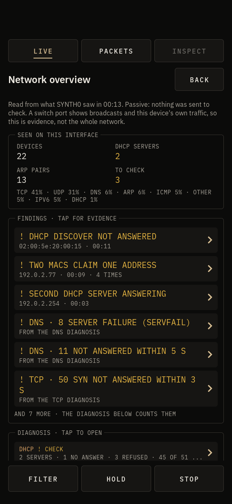
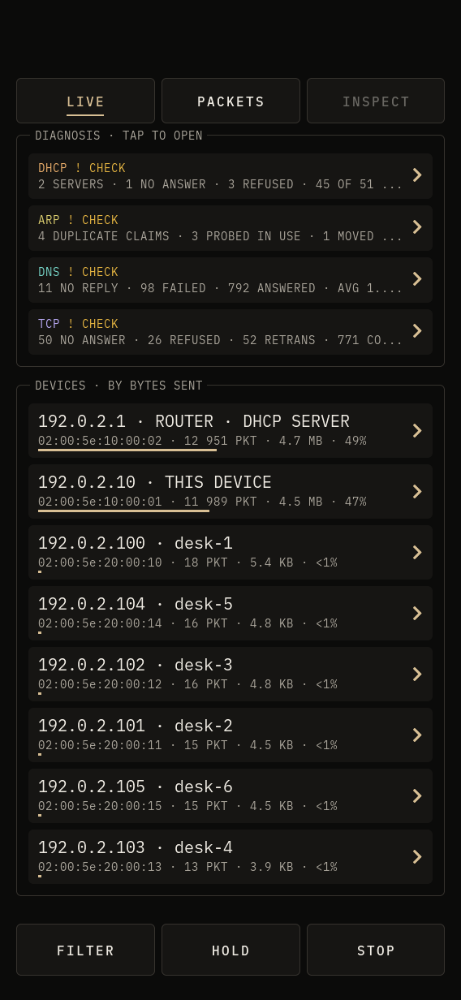
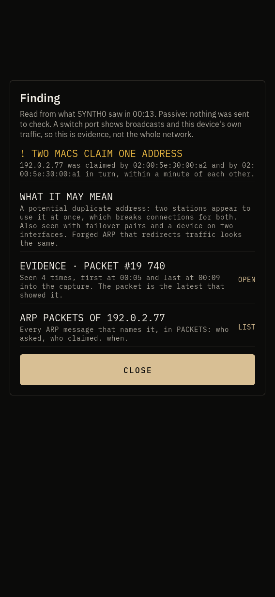
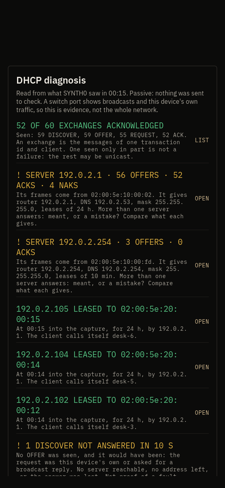
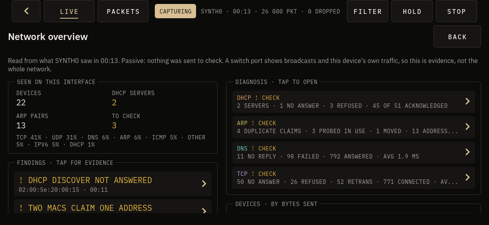

**Confidence.** Every sheet says first what it rests on: one interface, for so long, passive, and that a switch port shows broadcasts and this device's own traffic. An observation is told apart from what it may mean in every finding, and one thing only is called confirmed: a client's own DECLINE. A server's message is taken only from a BOOTREPLY and a client's only from a BOOTREQUEST; a renewal under a transaction id used before is an exchange of its own. Nothing waiting is judged once frames pass unseen (HOLD, shedding): DHCP waits, this device's ARP waits and probes are let go and counted. A stopped or replayed capture does not judge what was still waiting.

**Resources.** The three tables are one allocation of about 40 KiB at START and never grow. Work per frame is one hash probe of at most eight entries for the source MAC; an ARP or DHCP frame adds one or two more. The late decisions scan 64 transactions and 16 waits twice a second, only while something waits. The totals (33 figures) go with the diagnosis once a second; the lists (at most 8 devices, 4 servers, 6 leases, 12 events, under 4 kB of text) are sent only when asked, and the app asks once a second only while the overview or one of its sheets is on screen. Figures: §9.1 (host) and §9.9 (Unit B).

## 4d. Marks and their evidence (N1.0)

The findings (§4a to §4c) are the capture's own idea of what is worth a look. A **mark** is the person's: "it happened just now". One tap on MARK stamps the moment, and the evidence page says what the capture saw of DHCP, ARP and DNS in the minute before it and the minute after. It is the first, small slice of the WHEN question in the NEURAL design (draft pull request #186), reduced by the owner on 2026-11-25 to a CPU-only vertical slice for DHCP, DNS and IPv4 address troubleshooting from an ordinary network port. Nothing of #186's engine, models or KPU is in it, and it has no WHO or WHY screen.

**The rule of every line.** An observation is a packet that was seen, said as that and with the packet's number. What it may mean comes after it, as a sentence that says "may". A reply that was not seen is **never called missing or unanswered**: a request says whether its reply could pass this interface at all, and a window says how much of it was watched. There is no health score, no confidence figure and no diagnosis. (The network intelligence's own "not answered" findings, §4c, are made only for requests whose answer would have passed this interface; they are not repeated here.)

**What is observed.** As packets are stored the helper notes, in 32 bytes each: every DHCP message (DISCOVER, OFFER, REQUEST, ACK, NAK, DECLINE, RELEASE, INFORM); every ARP request, reply, probe and announcement, and the two ARP events of §4c that concern an address (it changed MAC; two MACs claim it); and the DNS messages the DNS diagnosis (§4b) follows: a query, a repeated query, an answer and a failure code. An observation keeps when it was seen, its packet's number, a MAC and at most two IPv4 addresses, the DHCP transaction id or the DNS id and response code, the lease or the response time, and six flags: this device's own; broadcast; a request whose reply would pass this interface; routine (another station's ordinary ARP); a DNS answer whose question was not seen; over IPv6. **No name and no byte of a payload** is kept: HEADERS stays what it was.

**The history.** The last 2,048 observations, in a ring. With the eight marks it is one allocation of 74,568 bytes at START that never grows. At a few observations a second - an ordinary access port - that is minutes; on a segment that makes more than 34 a second it is less than the minute a window asks for, and the window then says `OLDEST NOT KEPT`.

**A mark** is a moment on the session's clock (milliseconds since START, which also runs before the first packet and stands still once the capture has stopped). A capture holds its **eight newest**; a ninth replaces the first, and the page says so. Each owns two windows of up to 60 s:

| | Before the mark | After the mark |
| --- | --- | --- |
| Filled | once, from the history, when the mark is set | as packets arrive, until 60 s have passed or the capture stops |
| Shorter than 60 s when | the capture started less than a minute before (`THE CAPTURE STARTED THEN`) | still filling (`STILL OPEN`), or the capture stopped (`THE CAPTURE STOPPED THEN`); a mark on a stopped capture has `NOTHING AFTER` |
| Counted | every observation in it, by kind | the same |
| Kept as rows | the twelve nearest the mark, routine ARP at most three of them | the first twelve, routine ARP at most three |
| How much was watched | for each second: watching, on HOLD, or counting only (shedding); and the frames the kernel reported lost in it | the same |

**Visibility is part of the evidence.** A window says `EVERY FRAME SEEN`, or what was not: `! 312 FRAMES LOST`, `ON HOLD 14 S`, `COUNTING ONLY 5 S`, `OLDEST NOT KEPT`. An observation made while frames were being lost stays on the page: what was seen was seen, and the page adds that a request or a reply may be among what was lost. Nothing is observed during HOLD, and the seconds on HOLD are told. Two windows that hold nothing say so in one sentence, and only a window that was watched whole is called quiet - with what that leaves out: what other devices sent to each other.

**What one port sees.** On a switch port without a mirror, and on a Wi-Fi station, the capture has this device's own traffic and what is sent to every station (§2). So:

| Seen | Usually not seen |
| --- | --- |
| every DISCOVER, and a REQUEST that is broadcast | an OFFER or ACK to another device, unless the client asked for a broadcast reply or the server broadcasts anyway |
| every ARP request, probe and announcement | the ARP reply to another device's request |
| this device's own DNS questions and their answers | every other device's DNS, in both directions (a question that is seen is said as another device's, whose answer may never pass here) |

Each DHCP request row therefore ends with one of three sentences: its reply comes back to this port (this device's own); it asks for a broadcast reply, so the reply would pass this port; or its reply goes to that device alone, and not seeing one here says nothing. The page's last panel says the same in general, and then whatever limited these two windows in particular. The counts list a protocol's ordinary exchange even at zero - DISCOVER, OFFER, REQUEST and ACK; an ARP request and reply; a DNS query and answer - so `DISCOVER 3 · OFFER 0` is on the page as two counts side by side, with the sentence about visibility next to it, and no verdict.

**MARK on the screen.** On LIVE, while a capture is on the screen in any state (capturing, HOLD, stopped), a strip of its own above the capture bar: `MARK THIS MOMENT`. FILTER, HOLD or RESUME and STOP stay exactly where they were, and so does every panel of LIVE. One tap sends the helper `mark` and, in the same breath, asks for that mark's evidence; the page opens when the answer is there (on the host about a tenth of a second after the finger goes down, §9.1), so the tap is answered with what was seen. Should the answer be late the page opens without it after 0.4 s and says it is reading. The capture goes on: nothing else is sent, and the helper does not pause. Once a capture has a mark, a second button beside MARK counts them (`2 MARKS ›`) and reopens the newest. In the wide shape both are in the top row before the capture's buttons, as `MARK` and the count. **Once a capture has stopped or is being saved, MARK leaves the wide top row** (owner's decision, 2026-11-25), so the state's line has the room it had before N1.0; the count stays while there are marks, so their evidence, its arrows and every packet the buffer still holds are a tap away, as before STOP. The tall shape keeps MARK on a stopped capture (a mark set then stands where the capture stopped) and shows it disabled while SAVING. The key `M` marks on LIVE wherever MARK is offered, and nowhere else.

**The evidence page** is LIVE's third face, as the network overview is its second: the tabs, the state, MARK and the capture's buttons stay. From the top:

- `Mark 2 of 3`, arrows to the mark before and after, BACK; then when it was set: `04:13 INTO THE CAPTURE · 14:02:12 · ON HOLD` (the time of day only when the unit's clock is set).
- **WHAT WAS WATCHED**: the two windows side by side, each its length, what cut it short or keeps it open, and how much of it was seen.
- **OBSERVED · MESSAGES COUNTED**: DHCP, ARP and DNS in their hues, a line a kind, BEFORE and AFTER.
- **OBSERVATIONS · TAP FOR THE PACKET**: the rows before the mark, a line for the mark itself, the rows after. A row has its protocol, the time from the mark (`-12.4 S`, `+3.1 S`), `PACKET 1 204`, what was seen (`DISCOVER · 02:00:5e:00:00:21`), and one or two sentences. A tap opens that packet in INSPECT, with PACKETS showing every packet and standing at it, so its neighbours are a row away; Back returns to PACKETS, then to the page. Under the rows, `DHCP, ARP AND DNS IN PACKETS` lists those three classes from where the evidence begins.
- **WHAT THIS CAN AND CANNOT TELL**: the limits, in sentences.

**Expired evidence.** A row's packet lives in the capture buffer and leaves it as the buffer turns (§4); the mark's counts and rows do not. Each answer says what the buffer still holds of every row's packet. When it is gone the row stays, says `! ITS PACKET HAS LEFT THE BUFFER`, loses its chevron and takes no tap; when only its bytes are gone it says `ITS BYTES HAVE LEFT THE BUFFER · THE SUMMARY REMAINS` and still opens. A pinned packet does not expire.

**Session-local.** Marks and their evidence live in the helper, with the capture. They are not written anywhere, not in a saved `.pcap`, not sent to a companion (`capture.status` is unchanged), and they go with the capture on DISCARD, NEW CAPTURE, leaving the app or a helper crash. The log gets one line a mark - its number and its time into the capture, no address.

**Resources.** One observation is a 32-byte copy into the ring and, for each mark whose window is open, one count and at most one row copy. Host bench: decode with the network intelligence 20 ns a frame, with the history 22 ns (§9.1; no device figure). The evidence is asked for only while its page shows: once a second while the window after the mark is filling, every five seconds after that (for what the buffer still holds), and once when the capture changes state. An answer is at most 28 lines, under 4 kB, queued whole like the network intelligence's lists. LIVE alone asks for nothing. In the shell the page is some 350 objects, and a layout pass walks every object of the active screen, hidden or not; LIVE and PACKETS force one at every poll that changed something. So the page waits on a screen of its own, which is never loaded, and is on the active screen only while it shows: a capture that is never marked pays nothing for it (measured, §9.1).

From the simulator (documentation addresses only): MARK on LIVE; the repeated-DISCOVER fixture replayed and marked; a live capture's evidence in the wide shape and at text size Large; a window with frames lost; a row whose packet has left the buffer; and a stopped capture in the wide shape, MARK gone from the top row and the count of marks still there.

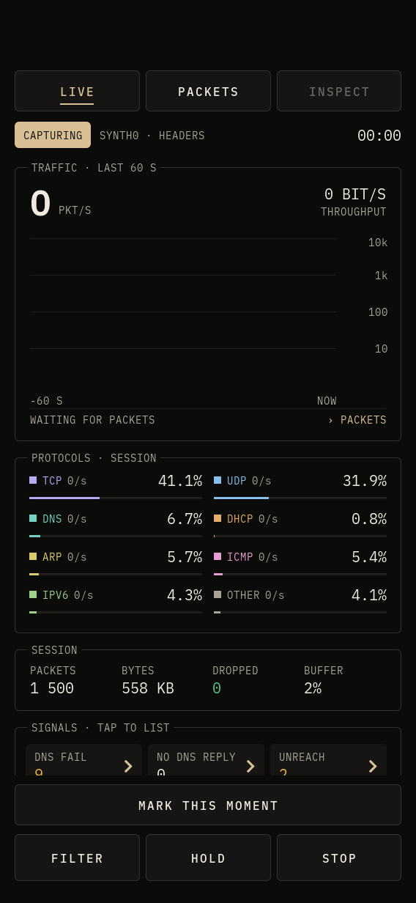
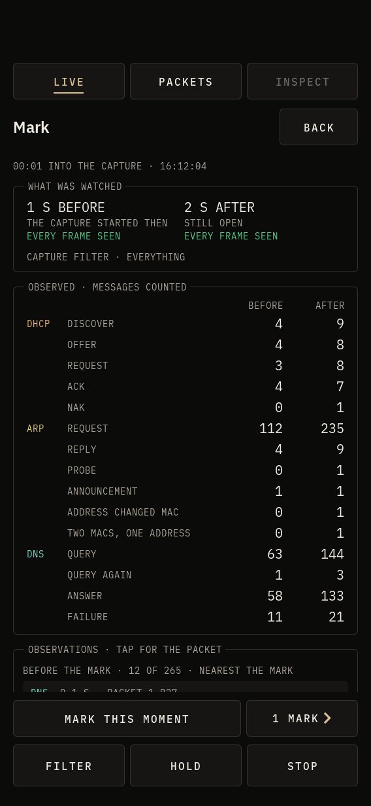
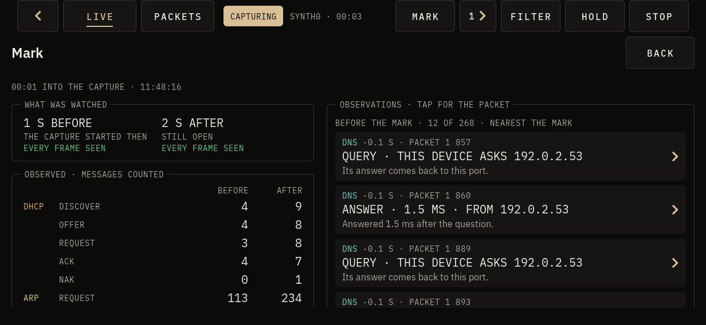
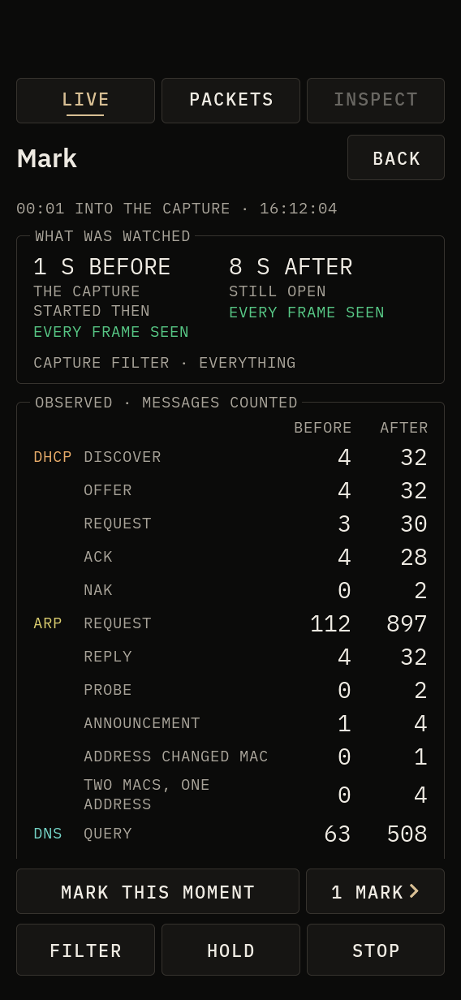
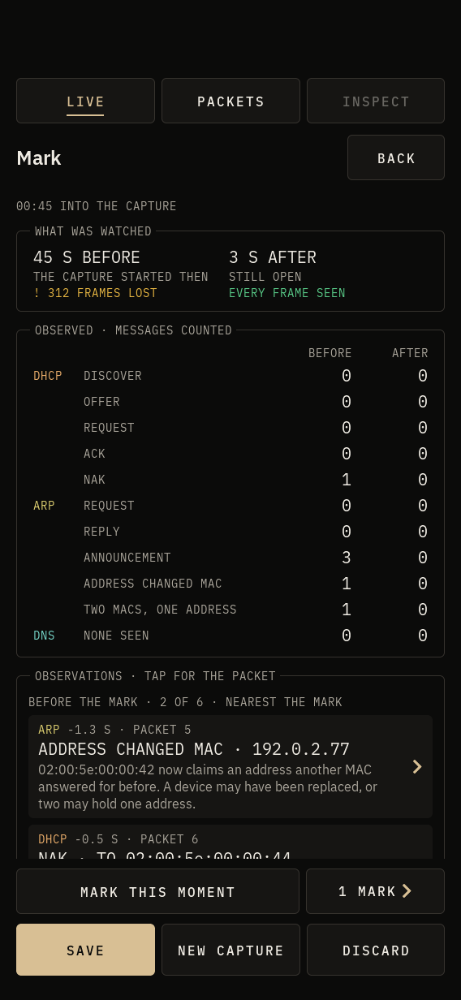
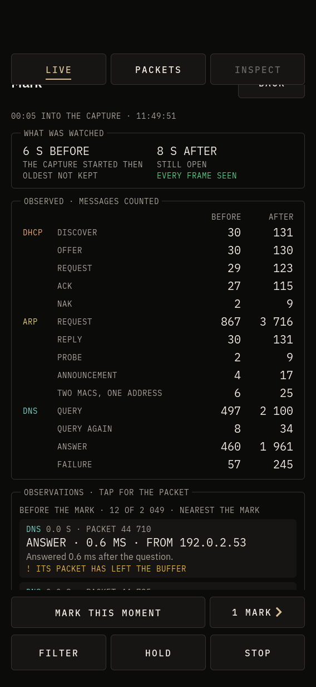
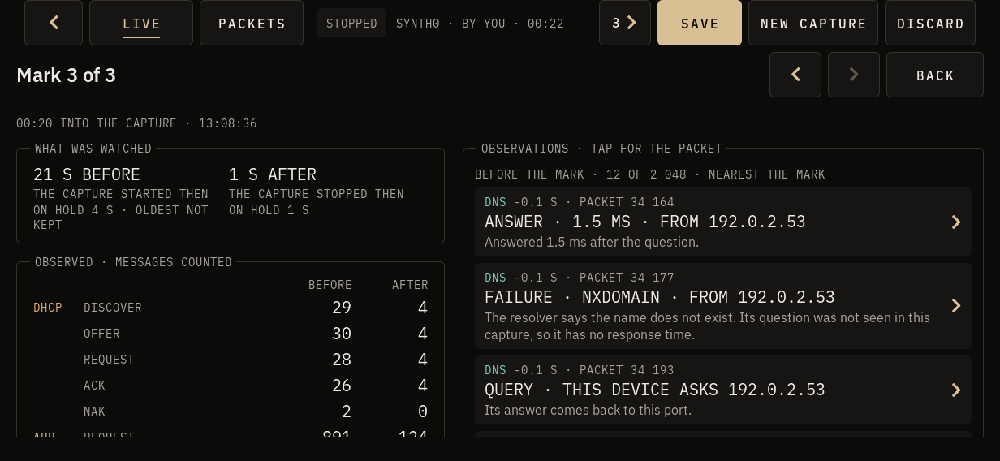

## 5. Privilege

All Doors processes run as root (docs/ARCHITECTURE.md). After its capture socket is open, the helper sets `no_new_privs`, clears the bounding set, empties its capability sets with `capset`, reads `/proc/self/status` back and reports what it found (`note caps ...`). A decoder fault can then still write files root owns, but cannot open sockets, change interfaces or load code into the kernel. On Unit A every capability set, the bounding set included, reads 0 with `NoNewPrivs: 1` while the capture runs (VERIFIED, §9.2). File capabilities, a dedicated user and seccomp are not available on the image or not checked (ADR-016).

Promiscuous mode is not offered in this version. The helper accepts the flag (libpcap sets it by socket membership, which the kernel reverts when the socket closes, DOCUMENTED, packet(7)), but the app shows OFF and takes no tap on the row until the reversion is verified on the hardware.

## 6. The line protocol

Tab-separated lines of at most 1024 bytes on the helper's stdin and stdout (`core/pocketpcap/ppc_proto.h` is the reference). Commands may also be typed with spaces, so the helper can be driven by hand from a serial console:

```
$ pos-capture session
hello	1	0.4.0	pcap
state	idle	none	-	0	1
start eth0 headers 0 all 900
note	caps	dropped bnd=empty
state	capturing	none	eth0	100	1
stats	250	12	12	0	0	0	0	1834	0	0	1	12	12	0	0	...
window 1 tail 9 0
rows.begin	1	0	3	12	1	12
row	4	1203466	2011	in	4	ARP	60	0	02:..	broadcast	Who has ...
...
stop
quit
```

Since M12.1 (protocol 5) there is also the command `net <req>` and the events `net` (the 33 figures of `struct ppc_net_totals`, once a second with `diag`, on stop, and before each answer), and the answer to `net`, queued whole: `net.begin <req>`, `net.host <mac> <ip|-> <flags> <pkts> <bytes> <name|->`, `net.srv <ip> <mac> <relayed> <offers> <acks> <naks> <seq> <lease_s> <router|-> <dns|-> <mask|->`, `net.lease <ip> <mac> <server> <lease_s> <rel_us> <seq> <name|->`, `net.evt <kind> <sev> <count> <seq> <first_us> <last_us> <ip|-> <mac|-> <ip2|-> <mac2|->`, `net.end <req>`. An address on these lines is dotted IPv4 or a colon MAC the helper wrote; the parser refuses anything else in its place, and a name is made printable ASCII.

Since N1.0 (protocol 6) there are the commands `mark` and `evid <req> <id>` (id 0: the newest mark), and the events `mark <id> <first> <at_ms> <state> <seq> <wall_s>` (the answer to `mark`, queued, never dropped) and the answer to `evid`, queued whole: `ev.begin <req> <id> <first> <last> <at_ms> <state> <seq> <wall_s> <now_ms>`, two of `ev.win <side> <flags> <span_ms> <watched_s> <held_s> <shed_s> <lost> <kept> <more> <k1..k18>` (side 0 before the mark, 1 after; the eighteen counts by kind), each followed by its rows `ev.obs <side> <kind> <flags> <t_ms> <seq> <alive> <mac|-> <ip|-> <ip2|-> <a> <b>` (alive: 0 the packet has left the buffer, 1 its row remains, 2 whole), and `ev.end <req>`. A mark that is not held is refused with `error nomark`, a mark before START with `error state`.

Commands: `start <iface> <headers|full> <promisc> <all|ip|names|noself> <limit_s>`, `hold <0|1>`, `stop`, `discard`, `view <id> <time|newest|len> <classes> <host|-> <port> <pinned> [<signals> [<diag>]]` (M5: the list's display filter and sort; M7: a hex mask of findings; M11.1: one diagnosis code), `marks <req> <buckets>` (M7: which of at most 64 equal parts of the view hold a finding), `save` (M8), `window <req> <tail|seq:N|rank:N|us:N> <before> <after>` (at most 48 rows of the view), `inspect <req> <seq> <step>` (M6: one packet, or its neighbour in the view), `pin <seq> <0|1>`, `stats`, `quit`. Events: `hello`, `state`, `stats` (4 Hz; `match` is the view's count), `bin` (each elapsed second), `rows.begin`/`row`/`rows.end` (`rows.begin` carries the anchor's rank, `row` its flags: pinned, bytes gone), `pkt.begin`/`pkt.ends`/`layer`/`field`/`hex`/`pkt.end` (the inspector's packet, queued whole), `pinned`, `finding <layer> <text>` (inside a packet), `detail <layer> <text>` (M11.1: the diagnosis of the packet, inside it), `diag` (M11.1: the 36 figures of `struct ppc_diag`, once a second while capturing and on stop), `marks`, `saved <run|done|fail> <packets> <total> <bytes> <name|code>`, `error <code> <text>`, `note`, `bye`. Protocol 6 (N1.0: `mark` and `evid`; protocol 5 was M12.1: `net` both ways; protocol 4 was M11.1: a sixth counter on `stats`, `diag`, `detail`, the view's diagnosis; protocol 3 was M7 and M8, protocol 2 M5): the shell and the helper are installed together, the shell refuses a helper of another protocol. Packet-derived text is ASCII; the inspector's own words may carry two UTF-8 marks, the middle dot and the right arrow (`ppc_sanitize_marks`), and nothing else. Snapshot lines (`stats`, `bin`) are dropped and counted (`ui_skipped`) when the shell has not read the previous ones; answers are queued in a 64 KiB buffer or refused with `error busy`. Sequence numbers start at 1 and are never reused; a packet that left the store is simply not there.

## 7. The screens

Portrait: three tabs, LIVE, PACKETS and INSPECT (enabled once a packet has been opened), and a capture bar at the foot. Landscape has a shape of its own (§7a). The header's hint always states the capture: `NOT CAPTURING` (`SIMULATED` in the simulator), `CAPTURING · ETH0`, `HOLD · ETH0`, `STOPPED · ETH0`, `CAPTURE ENDED`.

| View | What it shows | Bar |
| --- | --- | --- |
| Setup | READY or NO LINK; the interfaces from sysd (`system.status.network`; Ethernet with a carrier and Wi-Fi while associated are selectable, Wi-Fi with its network's name from netd, §2a); capture options (stored bytes, stop after, capture-filter preset, promiscuous OFF); the privacy note | START CAPTURE |
| Capturing, hold | CAPTURING or HOLD chip, interface, link speed, stored-bytes mode, elapsed; a banner for kernel drops, shedding, or what HOLD is counting. TRAFFIC: packets per second, throughput, the graph of the last 60 seconds (DS §59.5) and a readout of the selected or newest second (`03:55 · 6 885 PKT · TCP 99%`, `00:06 · HELD · 300 PASSED`); a tap on a column selects that second, a second tap clears it; the readout's `› PACKETS` opens PACKETS. PROTOCOLS: each class's packets in the newest second and its share of the session's stored packets, a tap opens PACKETS. SESSION: packets, bytes, dropped, buffer fill. SIGNALS: the six findings' counts, each a tap to its packets; the DNS and TCP diagnosis lines, each a tap to its sheet (§4b; wide: under TRAFFIC); the NETWORK line, a tap to the network overview (§4c). Above the bar, MARK THIS MOMENT and, once there is a mark, the count of marks (§4d) | FILTER, HOLD or RESUME, STOP |
| Network overview (M12.1) | LIVE's second face, in LIVE's place under the same tabs: `Network overview` and BACK; what it rests on; SEEN ON THIS INTERFACE (devices, DHCP servers, ARP pairs, to check; the classes' shares); FINDINGS, at most six with `!` on a warning, each a tap to its evidence; DIAGNOSIS (DHCP, ARP, DNS, TCP), each a tap to its sheet; DEVICES, at most eight by bytes sent, with roles, name, MAC, frames, bytes and share, each a tap to its packets. Wide: figures and findings beside diagnosis and devices. Back, BACK, the LIVE tab and key 1 return to LIVE | the state's buttons |
| A mark's evidence (N1.0) | LIVE's third face, in LIVE's place under the same tabs: `Mark 2 of 3`, the arrows to the other marks and BACK; when it was set; WHAT WAS WATCHED (the window before and the window after); OBSERVED (DHCP, ARP and DNS messages counted before and after); OBSERVATIONS, at most twelve a side, each a tap to its packet in INSPECT, and the three classes' packets in PACKETS; WHAT THIS CAN AND CANNOT TELL. Wide: windows, counts and limits beside the observations. Back, BACK, the LIVE tab and key 1 return to LIVE (§4d) | MARK and the marks' count; the state's buttons |
| Stopped | STOPPED and why (BY YOU, TIME LIMIT, LINK LOST); after SAVE its progress, then `SAVED · n PACKETS · size · name`, or why it was not saved | SAVE (primary until saved), NEW CAPTURE, DISCARD |
| PACKETS (M5) | FILTER, the filter in words and the count (`312 OF 48 417 PACKETS`), the sort (`TIME ↓` oldest first, `TIME ↑` newest first, `LEN ↑` largest first), FOLLOW; the column heads; a window of 56 px rows (time and gap, direction, protocol word in its class hue, source → destination, length, the row's sentence, `PIN` on a pinned row); a rail that jumps anywhere in the view; `FOLLOWING THE NEWEST` or `VIEW HELD AT #n`, and where the buffer starts. A drag moves the list a row per 56 px and holds it; a tap opens the row in INSPECT. The filter sheet: one protocol class or all, the host and port a FILTER BY set (cleared there, not typed), PINNED ONLY | FILTER while following, `LIVE ↓ n` (the newer packets) while held; the state's buttons |
| INSPECT (M6) | The packet's number, class and time, gap, direction, bytes on the wire and stored, PINNED; PIN, previous, next (the list's order); the two ends as slabs that filter on their host; the layers (the deepest open) with 36 px field rows that select; the stored bytes in hex (at most 512), the selected field's bytes marked | FILTER BY (the selected field's host, port or class); the state's buttons |
| Helper stopped | The error panel: what happened and its signal, that the interface was released, that the packets went with the helper and nothing was written; the last session's figures | NEW CAPTURE |

FULL, no time limit, SAVE, deleting a saved capture, DISCARD, NEW CAPTURE with packets, and Back with packets in memory each ask first, the safe choice accented; the last three say whether a saved file stays. The screen stays on while PacketShark is in front (`awake_apps`, ADR-016 rule 14), so a capture never runs behind a dark panel.

Screenshots of every state, both orientations: `PACKETSHARK_SHOTS=<dir>` on `packetshark_app_test`.

## 7a. The wide shape and the keys (M9)

**Wide (mockup 08, DS §59.7).** Chosen from the room (wider than tall and at least 900 px), not from the orientation. The shell builds no header in landscape (`POCKETOS_HEADER_NONE_LANDSCAPE`); the app's own top row starts at the display's top edge, clear of the corners: a back slab (the Back action: it asks before leaving a capture), LIVE and PACKETS, the state chip with one line of the session (`ETH0 · 00:04:13 · 48 417 PKT · 0 DROPPED`, shortened where it does not fit: with MARK in the row on LIVE a running capture keeps its elapsed time; once the capture has stopped MARK leaves the row and the line has its room back, and where the count of marks remains a line that still does not fit keeps where and why it ended, then why alone; the mark that a companion is reading is fitted with the line, so neither is cut by dots), and the capture's buttons, all 56 px. Under it LIVE is two columns (TRAFFIC; PROTOCOLS, SESSION, SIGNALS), and PACKETS is the list with the inspector beside it: a row is one 40 px line (time, word, addresses, length, sentence), a tap fills the inspector without leaving the list, and a selected field offers FILTER BY in the top row. There is no INSPECT tab. The same objects serve both shapes; they are moved, not built twice.

**Keys.** A keyboard does what the screen's controls do and no more: no key starts a capture, answers a sheet or deletes a file.

| Key | Does |
| --- | --- |
| Esc | one level back (the Back action) |
| 1, 2, 3; Tab | LIVE, PACKETS, INSPECT; the next tab |
| Space; S | HOLD or RESUME; STOP |
| F | the filter sheet |
| Up, Down | PACKETS: the previous or next packet of the list (the list follows it); INSPECT: the previous or next field |
| Left, Right | INSPECT and the wide shape: the previous or next packet |
| Home, End | PACKETS: the oldest end; the newest (FOLLOW) |
| Enter | PACKETS: the selected packet in INSPECT; INSPECT: FILTER BY the selected field |
| P | PIN or unpin the inspected packet |
| M | LIVE: MARK this moment, wherever MARK is offered (N1.0, §4d) |

The key table is this milestone's reading of "keyboard keys": the design package's own table is outside the repository, so it is for the owner to confirm or change.

## 8. Building and running

```sh
# host: helper and every PacketShark suite
make tools/capture/pos-capture packetshark-test
make packetshark-san-test                  # ASan + UBSan, fuzz 60 s
make tools/capture/pos-capture packetshark-n1-test   # MARK and its evidence alone (N1.0)
# host build with a live source: point it at libpcap headers and a library
make PACKETSHARK_PCAP=1 PACKETSHARK_PCAP_CFLAGS=-I<dir with pcap/pcap.h> \
     PACKETSHARK_PCAP_LIBS=<path to libpcap.so> tools/capture/pos-capture
# simulator: captures synthetic traffic by default
cmake -S ui/shell -B <build> -DLVGL_DIR=<lvgl> -DPOCKETOS_DISPLAY=sdl && cmake --build <build>
SHELL_BIN=<build>/pocketos-shell bash tests/packetshark_shell_test.sh
# the evidence page alone, both shapes (PACKETSHARK_SHAPE=portrait or landscape: one of them)
PACKETSHARK_ONLY=n1 SHELL_BIN=<build>/pocketos-shell bash tests/packetshark_shell_test.sh
```

The image builds `pos-capture` with libpcap (`PACKETSHARK_PCAP=1` in `platforms/k230/package/pocketos/pocketos.mk`; the package selects `BR2_PACKAGE_LIBPCAP`, the same 1.10.5 the toolbox's tcpdump already put in the image). `-DPOCKETOS_WITH_PACKETSHARK=OFF` builds the shell without the app.

Overrides: `POCKETOS_CAPTURE_HELPER` (the helper's path), `POCKETOS_CAPTURE_SOURCE` (`synth:PPS[:SEED]`, `file:PATH`, or empty for the chosen interface), and for a replayed file alone `POCKETOS_CAPTURE_SELF_MAC` (the MAC to take as this device's, so the replay's frames have a direction; a pcap file carries none). `tests/ppc_evid_mkfixtures <dir>` writes the five evidence fixtures as pcap files. Fixtures: `tests/ppc_mkfixtures <dir>` writes the decoder fixtures (documentation addresses and example.net names only); their expected rows are `tests/data/packetshark/*.expected`. No real capture is ever committed.

## 9. Validation

### 9.1 Host (build host, x86-64, WSL Ubuntu 22.04, GCC 11.4)

| Suite | What it covers | Result |
| --- | --- | --- |
| `ppc_decode_test` | each protocol; QinQ and extension headers; fragments; HEADERS keeps no HTTP payload and the whole DHCP message; every cut of four frames on the heap; DNS compression, loop, forward pointer, label limit; a million frames with no allocation | pass |
| `ppc_pcapfile_test` | write and read back; byte-swapped microsecond files; damaged files refused | pass |
| `ppc_store_test` | seq never reused; both rings evict independently; a pin whole after 200,000 packets (F7); allocation failure | pass |
| `ppc_stats_test` | seen = stored + held + shed (T1); bins; a 56-year clock step and one back leave relative time continuous (T3) | pass |
| `ppc_proto_test` | every command and event round-trips; damaged lines refused; longest lines fit | pass |
| `ppc_fuzz` | decode + store rule + format + DNS names on mutated fixtures (no libFuzzer on this host: its own mutation driver); 60 s under ASan and UBSan in `packetshark-san-test` | no finding |
| `pos_capture_test.sh` | every fixture against its expected rows and against the host's tcpdump; a session through a pipe; busy lock; SIGTERM; clock step; time limit; damaged replay; S4, S5, S7; the bench | pass |
| `psk_model_test`, `psk_session_test` | the model; the graph's ladder at 0, 1, 9, 10, 99, 100, 1 000, 10 000 and 1 000 000 and that it never falls; the 60-second window; the readout of a busy, quiet and held second; the client against the real helper: crash, hang, no hello, missing helper, protocol damage, abandon under 500 ms, twenty cycles with no child or descriptor left | pass |
| `packetshark_app_test`, `packetshark_shell_test.sh` | every M3 state in both orientations; targets and safe area; confirmations; crash and `kill -9` shown within a second; twenty opens and closes leave no helper, timer or object. M4: LIVE within 2 px of mockup 01's boxes (status, traffic, graph, protocol cells, session, tabs, bar); every class drawn in its own hue (snapshot); a tapped column moves the readout to that second and stays on it; held seconds marked at the baseline; the readout and a protocol open PACKETS; nothing clipped or overlapping in every theme and display mode and every text size; at 8 000 synthetic pps the poll's work under 4 ms (host: 0.2 to 1.0 ms) | pass |
| `ppc_signals_test` (M7) | each finding and what must not be one (keep-alive, bare ACK, the other direction, a query, NetBIOS, a later fragment); the sequence space wrapping; a SYN reported once at 3 s and never while frames pass unseen; 20,000 connections through 16 entries; the late mark in the store and the views that filter on findings; Ethernet padding not counted as payload | pass |
| M7 to M9 in the suites above | `pos_capture_test.sh`: the five counters, views of findings, marks, SAVE refused while capturing and under `/tmp`, two saves two files, 0700/0600, no part file left (also after a quit mid-save), the file read back packet for packet by `pos-capture decode` and by tcpdump, the log naming no file. `psk_session_test`: the same through the app's client, the finding line under the TCP layer, and the saved captures listed and deleted (another file, a link, a path and a missing name refused). `packetshark_app_test`: SIGNALS and a tap to its packets, the rail's marks, the inspector's finding, SAVE's sheet and outcome, the saved list and its delete confirmation, every key, the wide shape's top row, columns and one-line rows. The fuzz target judges findings on every mutated frame | pass |
| `packetshark_lint.sh` | receive only; one libpcap include; the hot path allocates and formats nothing; the findings allocate once and format nothing; the shell links only the protocol; two files created (the lock, and SAVE's, new and never followed); packets written to SAVE's file and nowhere else; the saved captures listed and deleted, never opened; no key starts a capture, answers a sheet or deletes; no log line from a packet | pass |

| M11.1 in the suites above | `ppc_signals_test`: a query and its answer timed from the latest copy, a retry, an answer with another id or port not taken, an answer never asked for, unanswered at exactly 5 s and once, a late answer timed, response codes counted apart, nothing judged after frames passed unseen, mDNS and LLMNR not entered, IPv6, the 30 s memory, 5,000 queries through 1,024 entries; a handshake timed (and from the first of two SYNs), a SYN-ACK whose SYN was not seen, a handshake whose middle passed unseen, refused, aborted, after close and unseen resets, retransmissions seen, spurious and unseen, out of order against 3 ms and against a 40 ms handshake, one-way connections. `ppc_proto_test`: the sixth finding, the view's diagnosis both ends, the largest `diag` line, every figure in its place, damaged lines, `detail`. `pos_capture_test.sh`: six counters, a `diag` line a second and on stop, DNS answered, timed, unanswered and failed, TCP connected, timed and refused from the synthetic source (which now carries transactions and handshakes). `psk_model_test`: the summary and lines, their severities and ways, singular counts, no share from a few segments. `packetshark_app_test`: the six cells, the two lines and their severity, both sheets (nothing clipped), LIST to unanswered queries and refused connections, OPEN to the slowest handshake, the inspector's sentences, the filter sheet naming a diagnosis, Back closing the sheet, in both shapes. The fuzz target checks codes and table bounds on every mutated frame | pass (WSL Ubuntu 22.04, 2026-11-18; `packetshark-san-test`: 6.7 million inputs in 60 s under ASan and UBSan, no finding; the app test three times in a row) |

| M12.1 in the suites above, and two of its own | `ppc_net_test` (78 checks): requests, replies, gratuitous ARP and probes counted apart; a move a note, the first MAC claiming again a potential duplicate, a change back after a minute not one; a claim during a probe a note that the probed address is in use, the prober's own announcement and a late claim not; this device's three requests unanswered after 2 s and once, another station's never; a sweep at forty addresses in four seconds and not over eighty; the sender mismatch; DISCOVER to ACK as one exchange with its server, lease, name and roles; the router marked only once ARP ties its address to a MAC, and its move a warning; a unicast-answered DISCOVER, a relayed one and a REQUEST from a client that has an address never waited for, a renewal under a used transaction id judged on its own, an ACK in a BOOTREQUEST and a server without an address not taken, a broadcast one unanswered at exactly 10 s from its first copy and once, a late OFFER counted, this device's own judged without the flag, a REQUEST without ACK; NAK, DECLINE, a second server, a short lease, an ACK to INFORM, a relay; nothing judged after frames passed unseen; every cut of a DHCP ACK on the heap, an option longer than the frame, a host name of control bytes; 5,000 stations through 256 places, 1,000 transactions through 64, the ring of 32, nine servers through eight. `psk_net_test` (71): every `net` line both ways, a bad address or kind neither written nor read, the largest totals line; the model takes only the whole answer to the newest request and drops it with the helper; the summaries, the DHCP and ARP sheets and every event's four lines, each a whole sentence that fits its buffer; what was seen names the addresses; only a client's DECLINE is called confirmed and nothing is called an attack; the findings as one list, warnings first; the device lines, shares and filters. `packetshark_app_test` (72 more checks, both shapes): LIVE's NETWORK line and that LIVE alone asks for no list; the overview in LIVE's place with tabs, state and buttons kept; figures, findings, diagnosis and devices; every row a 56 px target; nothing clipped at any text size; a finding's sheet, its packet in INSPECT and its ARP packets in PACKETS; the DHCP and ARP sheets, a lease's ACK; a device's packets; the poll under 4 ms with the overview showing; HOLD said on the page; Back one level at a time; a stopped capture still read; NEW CAPTURE starts from nothing. The fuzz target runs the network intelligence on every mutated frame and checks its tables' bounds and its events' kinds; `packetshark_lint.sh` holds one allocation, no text, no unbounded loop and one place that asks for the lists | pass (WSL Ubuntu 22.04, 2026-11-24; `make packetshark-test`; `packetshark_app_test` 566 checks; `packetshark-san-test` on the final code: 6.5 million fuzz inputs in 60 s under ASan and UBSan, no finding) |

| N1.0 in the suites above, and three of its own | Five fixtures written before the analysis (`tests/ppc_evid_fixtures.h`): repeated DHCP discovery, a complete local DNS transaction, an invisible third-party reply, an observed event during packet loss, a mark followed by silence. `ppc_evid_test` (52 checks) plays them into the history with their own marks, HOLD and lost frames: counts and rows of each window, the visibility of each second, an observation during loss kept, a quiet minute watched whole, the same fixture played twice giving the same answer byte for byte, two observations of one packet in order, more observations than the 2,048 the history holds, routine ARP held to three rows, the ninth mark replacing the first, a mark 1.5 s after START, on HOLD and after STOP. `pos_capture_evid_test.sh` (34 checks) replays the five through the real helper against committed answers (`tests/data/packetshark/evid-*.expected`), twice, and without the MAC named; then live on the synthetic source: `mark` answered at once while the capture goes on, the window after growing, a mark on HOLD, STOP closing the window, a mark after STOP, a mark not held refused, the ninth mark, a row's packet opened by its number, and a log that names no address. `psk_ev_test` (91 checks) takes those committed answers through the parser and the model and checks every word the page would say of them, then the answers no replay gives (frames lost, HOLD, counting only, a window open, cut by START or STOP, or without length, a quiet minute with and without loss, expired packets, every kind with any flags): no verdict word, no percentage, no sentence cut by its buffer. `ppc_proto_test` (80): the two commands and five events both ways, damaged lines refused, the longest lines fit. `packetshark_app_test` part `n1` (94 checks tall, 91 wide): MARK a full target above the bar with LIVE's panels and the capture bar still within 2 px of mockup 01; one tap opens the evidence and the capture goes on; the page's words are the words module's, row for row; a mark near START, on HOLD, near STOP and on a stopped capture; a row to INSPECT, to its neighbours in PACKETS and back to the page; the three classes in PACKETS; a row whose packet left the buffer says so and takes no tap; nine marks; frames lost and a quiet minute shown from the helper's own lines; nothing clipped at Small, Medium and Large. `packetshark_lint.sh`: the history allocates once and formats nothing, an observation is 32 bytes of figures and addresses, no name or payload reaches it, the evidence is asked for in one function and never while its page does not show, a mark sends the helper nothing else, and the words name no missing reply, fault, score or percentage | pass |

`ppc_dissect_test` also checks that every MAC filter the inspector offers matches its own packet. Until 2026-11-18 a broadcast ARP request offered FILTER BY on its Ethernet destination, which listed nothing (§10); when the synthetic source put such a packet under the inspector, the FILTER BY check of `packetshark_app_test` failed intermittently.

Host bench (`pos-capture bench`, x86-64, not a device figure): decode 32 ns/frame, decode + store 95 ns, one row of text 443 ns. Device figures: §9.2. M12.1 adds two lines to the bench: decode with the network intelligence (15 ns a frame beside 8 ns for the decoder alone on the 2026-11-24 host) and the size of its tables (40,368 bytes; 40,384 since N1.0, which gave the tables a listener). N1.0 adds two more: decode with the network intelligence and the evidence history (22 ns a frame beside 20 ns without the history and 12 ns for the decoder alone, 2026-11-25 host), and the size of the history and its marks (74,568 bytes). N1.0 in the app, on the host with the synthetic source: from the finger going down on MARK to its evidence on the screen 103 to 109 ms, of which the test's own tap is 100; the poll's work with the evidence page showing 0.3 to 0.8 ms at 2,000 and at 8,000 pps with eight marks held (the same bound as LIVE's, 4 ms); the one poll that lays out a new mark's two dozen rows 1.6 to 5.4 ms; no frame dropped or shed. With the evidence page not on the screen, the poll's worst case at 8,000 pps over five captures each, same host and build tree: LIVE 0.4 to 1.0 ms (master e6aae88f: 0.9 to 1.2 ms), PACKETS following 1.5 to 3.6 ms (master: 3.1 to 3.9 ms). Before the page was taken off the active screen the same measurement read 1.3 to 1.8 ms and 4.3 to 5.9 ms: the cost of some 350 hidden objects in every forced layout pass, found by this comparison and removed. The 4 ms bound on PACKETS is close to what master itself needs on this host (3.9 ms in one of five), so that check can fail on a busy host without a change in the code. **None of this is a device figure: N1.0 has not run on a unit.**

### 9.2 Unit A, M0 to M3 (2026-11-16)

Doors 0.4.0 (`21baeef0`) on Unit A, eth0 up at 100 Mb/s on the owner's LAN. Built from `6755ab9a` against the v0.4.0 SDK sysroot and run from a non-persistent kit in `/tmp` (the kit's shell was built with the simulator's test hooks, so `shell.tap` could press its buttons from the console; the image build has none). The installed system was restored and checked byte for byte afterwards. The full record is outside the repository (`K230-artifacts/packetshark-m0-m3/REPORT.md`); no capture and no address from it is in the repository.

| Check | Result | Class |
| --- | --- | --- |
| Real capture on eth0, 30 s | 91 frames (ARP including the unit's own replies, switch RRCP, NDP router advertisements, SSDP, UDP), 0 kernel and 0 interface drops; protocol words and µs gaps as expected | VERIFIED |
| Capabilities while capturing (S9) | `CapInh`, `CapPrm`, `CapEff`, `CapBnd`, `CapAmb` all 0; `NoNewPrivs: 1` | VERIFIED |
| Priority (D5) | nice 5 | VERIFIED |
| Interface flags (S2) | `0x1003` before, during and after: never promiscuous | VERIFIED |
| Capture socket (S1) | present only between START and STOP or the helper's end (`/proc/net/packet`) | VERIFIED |
| `kill -9` of the helper (S3) | socket released, flags unchanged; the app shows the error panel and stays usable | VERIFIED |
| Lock, down interface, missing interface | `busy`, `down`, `nodev` | VERIFIED |
| Capture-filter presets on eth0 | `ip`, `names`, `noself` start and stop cleanly | VERIFIED |
| Memory with both rings full (P3) | 315,000 synthetic frames at ~19,860 pps, FULL: peak RSS 23.2 MB (budget 32 MiB), 0 drops | VERIFIED |
| Bench, C908 | decode 158 ns/frame; decode + store 688 ns; one row of text 4.7 µs (libpcap dispatch not included) | VERIFIED |
| App: open, START, HOLD, RESUME, STOP, Back → LEAVE | header hint follows each state; opening captures nothing; LEAVE ends the helper | VERIFIED |
| Screen held awake | while PacketShark is in front only | VERIFIED |
| Ten open → START → home cycles | no helper left, shell descriptors unchanged (14), shell RSS +128 kB | VERIFIED |
| CPU, quiet LAN, LIVE showing | shell 1.3 % of the hart, helper 0.05 % | VERIFIED |
| Other services | sysd, netd, radiod, meshcored unaffected (same PIDs) | VERIFIED |
| Logs | lifecycle lines only; no address | VERIFIED |
| Carrier lost while capturing | not tested (needs the cable pulled) | — |
| Line rate (P1, P2) | not tested (the line-rate gate, needs an authorised isolated traffic source) | — |

Two labels were corrected after this run (`a0d26736`: "KILLED (SIG 9)" instead of "CRASHED (SIG 9)" for SIGKILL, "MBIT/S" for the link speed); they are host-tested and were not redeployed.

### 9.4 Unit B, M5 and M6 (2026-11-16)

Doors 0.3.6 base image on Unit B with the PacketShark binaries replaced (portrait, Carbon, text size Large). Unit B's eth0 has no carrier, so everything below ran on the helper's synthetic source (`POCKETOS_CAPTURE_SOURCE=synth:N`, generated inside the helper, nothing transmitted), from a non-persistent kit in `/tmp` (a shell built with the simulator's test hooks, driven by `shell.tap` and screenshots), then the build was installed with a rollback kit. Built from `f98f089b` against the rm69a10 SDK sysroot and Unit B's own libpcap; no firmware flashed. The record is outside the repository (`K230-artifacts/packetshark-m5-m6/REPORT.md`).

| Check | Result | Class |
| --- | --- | --- |
| PACKETS following at 2,000 pps, buffer full and turning | rows in their class hues, the filter in words under the buttons at Large, `BUFFER FROM` moving | VERIFIED |
| Sort, FOLLOW, the filter sheet (one class, PINNED ONLY), FILTER BY on a port | as on the host; FOLLOW disabled in the length order | VERIFIED |
| INSPECT: layers, fields, hex, a field selected, PIN | as on the host; a pinned packet stays in PINNED ONLY after the buffer dropped it | VERIFIED |
| STOP: list and inspector still browsable | VERIFIED | VERIFIED |
| `kill -9` of the helper on INSPECT | error panel, PACKETS says the packets went with the helper, INSPECT disabled, shell descriptors back to 14 | VERIFIED |
| Five open → START → PACKETS → inspect → home cycles | no helper left, descriptors 14 → 14, RSS unchanged | VERIFIED |
| Helper, 8,000 pps, a length-ordered window every 250 ms for 10 s | 0 shed, 0 drops, 0 skipped snapshots, no `busy` | VERIFIED |
| Bench, C908 (`pos-capture bench`) | a filter over a full store (65,536) 2.4-3.1 ms, the length order 14.9 ms, one packet dissected 52 µs; decode 160 ns, decode + store 742 ns (unchanged) | VERIFIED |
| Shell cost, 2,000 pps, PACKETS following | 8.3 % of the hart (helper 0.7 %); worst poll 15 ms and worst frame 28 ms in the minute holding START. Before the repaint fix in `f98f089b`: 18.7 % and 44-64 ms | VERIFIED |
| Capabilities, nice | `dropped bnd=empty`, nice 5 | VERIFIED |
| Live capture on eth0, landscape, physical touch and drag | not tested (no carrier; driven by IPC; rotation not changed) | — |

### 9.5 Unit B, M7 to M9 (2026-11-16)

Unit B (Doors 0.3.6 base image, portrait, Neon, text size Large), eth0 cabled at 100 Mb/s on the owner's LAN. Built from `ef4e055d` against the rm69a10 SDK sysroot and Unit B's libpcap, and **installed** (shell and helper together, protocol 3) with a rollback kit, `/root/packetshark-m79-ef4e055d/RESTORE.sh`, which puts back the shell and helper that were there. The checks ran from a non-persistent test-hooks shell in `/tmp` driven by `shell.tap` and screenshots, first on the synthetic source, then on eth0; the test shell was removed afterwards and the installed shell opens PacketShark. Traffic for the eth0 run was made on the unit itself: pings, three lookups of names under `.invalid`, a connection to a closed port on the gateway and one to a documentation address (192.0.2.1). No capture left the unit; both saved files were deleted through the app. The record is outside the repository (`K230-artifacts/packetshark-m7-m9/`).

| Check | Result | Class |
| --- | --- | --- |
| Synthetic, 2,000 pps: a tap on TCP RST lists the resets, each row with `!` | 88 of 49,500, as on the host | VERIFIED |
| A retransmission in INSPECT | `! RETRANSMISSION` beside the class; under TCP, open, `! RETRANSMISSION OF #76653 · 28.0 MS EARLIER` | VERIFIED |
| Rail marks, the Findings row of the filter sheet | drawn; as on the host | VERIFIED |
| eth0: DNS failures | 6 (three NXDOMAIN lookups, A and AAAA) | VERIFIED |
| eth0: a reset | 1, the gateway's RST to the closed port | VERIFIED |
| eth0: an unanswered SYN | marked 3 s later on the first SYN to 192.0.2.1: `! SYN NOT ANSWERED WITHIN 3 S`; its four repeats listed as retransmissions | VERIFIED |
| eth0: an unreachable | none arrived (the gateway answered a UDP probe with nothing) | not verified |
| SAVE, synthetic, buffer full | sheet with the SSH warning; 65,536 packets, 5.8 MB, in 1.4 s; folder `drwx------`, file `-rw-------`; the unit's tcpdump reads 65,536 frames, `pos-capture decode` the same | VERIFIED |
| SAVE by a helper without capabilities (ADR-016 rule 17 with rule 9) | `CapPrm`, `CapEff`, `CapBnd` 0 and `NoNewPrivs: 1` while it wrote to `/root/Captures` | VERIFIED |
| SAVE, eth0 | 409 packets, 22.8 kB; tcpdump reads 409, the reset among them | VERIFIED |
| After SAVE | bar shows SAVED; DISCARD says the file stays; setup counts `1 · 5.8 MB` | VERIFIED |
| Saved captures | listed with size and `JUST NOW`; KEEP keeps the file, DELETE removes it and the row | VERIFIED |
| Logs | `capture: saving`, `capture: saved n packets in a file of n B`; no address, name or file name in either log | VERIFIED |
| Interface flags, capture sockets | `0x1003` throughout; no helper and no capture socket left after home | VERIFIED |
| Wide shape (`--rotation landscape` for the run) | the top row at the panel's top edge clear of its corners; LIVE in two columns; one-line rows with the inspector beside them; a tap on a row fills the inspector | VERIFIED |
| Wide shape at Large | SESSION goes two by two and SIGNALS is below the fold until LIVE is scrolled; the top row's session line shortens to `SYNTH0 · 00:07` | VERIFIED (a limit, §10) |
| Cost, 2,000 pps | PACKETS following, portrait: shell 10.5 % of the hart, helper 1.2 % (M5-M6 measured 8.3 % and 0.7 %; the difference was not broken down); wide, list held with the inspector: 6.7 % and 1.1 %. Shell RSS 16 MB, 15 descriptors with a helper, 14 without | VERIFIED |
| Keys | not tested: no keyboard on the unit | — |
| SAVE refused for lack of space, a save cut short by leaving, physical touch | not tested on the unit (host-tested) | — |

### 9.3 Unit A, M4

Doors 0.4.0 (`21baeef0`) on Unit A, landscape, Neon theme, eth0 up at 100 Mb/s on the owner's LAN. The kit was built from `135d8dc4`: the shell with the simulator's test hooks, `pos-capture` with libpcap, both against the v0.4.0 SDK sysroot. It ran from `/tmp`, as in §9.2, with `POCKETOS_LOG_LEVEL=debug`. Synthetic traffic is generated inside the helper (`POCKETOS_CAPTURE_SOURCE=synth:N`), so nothing was transmitted. Afterwards the installed system was restored and checked byte for byte. The full record is outside the repository (`K230-artifacts/packetshark-m4/REPORT.md`).

| Check | Result | Class |
| --- | --- | --- |
| Graph, readout, protocols on eth0, 2 min | drawn; panel titles in the border as on the host; at about 8 pkt/s the columns sit below the landscape fold (§10) | VERIFIED |
| Interface flags, eth0 run | `0x1003` throughout; the capture socket was gone after LEAVE (3, as before) | VERIFIED |
| CPU, eth0 (quiet LAN), LIVE showing | shell 1.4 % of one hart, helper 0.05 % | VERIFIED |
| CPU, `synth:2000` (2,003 pps measured) | shell 1.5 %, helper 0.55 % | VERIFIED |
| CPU, `synth:8000` (8,020 pps measured) | shell 1.6 %, helper 0.9 %; 0 drops, 0 shed | VERIFIED |
| Worst poll and frame per minute | eth0: 5.4 ms and 10.0 ms in the minute holding the app's opening and START, then 0.6 ms and 4.7 ms. `synth:2000`: 3.0 ms and 7.4 ms. `synth:8000`: 3.3 ms and 7.9 ms. The synthetic minutes include START | VERIFIED |
| RSS | shell 15.5 MB; helper 5.9 MB (eth0), 20.7 MB (2,000 pps), 23.2 MB (8,000 pps, rings filling) | VERIFIED |
| Three captures, each ended with STOP and LEAVE | no helper left; 3 packet sockets | VERIFIED |
| Logs | no address in the helper's log; no error in the shell's | VERIFIED |
| Column tap on the device | not driven (`shell.tap` presses by text, not by position); host-tested | — |

How the cost is measured: the sysroot's LVGL is built without the performance monitor (`LV_USE_PERF_MONITOR` 0, and the toolchain is not changed for it), so the app times its own poll (reading the helper's lines and painting) and a frame from the display's `LV_EVENT_REFR_START` to `LV_EVENT_REFR_READY`, keeps the worst of each and writes them once a minute at `POCKETOS_LOG_LEVEL=debug` (`packetshark: worst poll … us, worst frame … us in the last minute`). Nothing is logged at the default level.

### 9.7 Unit B, M10 Wi-Fi (2026-11-18)

Unit B (Doors 0.3.6 base image with master `851b549a`'s shell and `pos-capture` `50e424f4`, landscape), wlan0 associated to the owner's 2.4 GHz network (WPA2, 72 Mb/s, -53 to -58 dBm), eth0 cabled at 100 Mb/s on the same subnet. Only the shell changed: built from this branch against the rm69a10 SDK sysroot and **installed** with a rollback kit, `/root/packetshark-m10-wifi-9e82bd6c/RESTORE.sh`, which puts back master `851b549a`'s shell (exercised once, then installed again); `pos-capture` is the installed one, unchanged (protocol 3). The checks ran from a non-persistent test-hooks shell in `/tmp` driven by `shell.tap` and screenshots. Traffic was made on the unit itself over wlan0: pings to the gateway, DNS lookups from a socket bound to wlan0's address (one name under `.invalid`), an HTTP request, a connection to a closed port on the gateway, three UDP datagrams to an unused port, a 45 s download. One capture was saved, read back with the unit's tcpdump and deleted; no capture left the unit. The record is outside the repository (`K230-artifacts/packetshark-m10-wifi/`).

| Check | Result | Class |
| --- | --- | --- |
| Driver and capture backend | `rtl8189fs` v5.7.9 on SDIO; libpcap 1.10.5 opens wlan0 as `EN10MB`; the existing helper captures it unchanged | VERIFIED |
| Monitor mode | not among the driver's nl80211 interface types; no `CONFIG_WIFI_MONITOR` in its build (§2a) | VERIFIED (not possible) |
| Setup (final build `9e82bd6c`; the checks below it ran on `5d70102e`, which differs only in the not-connected wording) | eth0 `LINK UP` chosen by default; wlan0 `CONNECTED`, `WI-FI · <network> · <address>`; wlan1 (the driver's concurrent-mode twin) `DOWN`; a tap chooses wlan0 | VERIFIED |
| LIVE on wlan0 | counters, graph, protocol shares (TCP, UDP, DNS, DHCP, ARP, ICMP, IPv6, other), session figures; status line `WLAN0` | VERIFIED |
| ICMP | 5 echo requests out and 5 replies in, directions right; INSPECT: Frame, Ethernet II (wlan0's MAC), IPv4 | VERIFIED |
| DNS | three queries and their answers on wlan0; the NXDOMAIN answer marked `!` and `! DNS FAILURE` in INSPECT | VERIFIED |
| TCP | the HTTP exchange (16 segments, handshake to FIN) and the gateway's RST, marked `!` | VERIFIED |
| UDP | the three datagrams to the unused port (read back from the saved file) | VERIFIED |
| Display filter | ICMP 10 of 346, DNS, TCP 18 of 421, UDP 170 of 432, ALL | VERIFIED |
| Capture filter `DNS AND DHCP` on wlan0 | 15 packets, DNS, mDNS and DHCPv6 only; the pings sent meanwhile not captured | VERIFIED |
| SAVE on wlan0 | 590 packets, 61.8 kB, 0700/0600; tcpdump reads 590 and finds each flow above; the file deleted afterwards | VERIFIED |
| START, STOP, NEW CAPTURE, four captures in a row | one helper each, none left after; wlan0 stays chosen across NEW CAPTURE | VERIFIED |
| Switching to eth0 | eth0 chosen by a tap, captured: 74 packets, ICMP both ways, status line `ETH0` | VERIFIED |
| Association dropped while capturing (`wpa_cli disconnect`) | the capture ended within a second (the helper checks the carrier once a second), `link: carrier lost`, LINK LOST on screen; setup moved the choice to eth0 and showed wlan0 not connected; after `wpa_cli reconnect` (5 s) wlan0 was CONNECTED and chosen again | VERIFIED |
| Load, 45 s download on wlan0 | about 1,100 packets/s (10 Mbit/s), 57,101 packets, 0 dropped; shell 3.4 % of the hart, helper 0.2 %; helper RSS 10 MB, shell 16 MB | VERIFIED |
| Privilege and flags (ADR-016) | helper capabilities 0, `NoNewPrivs: 1`, nice 5; wlan0 flags `0x1003` before, during and after; the capture socket gone after each capture | VERIFIED |
| Other services | sysd, netd, radiod, meshcored, wpa_supplicant unaffected (same PIDs) | VERIFIED |
| Portrait shape, keys, physical touch | not tested on the unit (portrait host-tested) | — |
| Wi-Fi at line rate, roaming between access points while capturing | not tested | — |

On this unit the PC's SSH session runs over eth0: the unit answers ARP for both addresses on both interfaces (`arp_ignore` 0), so the LAN reaches wlan0's address through eth0's MAC, and the resolver's queries leave on wlan0 with eth0's address and are answered on eth0. Hence the DNS check used a socket bound to wlan0.

### 9.8 Unit B, M11.1 (2026-11-18)

Unit B (Doors 0.3.6 base image with M10's shell `9e82bd6c` and `pos-capture` `50e424f4` installed, landscape, Neon, text size Large), eth0 at 100 Mb/s and wlan0 associated, both on the owner's LAN. **Nothing was installed:** the shell (with the simulator's test hooks) and the helper, both built from `54732f93` against the rm69a10 SDK sysroot and Unit B's libpcap, ran from `/tmp`, driven by `shell.tap` and screenshots; the installed shell was stopped for the run and started again, and both installed binaries were checked unchanged afterwards. No firmware was flashed and Unit A was not touched. Traffic was made on the unit itself: DNS queries from a socket bound to the interface (to the LAN's resolver: a good name, a slow one, two names under `.invalid`; to 192.0.2.53, where nothing answers), the system resolver, HTTP to the gateway, its closed port 81, and port 81 of 192.0.2.1. One capture was saved, replayed through the same helper to read every line, and deleted. The record is outside the repository (`K230-artifacts/packetshark-m11/`).

| Check | Result | Class |
| --- | --- | --- |
| Helper on the unit | protocol 4, build `54732f93`, backend pcap; capabilities dropped (`bnd=empty`), nice 5 | VERIFIED |
| Synthetic, 2,000 pps: SIGNALS, both sheets, LIST to refused connections | six cells; `DNS ! CHECK` and `TCP ! CHECK` under TRAFFIC; sheets with every line and explanation | VERIFIED |
| eth0, DNS | 7 queries, 5 answered (18 ms average, 85 ms slowest), 2 NXDOMAIN called "a confirmed answer, not a network fault", 2 unanswered marked NO DNS REPLY after 5 s and called "not proof of a DNS failure" (the query to 192.0.2.53, and one to the resolver that tcpdump confirms had no answer) | VERIFIED |
| eth0, TCP | 3 of 5 connections opened, 2.5 ms average; the gateway's RST to port 81 `CONNECTION REFUSED · THE ANSWER TO SYN #172, 0.9 MS AFTER IT … NOT A NETWORK FAULT`; the SYN to 192.0.2.1 unanswered at 3 s, its four repeats `HANDSHAKE STEPS SENT AGAIN`; an upstream RST for it 36 s later, also a refusal, the delay stated; handshakes timed (`CONNECTED 5.8 MS AFTER SYN #160`) | VERIFIED |
| Replay of the saved eth0 capture | every line as live, read from the helper's `detail` lines; the two unanswered queries `NO ANSWER IN THIS CAPTURE · NOT JUDGED` because the file ends within their 5 s: an incomplete capture is not called unanswered | VERIFIED |
| wlan0 | the resolver's A and AAAA queries left on wlan0 and were answered on eth0 (this unit's ARP flux, §9.7): 2 unanswered on wlan0, explained as "the answer may have come in on another interface", while the lookup succeeded; HTTP to the gateway opened in 13 ms, port 81 refused, one retransmission seen | VERIFIED |
| Cost | 2,000 pps synthetic: shell 4.0 % of the hart, helper 0.9 %, helper RSS 6.3 MB, shell 16 MB, 15 descriptors; eth0 (quiet): 4.4 % and 0.1 %; wlan0: 3.8 % and 0.1 % | VERIFIED |
| Cleanup | after each capture and at the end: no helper left, 3 packet sockets as before, eth0 and wlan0 flags `0x1003` throughout, no address in the helper's log, sysd, netd, radiod, meshcored and wpa_supplicant running | VERIFIED |
| A controlled data retransmission | not tested: the image has neither `tc` nor `iptables` to drop a segment; SYN repeats and one natural retransmission were seen, data retransmission kinds are host-tested | — |
| Portrait on the unit, keys, physical touch, the wording fix of `ff3fefa1` | not tested on the unit (host-tested; `ff3fefa1` changes only the sheet's words for counts of one and small samples, seen wrong on this run) | — |

### 9.9 Unit B, M12.1 (2026-11-24)

Unit B (Doors 0.3.6 base image with master `14ae78ab`'s shell and `pos-capture` `90fd6f7d` installed, landscape, Neon, text size Large), eth0 at 100 Mb/s and wlan0 associated, both on the owner's LAN. **Nothing was installed and no firmware was flashed:** the shell (with the simulator's test hooks) and the helper, built from `4234cb78` against the rm69a10 SDK sysroot and Unit B's libpcap, ran from `/tmp`, driven by `shell.tap` and screenshots; the installed shell was stopped for the run and started again, both installed binaries were checked unchanged afterwards and the kit was removed. Unit A was not touched. PacketShark sent nothing; the traffic it observed was the LAN's own broadcasts and what the unit itself made with its ordinary tools: `arping` and `ping` to the gateway, `ping` to an address checked to be unused, and one DHCP exchange by `udhcpc` with a script that changes nothing. Screenshots and addresses stay outside the repository (`K230-artifacts/packetshark-m12-1/`).

| Check | Result | Class |
| --- | --- | --- |
| Helper on the unit | protocol 5, backend pcap; capabilities 0, `NoNewPrivs: 1`, nice 5 | VERIFIED |
| Synthetic, 2,000 pps: LIVE's NETWORK line, the overview, a finding's sheet, its packet in INSPECT, the DHCP and ARP sheets, HOLD, STOP | as on the host, at text size Large in the wide shape; `! CHECK` with the findings the synthetic source carries | VERIFIED |
| eth0, DHCP | this device's DISCOVER, OFFER, REQUEST and ACK paired as one exchange, `1 OF 1 ACKNOWLEDGED`; one server with its MAC, router, DNS, mask and 24 h leases; the lease listed with its client; `OK` | VERIFIED |
| eth0, ARP | 9 pairs and 62 requests in 31 s; the three requests for the unused address reported as the note `NO ARP REPLY FOR AN ADDRESS`; an address that did answer ARP (checked with `ip neigh`) reported nothing | VERIFIED |
| eth0, a healthy LAN | `TO CHECK 0`: 12 devices, no warning in 50 s | VERIFIED |
| wlan0 | the same exchange and requests over Wi-Fi: 23 devices, one server, `1 OF 1 ACKNOWLEDGED`, the note for the unused address, no warning | VERIFIED |
| Cost, 2,000 pps synthetic | LIVE showing: shell 4.6 % of the hart, helper 0.9 %; the overview showing (lists once a second): 3.2 % and 0.9 % (M11.1 measured 4.0 % and 0.9 % on LIVE). Helper RSS 16 to 19 MB as the rings fill, shell 16.4 MB, 15 descriptors | VERIFIED |
| Cost, eth0 with the overview showing | shell 2.5 %, helper 0.1 %; helper RSS 6.0 MB, shell 16.4 MB | VERIFIED |
| Logs | no address in the helper's or the shell's log | VERIFIED |
| Cleanup | no helper left, 3 packet sockets as before, eth0 and wlan0 flags `0x1003` throughout, sysd, netd, radiod, meshcored and wpa_supplicant running, the installed shell and helper unchanged | VERIFIED |
| A second DHCP server, a NAK, a DECLINE, two MACs for one address, a probed address in use, a moved router | not tested on the unit: they need a second server or a second station misbehaving on the owner's LAN, which this run did not make. Host-tested (§9.1) and seen on the unit from the synthetic source | — |
| The UI in both shapes, a second run of the same build from `/tmp` (`--rotation portrait` for the tall shape), synthetic 2,000 pps, text size Large, driven by `shell.tap` | LIVE's NETWORK line opens the overview; the three tabs and the capture bar stay and work; a finding opens its sheet; LIST shows the 14 ARP packets that name the address (`ARP · HOST 192.0.2.77`); OPEN shows the ARP packet with that sender in INSPECT; a device lists its packets (`HOST 192.0.2.10`); the DHCP sheet; BACK and the LIVE tab return to LIVE; a row below the fold is reached by scrolling to it; nothing cut or overlapping in the pictures; no error in the shell's log | VERIFIED |
| Physical touch and finger scrolling, the same build from `/tmp`, landscape, synthetic 2,000 pps | passed, as reported by the owner at the unit (2026-11-24); one capture started, no error in the shell's log. What was tapped is not recorded | VERIFIED (owner) |
| Keys | not tested: the unit has no keyboard | — |

### 9.10 N1.0, MARK and its evidence: host only (2026-11-25)

Build host (x86-64, WSL Ubuntu 22.04, GCC 11.4), the simulator's panel in both shapes, the real helper on the synthetic source and on the replayed fixtures. **No unit was used: nothing here is a device result.** Each line of the owner's brief, how it was checked, and the result.

| Asked for | Checked by | Result |
| --- | --- | --- |
| Fixtures before the analysis: repeated DHCP discovery, a complete local DNS transaction, an invisible third-party reply, an observed event during packet loss, a mark followed by silence | `tests/ppc_evid_fixtures.h`, five scenes of documentation addresses built frame by frame; played by `ppc_evid_test`, written as pcap files by `ppc_evid_mkfixtures`. They were written before `ppc_evid.c`, and committed with it in one commit, so the history does not show the order | PASS |
| A clear, one-tap MARK on LIVE | `packetshark_app_test` n1: MARK a full 56 px target inside the safe area, above the capture bar (tall) or in the top row (wide), at Small, Medium and Large; the key `M` | PASS |
| Immediate acknowledgement, capture controls preserved | n1: one tap opens the mark's evidence, 103 to 109 ms after the finger goes down (the test's tap is 100 ms); still CAPTURING, the counters rise, HOLD, RESUME and STOP work from the page; LIVE's status, TRAFFIC and the capture bar within 2 px of mockup 01 with MARK on the screen | PASS |
| Owner's decision, 2026-11-25: no MARK in the wide top row after STOP or while SAVING; the status line's room restored; marks and their evidence still reachable after STOP, retained packets still open in INSPECT | `packetshark_app_test` part `journey`: master's own check of the wide stopped line (`SYNTH0 · BY YOU`) passes unchanged. Part n1, wide: after STOP no MARK, the line whole and uncut, `M` marks nothing, the count opens the newest mark, the arrows step back, a row opens its packet in the inspector beside the list, LIVE shows the evidence again; the same while SAVING; the tall shape keeps MARK after STOP; the unit turned on a stopped capture: tall offers MARK again at once, wide takes it away again (LIVE is repainted when its shape changes) | PASS (focused reruns only: journey 82 checks, n1 193 checks, lint; the full suite was not repeated for this change) |
| A small, bounded, CPU-only history of DHCP, ARP and eligible DNS | `ppc_evid_test` (ring of 2,048, eight marks, twelve rows a side, routine ARP three); `packetshark_lint.sh` (one allocation of 74,568 bytes, no text, no unbounded loop, no clock, no socket); no model, no KPU: nothing of #186 is linked | PASS |
| Before and after windows, labelled; the observations; the visibility limits | `psk_ev_test` (every word of the page from the helper's committed answers and from built ones), n1 (`page_is_models`: the page shows the words module's text and nothing else; `packetshark_lint.sh`: the page file holds headings only) | PASS |
| Observations linked to their packets in PACKETS and INSPECT | n1: a row opens its packet in INSPECT (the packet's number and protocol are the row's), PACKETS stands at it among its neighbours, Back returns to the page; the three classes listed in PACKETS. `pos_capture_evid_test.sh`: a row's packet opens in the inspector by its number | PASS |
| Expired evidence said explicitly | n1 at 8,000 pps: when the buffer has turned, the row says `! ITS PACKET HAS LEFT THE BUFFER`, has no chevron and takes no tap; its counts and words stay. `psk_ev_test`: gone, and bytes gone | PASS |
| Marks near START, during HOLD, near STOP | `ppc_evid_test` (1.5 s after START, on HOLD, STOP closing the window, after STOP); `pos_capture_evid_test.sh` (the same through the helper, live); n1 (the same on the screen, with what each window says) | PASS |
| Marks during periods without relevant traffic | `ppc_evid_test` (the silence fixture: the window after is whole, watched throughout, empty); `psk_ev_test` (the sentence, and its other form when part of the time was not watched); n1 (the page for such an answer, put into the model as the helper words it) | PASS, with a limit: no live capture was quiet in the app test, since the synthetic source always carries these protocols |
| Session-local | `packetshark_lint.sh` (two files are created, as before: the lock and SAVE's capture; `capture.status` reads the same members); n1 (DISCARD ends the marks); `pos_capture_evid_test.sh` (the log names no address) | PASS |
| HEADERS privacy kept | `packetshark_lint.sh`: an observation is 32 bytes of figures and addresses; no DNS name, payload or stored byte reaches the history | PASS |
| Capture performance kept | `pos-capture bench`: 22 ns a frame with the history beside 20 ns without; n1: no frame dropped or shed at 2,000 and 8,000 pps with eight marks held; the page's poll 0.3 to 0.8 ms against the 4 ms bound; a new mark's page laid out in one poll of 1.6 to 5.4 ms | PASS on the host. **NOT TESTED on a device** |
| Facts apart from interpretation; no missing reply inferred; no score, percentage or automatic diagnosis | The unseen-reply and repeated-DISCOVER fixtures: no OFFER or ACK is counted or made up, each request says its reply is not for this port, and the limits say so in general. `psk_ev_test` and n1 search every text for fifteen verdict words and `%`; `packetshark_lint.sh` does the same on the source | PASS |
| Valid observations kept during packet loss or incomplete visibility | `ppc_evid_test` (500 frames reported lost: every row kept, the loss told with the window); `psk_ev_test` and n1 (`! 312 FRAMES LOST` beside the rows) | PASS |
| Replay consistency | `ppc_evid_test`: every fixture played twice gives the same mark byte for byte, and again with the clock told four times as often; `pos_capture_evid_test.sh`: each replay twice against its committed answer | PASS |
| Portrait, landscape and Large text | n1 in both shapes; the page, MARK and LIVE audited for clipped or overlapping text at Small, Medium and Large; screenshots in §4d | PASS in the simulator. Not seen on the panel |
| No regression in the rest of PacketShark | `make packetshark-test` (the host suites and the lint), `make packetshark-san-test` with a 5 s fuzz (ASan and UBSan), and `packetshark_app_test` whole, once each | PASS (figures in the pull request) |

Not done, and why: no unit was touched (the brief forbids it), so the helper's cost on the K230, the page's layout time there, MARK under a finger on the panel and the readability of the page at arm's length are all open. The line-rate gate is as it was.

### 9.6 Integration into master (2026-11-16)

Pull request #141 merged the four stacked branches (head `27115c45`) onto master `f8939dbb`, which already had the RIFT Activity graph and shell notices (#140), without conflicts. Two test expectations were brought up to date: the SPDX header on three PacketShark test scripts (`tests/license_audit_test.sh`) and PacketShark as the ninth app of the Apps folder (`tests/launcher_folder_shell_test.sh`, `tests/launcher_groups_shell_test.sh`). On the merged tree, built on the host and for the K230 (v0.4.0 SDK sysroot, `pos-capture` with libpcap, the shell in Release), `make packetshark-test`, `packetshark_shell_test.sh`, `packetshark_lint.sh`, `rift_lint.sh`, `home_layout_test`, `shell_ipc_test.sh`, `vision_shell_test.sh`, `license_audit_test.sh` and `build_outputs_test.sh` passed. The RIFT, launcher, DeskBuddy, notices and text-size shell tests failed exactly the checks they fail on master `f8939dbb`, which are unrelated to PacketShark. The merged build was not run on a unit; the unit results above are from the milestone branches.

## 10. Known limits and open items

- **The line-rate gate is not started:** behaviour at line rate (drops, the shell's frame time under load, GRO records) is unmeasured on the hardware and needs an authorised, isolated traffic source.
- **Owner decisions:** ADR-016 accepted 2026-11-16 subject to its security constraints, which bind every later milestone (in particular: promiscuous mode not offered until its reversion is verified on the hardware; capabilities dropped before a frame is parsed). The libpcap dependency approved 2026-11-16. DS §59 accepted 2026-11-16 after the owner reviewed the mockups; minor adjustments for readability, touch accuracy or LVGL rendering on Unit A are allowed and recorded in DS §59.11.
- M7 to M9 ran on Unit B (§9.5) except the keys (no keyboard there), a real ICMP unreachable, and SAVE's failure paths. The shell and helper must be installed together (protocol 3).
- The unanswered SYN is `NO ANSWER` on LIVE and in INSPECT since M11.1 (it was `NO REPLY` on LIVE).
- The diagnosis (§4b) is heuristic, from one interface: DNS over TCP, mDNS and LLMNR transactions are not followed; a DNS server that answers from another address than it was asked at is not matched; a gap is one per direction (a second gap before the first is filled is not tracked); out of order and retransmitted are told apart by time alone; a reset long after an unanswered SYN still counts as a refusal (the inspector states the delay); zero-window probes and duplicate ACKs are not judged. The TCP RST cell still counts every reset; which ones are faults is the sheet's to say.
- Two cosmetic faults seen on Unit B after the M11.1 install were fixed afterwards (host-tested): in the tall shape at text size Large, `NO DNS REPLY` read `NO DNS ...` (the six words now wrap together when one does not fit), and the diagnosis sheet's confidence note said `1 queries were let go` (counts of one are singular there too). A later fix makes LIVE's fits again whenever its shape or the text size changes - at the first poll LIVE is seen - not only when the capture has something new to paint, so a quiet capture is not left showing `NO DNS ...`; and "1 packets" in the same note is singular as well.
- M11.1 changes the synthetic source: a DNS transaction and a TCP handshake in every 32 frames (some failed, unanswered, asked twice or refused) replace the unpaired DNS frames.
- An unsaved capture is lost by a helper crash or by leaving the app (D10, accepted; said on screen). A saved capture cannot be opened again in the app in this version: it is listed and deleted there, and read with another tool.
- SAVE writes the buffer as it is: packets whose bytes have left the ring, and pinned packets that left the buffer, are not in the file. Saved files are readable by anyone who can log in as root over the network (ADR-016, accepted risk; said on the save sheet).
- Signals are heuristics (§4a): out-of-order segments read as retransmissions, findings are not judged in HOLD or while shedding, and DNS over TCP is not read.
- The synthetic source now carries about one finding in a hundred frames, so the simulator has every kind to show.
- Promiscuous mode not offered (§5).
- Wi-Fi (§2a, §9.7): managed mode only; monitor mode is not offered by the driver. A Wi-Fi capture ends at the first loss of association, roaming included when the driver drops the carrier for it. The `NOT MY SSH` preset excludes SSH to and from the chosen interface's address when the capture starts; a lease that changes the address during a capture is not followed. The interface rows come from sysd and netd every 2 s while setup shows, so a join appears within that time. Unit B's eth0 and wlan0 are on one subnet, so the unit's own traffic can leave on one interface and its answers arrive on the other (§9.7); that is the unit's routing, not something PacketShark changes. Wi-Fi at line rate is unmeasured, like Ethernet.
- The network intelligence (§4c) is evidence from one interface, passive, IPv4 only: IPv6 neighbour discovery, router advertisements and DHCPv6 are decoded and listed but not analysed. A device's address comes from ARP and DHCP alone, so a device that only sends IP is listed by its MAC. On a switch port without a mirror, other devices' unicast (DHCP answers without the broadcast flag, ARP replies, renewals) is not seen, so counts of those are low and such requests are not judged. A second DHCP server, an address at two MACs and the router's address at a new MAC are reported as what was seen with what it may mean; telling a failover pair from a rogue device needs the owner's knowledge of the network. DHCP option overload (options in the `sname` and `file` fields) is not read; a relayed answer is attributed to the server identifier, with the relay's MAC. The tables are bounded (256 devices, 256 pairs, 64 exchanges, 8 servers, 32 events): on a large or busy network the oldest are replaced and counted, and an exchange replaced while it waits is counted unjudged, not unanswered. The overview lists at most eight devices and six findings (it says how many more there are). A device's row lists packets by its IPv4 address: a device known only by its MAC offers no list, and the router's row lists what was addressed to or from the router itself, not what it forwarded (a record keeps an IP packet's addresses, not its MACs). ARP and DHCP packets carry no mark in PACKETS or INSPECT yet: a finding's evidence is reached from its sheet.
- **Marks and their evidence (§4d) have not run on a device**: N1.0 is host-tested only, so its cost on the K230 (the helper's 22 ns a frame, the page's layout of a new mark) is not measured. The helper and the shell must be installed together (protocol 6).
- A mark's evidence is what one interface saw of DHCP, ARP and DNS over IPv4 (DNS also over IPv6, without its addresses), nothing else: no TCP, no ICMP, no IPv6 neighbour discovery or DHCPv6. On a switch port the replies to other devices' requests are not seen (§4d's table), and the page never calls them missing. There is no mirror-port mode.
- A window is 60 s and a capture keeps eight marks and the last 2,048 observations; none of the three can be changed on the screen. On a segment with more than about 34 relevant messages a second the window before a mark is shorter than a minute and says `OLDEST NOT KEPT`. Each side shows at most twelve rows, the nearest the mark; the rest are counted.
- A mark cannot be named, moved or removed, and marks are not saved with a capture: a saved `.pcap` has the packets, not the marks. A mark set on a stopped capture stands where the capture stopped.
- A replayed file has no direction of its own, so nothing in it is called this device's unless `POCKETOS_CAPTURE_SELF_MAC` names one (tests only); a replay's HOLD, lost frames and mid-capture marks do not exist in a pcap file and are tested through the history directly and through the helper's own lines.
- At text size Large a long observation line can break inside an address - a MAC at a colon, an IPv4 address at a dot (LVGL's break characters). Nothing is cut: the address runs over two lines.
- M12.1 changes the synthetic source: DHCP exchanges between six clients and the server at 192.0.2.1 and ARP between stations (now and then a second server, a NAK, an unanswered DISCOVER, a duplicate claim, a defended probe, an unanswered request of this device) replace the unpaired DHCP DISCOVER frames, and the random ARP request now comes from the router's address.
- The wide shape (§7a) is sized for the panel at text size Small; at Medium and Large LIVE's right column and the setup scroll. The error panel and the sheets use the portrait column in the wide body.
- During HOLD the per-class rates read `0/s`: held packets are counted, not classified (DS §59.11).
- The relative-time origin is corrected for clock steps; frames still in the kernel ring across a step can read time 0 (an edge, not measured).
- GRO-merged records (r8152) are labelled `[GRO]`; whether they occur on the unit is measured in the line-rate gate.
- No seccomp; no dedicated user (ADR-016).
- A full repaint of a following list is the costliest frame the app draws (about 28 ms on Unit B); a following list repaints twice a second.
- The display filter has one protocol class at a time in the sheet (the protocol carries a mask); a host or port comes from FILTER BY or an end's slab, never typed.
- A MAC filters only ARP and frames with no network layer: an IP packet's record keeps its IP addresses, not its MACs, so its Ethernet addresses offer no FILTER BY. An ARP record keeps the sender and target MAC of the ARP message, so an ARP frame's Ethernet address offers FILTER BY only when it is one of them: the broadcast destination of a request (`ff:ff:ff:ff:ff:ff`) offers none (before this fix it offered one that listed nothing).
- The length order is a snapshot rebuilt at most once a second; while packets arrive its last rows can have left the buffer by the time they are shown.
- The hex view shows at most the first 512 stored bytes (said under it).
