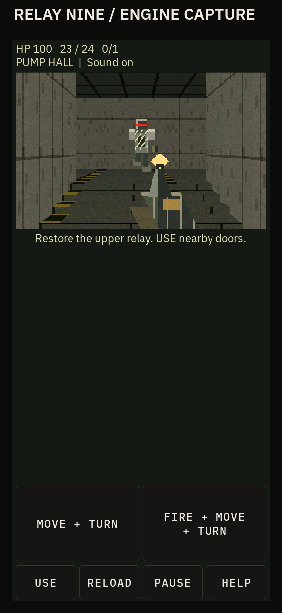
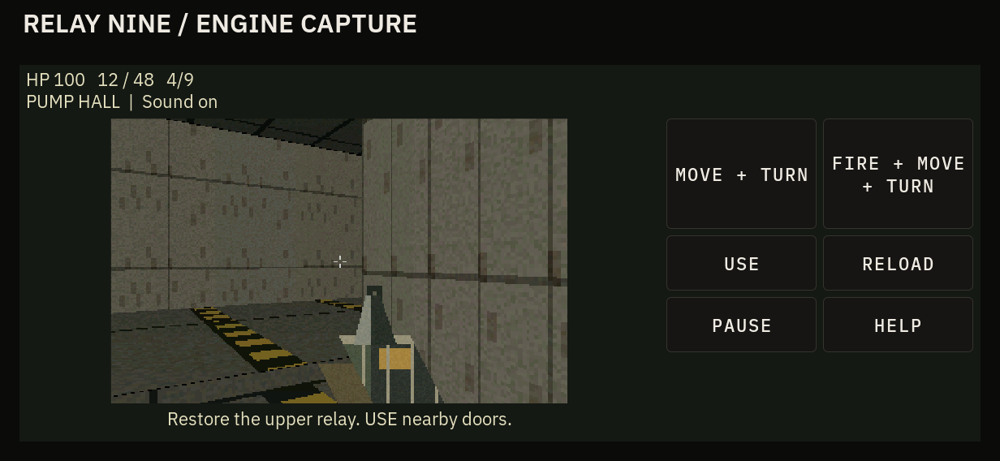

<!-- Copyright (c) 2026 PocketOS authors. SPDX-License-Identifier: Apache-2.0 -->
# Relay Nine

**Current implementation and handoff:** [industrial polish, BREACH-2 shotgun, title and optional maintenance loop](RELAY_NINE_POLISH.md). Gameplay details, captures and validation below preserve the `4d5a0ed` baseline. Current captures live in `relay-nine/polish/`.

The implemented successor to the preserved Neon Outpost prototype, on draft
PR #104. Open **Games → Relay Nine**, then **PLAY** or Enter. Restore the relay
console in the upper control room, descend the return stairs and **USE** the
exit lock. One complete original level, nine enemies, one carbine, ammunition
and medical pickups, death, pause, help, restart and reachable victory.
Back/Home or rotation abandons the run; there is no save, jump or campaign.
The internal ID and existing branch remain `neon-outpost` / `feat/neon-outpost`.

## Actual rendering

These are captures of production game/render code inside the real LVGL app
harness, with Large text. They are **engine output**, not the approved concept.
The harness heading identifies them. The `shell-*` captures include the actual
Doors shell chrome and production physical-key translation. None is a K230
capture or proof of device performance.





[Landscape combat](relay-nine/landscape-combat.png) ·
[Portrait stairs](relay-nine/portrait-stairs.png) ·
[Upper relay control](relay-nine/landscape-upper-control.png) ·
[Portrait victory](relay-nine/portrait-victory.png) ·
[Death](relay-nine/landscape-death.png) ·
[Real shell landscape](relay-nine/shell-landscape-gameplay.png) ·
[Real shell portrait help](relay-nine/shell-portrait-help.png) ·
[720p gameplay](relay-nine/hdmi720-combat.png).

The [approved concept](neon-outpost/proposal/relay-nine-concept.png) remains
labelled **CONCEPT ART — NOT ENGINE OUTPUT**. Its illustrated fidelity is not
claimed by these deliberately low-resolution original pixel recipes.

## Baseline level plan (optional route changes in the current update)

Worn olive-gray steel plates, rivets, pipes, stained concrete, grating and
hazard-edged steps; restrained amber hall lighting and red robot optics. Solid
pumps and compressor bays break sight lines. Materials and sprites have their
own palette, independent of the Doors interface theme. Shell/menu typography
uses the selected text size. Reduced motion removes receiver recoil while
retaining local muzzle/hit cues and sound.

```text
NORTH
C gallery +0.75 -- D1 -- D compressor +0.75 -- six steps --> E control +1.50
 guard, med, ammo         2 scavengers, ammo                 guard, relay K
      ^                                                          |
 six steps                                                twelve steps down
      |                                                          v
B pump hall 0.00 <--- D2 (K unlocks) ----------------------- J return 0.00
 guard, 2 scavengers, ammo                                  scavenger, med
      ^                                                          |
     D0                                                       D3 (K)
      |                                                          v
A service lock 0.00                                          F exit 0.00
 start, equipped carbine, guard                              USE to win
```

The carbine is equipped at the start rather than a separate pickup. Three ammo
crates add 24 reserve rounds each (cap 120); two medical packs add 30 HP (cap
100). Start with a 24-round magazine and 24 reserve. Guards take four hits;
scavengers take two. Every enemy can be defeated, but kills are not the exit
gate. K opens the return shortcut and exit door. Doors lift over 0.8 seconds;
actors must wait for body clearance. The west gallery and raised relay room
are real support heights, with six 0.125 m steps each; twelve steps descend to
return level. No room-over-room geometry or traversable space beneath platforms.

Guards walk with four gait phases and directional silhouettes, telegraph a
350 ms attack, flash on discharge, react to hits and collapse. Six-legged
scavengers scuttle, wind up for 260 ms, attack at close range and collapse.
Ranged attacks aim at wind-up and can be dodged. One automatic carbine fires
at four shots/second, reloads in 900 ms, with visible receiver movement, muzzle
flash, impacts, hit reaction and eight distinct synthesized sound cues.

## Controls and supported input

| Input | Action |
| --- | --- |
| W/S or Up/Down | Forward/back |
| A/D | Strafe |
| Left/Right | Turn |
| Hold Space | Fire, concurrently with movement and turning |
| F / R | Use nearby door/relay/exit / reload |
| P or Esc | Pause/resume |
| H / Enter | Help / begin or resume |
| RESTART | Fresh level from pause, death or victory menu |
| MOVE + TURN pad | One finger: vertical displacement controls speed, horizontal controls yaw |
| FIRE + MOVE + TURN pad | Same two axes, plus held trigger; center fires while stationary |
| USE, RELOAD, PAUSE | Stop and tap separate buttons |

Each pad uses a fixed neutral center and a 0.17 dead zone. Its mode stays fixed
from press to release; dragging between pads does not change the mode. Release
or press-lost clears all pad actions. Touch requires one pointer and does not
assume multitouch; touch strafe is not provided. Portrait pads sit below the
view; landscape/720p pads occupy the side. Visible action targets are at least
64 pixels in the tested layouts.

The opt-in `pos_input_game_*` subscription observes physical TCA8418 releases
before the ordinary text path discards them. SDL observes down/up in a bounded
synchronized event-watch queue drained on the UI thread. Down-time mappings,
both Space contacts, repeats and source reset are handled separately from
legacy text. No subscriber means existing app behavior. Focus loss, redirect,
overflow/disconnect, lock, screen-off, long frame gap and close clear held
actions and pause. A released/repressed key is required after lost input.
**Hardware rollover and physical touch behavior remain unverified here.**

## Architecture and resolved details

- `relay.c/.h`: pure C world, 41 nonoverlapping rectangular convex sectors and
  explicit split directed portal edges; bounds are 96 sectors, 512 edges,
  16 enemies and 16 items. The map is authored in code. The two solid machinery
  props share rendering/shot geometry and cannot be entered. Fixed 10 ms steps,
  capped 250 ms catch-up, radius 0.22 m, body 1.65 m, eye 1.45 m, maximum step
  0.201 m. Small-step axis sliding, support changes and gravity handle movement.
  Bounded sector-graph routing respects step, width, door and headroom.
- `relay_render.c`: sector/portal **column traversal**, clipped vertical
  openings, textured upper/lower bands and floor/ceiling plane spans. This
  resolves the proposal's portal-window traversal without a general polygon
  rasterizer/BSP. Each column is capped at 96 sector transitions; cap hits are
  counted. Per-pixel 16-bit **linear distance** (1/512 m), rather than the
  proposed reciprocal encoding, handles masked sprite occlusion behind low
  walls and machinery. Near-edge projection is clamped before integer conversion.
  Internal output is 320×200 RGB565; no separate 256×160 diagnostic mode yet.
  Color plus depth is 256,000 bytes, excluding world/art/LVGL buffers.
- `relay_art.c`: cached six 64×64 material recipes, masked 64×64 machine/pickup
  sprite recipes and a 128×96 asymmetric carbine. Sprite direction, gait,
  wind-up, discharge, hit and collapse are selected at draw time. No external
  atlas, concept pixels, copied engine or game assets. No dynamic shadow pass,
  alpha smoke, masked railings or full mesh machinery.
- Yaw-only aiming keeps a narrow horizontal tolerance (0.32 m) with vertical
  assistance up to 1.05 radians to make nearby low scavengers hittable. This is
  wider than the proposal's initial narrow-cone wording, resolved for this
  delivery. A 3D visibility trace to the visible upper body, floor/ceiling,
  doors and nearest target controls hits; no shots through plinths.
- `neon_app.c`: existing registry, geometry, pause, aspect-preserving scaling,
  image cache cleanup and single-timer integration retained and extended.
  Display name is Relay Nine. Historical `neon.c`, `neon.h` and
  `neon_render.c` remain available for old focused fixtures; they are no longer
  linked into the app. The grid, renderer, navigation and geometric enemy art
  were replaced, rather than recolored.
- `audio.effects`: one demand-started foreground process, four voices, fixed
  sample bank, one existing pocketaudio stream. No ALSA on the UI thread, no
  per-shot child process, no new dependency or persistent daemon. Timestamped
  commands expire after 200 ms; client is nonblocking, effects coalesce to eight
  per frame. Mix is clamped to ±8192; volume/mute, exclusivity, route and recovery
  use existing policy. Pause/end/close stop and reap the process. Fault cleanup
  has bounded 300 ms grace periods and can briefly delay leaving the app.
  Busy/unavailable/muted states are visible. See [API](../api/audio-effects.md)
  and [ADR-014](../decisions/ADR-014-foreground-audio-effects.md).

## Baseline validation at `4d5a0ed`, 2026-10-22

Host build: SDL Doors shell, app harness, physical keyboard adapter and SDL input
adapter, plus the actual ALSA-backed effects service. The representative stair /
gallery / enemy / weapon scene was built and visually inspected first, before
extending the level. Final production captures were inspected in portrait and
landscape, including combat, stairs, the upper room and terminal states.

| Check | Result |
| --- | --- |
| Engine/renderer/mixer | 29,695 assertions: map/portal validation, stairs, doors, solid machinery, 3D rays, low-wall head-visible/legs-hidden pixels, near-edge rendering, shooting/reload, telegraphs, death, pause, equivalent tick schedules, bounded traversal, sample clipping |
| Complete production-logic run | Input-only pilot, no teleports/state edits: 4,141 fixed steps (41.41 simulated seconds), all 9 enemies, relay activated, exit won, HP 100, magazine 22/reserve 72; this is a fast scripted route, not measured human play time |
| ASan + UBSan | Same focused engine/renderer/mixer checks passed; leak detection disabled because this executor's tracing prevents LeakSanitizer; no passing leak-scan claim |
| Real LVGL app | 504 assertions: Small/Medium/Large × portrait 568×1232, landscape 1232×568, HDMI 1280×720; touch compound movement/turn/fire, releases/press-lost, simultaneous keyboard actions, two Space contacts, source loss, lock/screen-off/redirect/delayed timer, death/restart/victory and 12 playing/held closes with child reap and timer cleanup |
| Physical-key translation / SDL adapter | 115 / 18 assertions; actual source adapters, chord down/up, release, focus/reset and ordinary text behavior |
| Existing input/keymap regression | 80 / 96 assertions passed |
| Actual audio service | 26 checks, real ALSA file/null PCM: nonzero original mix, limits, exclusive owner, mute-without-PCM, EOF, SIGTERM, SIGKILL + recovery, stale-event silence; no audio hardware used |
| Real shell smoke | Portrait, landscape, 720p at Large; help/play, raw physical chord/release, pause, Back/Home and reopen; all three layout audits have zero issues |
| Architecture / whitespace | Focused game lint and diff checks passed |

An optimized host observation of 415 rendered frames at 320×200 gave CPU p50
1.643 ms, p95 3.335 ms, p99 3.766 ms; maximum 3,839 column portal transitions in
one sampled frame and zero traversal-cap hits. This excludes LVGL scaling,
flush, scheduling and device memory/display cost. **It does not establish K230
frame rate, input latency, audible onset or underrun behavior.**

One bounded final source/diff review corrected a near-portal projection divide
and malformed-map range validation, removed misleading non-solid machinery
artwork, and made process-spawn failure visible. Focused affected checks were
rerun. No broad test sweep, toolchain installation, device access, deployment,
merge or release was performed. The licensing audit's pre-existing missing
SPDX on `tests/hw/mesh_explicit_path_rf.sh` remains unrelated and unchanged.

## Reproduce on a prepared host

Use the repository's existing pinned LVGL and installed SDL2/ALSA development
libraries. In this managed environment the existing activation file is
`/workspace/.k230-host/activate.sh`; no target toolchain was added.

```sh
make CC=gcc relay-nine-test
ASAN_OPTIONS=detect_leaks=0 make CC=gcc relay-nine-san-test
cmake -S ui/shell -B out/relay-shell -DPOCKETOS_DISPLAY=sdl -DLVGL_DIR="$PWD/vendor/lvgl"
cmake --build out/relay-shell --target pocketos-shell neon_app_test relay_sdl_input_test shell_kbd_test pos_input_test pos_keymap_test -j4
export DOORS_AUDIO_EFFECTS_HELPER="$PWD/tools/audio-effects/pos-audio-effects"
# Host null output; remove these two overrides for configured local audio.
export POCKETOS_AUDIO_BOARD=generic POCKETOS_AUDIO_PCM=null
RELAY_SHOTS=docs/apps/relay-nine out/relay-shell/neon_app_test
out/relay-shell/shell_kbd_test
out/relay-shell/relay_sdl_input_test
out/relay-shell/pos_input_test
out/relay-shell/pos_keymap_test
SHELL_BIN=out/relay-shell/pocketos-shell bash tests/neon_shell_test.sh
out/relay-shell/pocketos-shell --no-lock --open neon-outpost
```

For just the representative scene set `DOORS_RELAY_SLICE=1` when launching the
shell. Omit it for the complete level. The slice is a developer fixture, not a
second campaign or a screenshot substitute for the full production run.

## Exact remaining local build and hardware gate

The pinned Xuantie V3.0.2 toolchain is absent from `/opt/toolchain` here, so no
cross-build is claimed and none was installed. On the existing prepared WSL2
checkout, following [BUILD_ENVIRONMENT](../BUILD_ENVIRONMENT.md):

```sh
export POCKETOS_VENDOR_DIR="$HOME/work/t-display-k230"
# From the Doors checkout; applies to the local pinned SDK only.
platforms/k230/scripts/apply_to_sdk.sh
platforms/k230/scripts/build_image.sh "" pocketos-rebuild
```

This must compile both the DRM shell and installed `/usr/bin/pos-audio-effects`
against the pinned target sysroot. Inspect compiler/link output and package
contents. Building does not authorize copying to a device or deploying an image.

A separately authorized local hardware check must then measure:

1. Same stair/combat/relay/exit route at 320×200: renderer, LVGL and flush timing
   p50/p95/p99, stalls and peak memory; compare actual panel and established HDMI
   modes. Record traversal-cap counters. Host timing cannot substitute for this.
2. Physical W+Left+Space and A+Right+Space chords, both Space contacts, release,
   disconnect, one-finger compound-pad drag/release, focus/lock/screen-off and
   Back/Home/reopen. Rollover is documented by controller support, not verified
   for this unit by a host injection fixture.
3. Physical speaker effects, system volume/mute, overlapping shot/hit/door,
   actual command-to-audible onset tails (initial goal ≤100 ms), underruns,
   audio-busy contention, pause/resume and abnormal-owner recovery. Existing
   20 ms/80 ms period/buffer policy remains; no low-latency target claim.

Until those checks, target performance, speaker onset and real input rollover
remain concrete unverified limits. There is no replacement target toolchain,
unbounded rendering optimization or further engine proposal hidden in this gate.

## Provenance

All new simulation, segment/plane projection, map, pixel recipes and synthesized
sound recipes are original first-party Apache-2.0 work. No Doom/Wolfenstein code,
textures, maps, sprites or audio, engine ports or imported asset packs. Artwork
is reproducible from `relay_art.c`; sound from `core/audio_effects/effects.c`
with seed `0x52454c41 + kind*117`. Code review can inspect both recipes directly.
Existing Doors fonts/theme/chrome retain their existing terms.

[effects.wav](relay-nine/effects.wav) is the actual service's mixed 48 kHz mono
S16 output captured on a host ALSA file/null sink by `tests/relay_audio_test.py`:
shot, impact, empty click, wind-up, attack, reload, door and pickup. It is a demonstration capture, not a device recording.
SHA-256: `0bf7c3b77f4dc41ab6af1aad36d216439b984d40c878b4c7adffd95976edce11`.
The sample timing includes host scheduling and is not a latency benchmark.
Inventory explicitly classifies this WAV as ORIGINAL; PNGs follow the existing
`docs/apps/*` CAPTURE rule. The separately inventoried AI concept is excluded
from engine assets and remains labelled concept.
