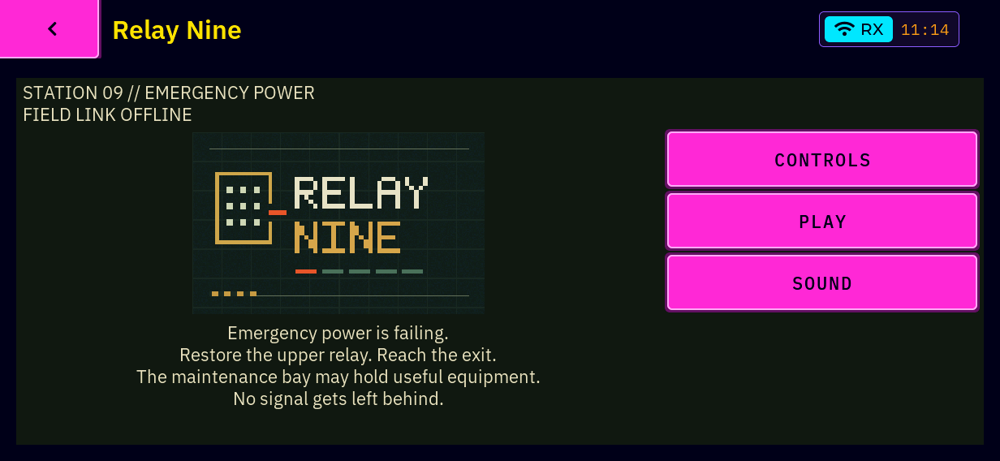
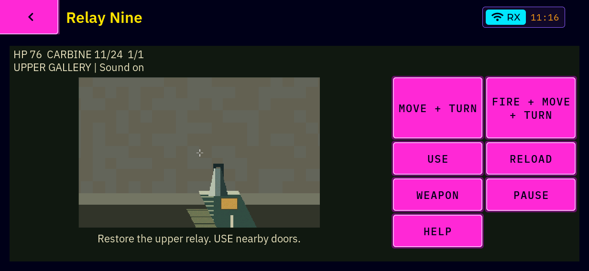
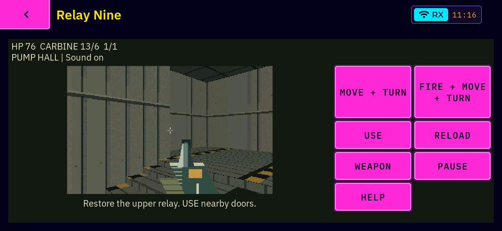

# Relay Nine — first K230 build and unit B device pass

Date: 2026-10-22. PR #104 (draft). Device: unit B, Doors 0.3.6 image with the
owner-approved Neon shell `f398ecb` and its QR LVGL installed (inspected
read-only before testing; see "Unit B" below). Evidence classes follow
AGENTS.md: **VERIFIED** = measured or observed on unit B in this pass.

Three kinds of evidence are kept apart below:

- **Automated device evidence**: scripted runs on unit B (stats file, CPU/PCM
  sampler, panel screenshots, helper exit reports).
- **Owner observations**: one short touch play session, owner's own words/choices.
- **Reused host tests**: the cloud/host results in [RELAY_NINE_POLISH.md](RELAY_NINE_POLISH.md);
  only affected host checks were rerun here.

## Build (pinned SDK, no toolchain installed)

| Item | Value |
| --- | --- |
| Source | `00dc0ab` (`git archive`), `BUILD_ID` file `00dc0ab`, embedded in the shell |
| Toolchain | Xuantie-900 linux-6.6.0 glibc gcc Toolchain V3.0.2 B-20250410, GCC 14.1.1 (pinned SDK) |
| BSP / SDK | `bb831ab358b6…` / `22d02c6b6783…` (WSL `~/work/doors-vendor`) |
| Sysroot | Neon `f398ecb` sysroot, QR LVGL (`LV_USE_QRCODE 1`) |
| Flags | SDK buildroot `-O2 -g0 -D_FORTIFY_SOURCE=1`, CMake Release, DRM display |
| `doors-shell` | sha256 `f2ddec9224fe8d28f6cab4b77648df7ed150db5995481b960852102ec2fd47a1`, 0 warnings |
| `pos-audio-effects` | sha256 `53f3f9fbbc8eadc63a6ca2a07bffd8d2833e2f486524c3278bb7b5284fc22006`, 0 warnings (the helper prints no build id; it is identified by hash) |

Only the two affected targets were built (`pocketos-shell` via CMake,
`tools/audio-effects/pos-audio-effects` via the root Makefile with the SDK
compiler). No package/image build.

Runtime dependencies (`readelf -d`): shell `libcjson.so.1 libm.so.6
liblvgl.so.9 libpthread.so.0 libgpiod.so.3 libdrm.so.2 libevdev.so.2
libatomic.so.1 libc.so.6`; helper `libasound.so.2 libm.so.6 libc.so.6`.
**Compatibility (VERIFIED):** every undefined dynamic symbol (shell 526,
helper 87) resolves, with its symbol version, against the libraries copied
read-only from unit B (`liblvgl.so.9.5.0` `2c4fd81b…`, glibc ≤ 2.33,
libasound, libcjson, libgpiod, libdrm, libevdev, libatomic, libpthread,
loader). No device library was staged or replaced; the kit runs on the
installed LVGL.

The branch was first brought up to date with master by merge commit
`0665de0` (#103, #105, #106; `Makefile`, `ui/shell/CMakeLists.txt`,
`ui/shell/shell.c` merged cleanly, both sides kept).

## Unit B, staging and restoration

Inspected read-only first: `172.16.5.198`, Doors 0.3.6 (`BUILD_ID=9ad64a1`),
installed `/usr/bin/doors-shell` `86d7b017…` (Neon f398ecb) supervised,
`/usr/lib/liblvgl.so.9.5.0` `2c4fd81b…`, `settings.conf` `b040ab0c…`; the panel
held only by the installed shell, no `/dev/snd` owner, no effect helper
installed, no keyboard attached (input devices: power key, BOOT key,
`goodix_ts`). No other temporary session owned the display or audio.

Kit: [docs/hardware/relay-nine-gate/](../hardware/relay-nine-gate/) in
`/root/relay-nine-00dc0ab` (an earlier `/root/relay-nine-1bd693a` holds run A).
`rn-start.sh` records a baseline (settings copy, screenshot list,
`amixer contents`, audio lock/recovery files, hashes of every file under
`/etc/pocketos` and `/var/lib/pocketos`), stops `S90doors-shell` through its
init script and starts the kit shell with `DOORS_AUDIO_EFFECTS_HELPER` (kit
helper; nothing placed at `/usr/bin/pos-audio-effects`) and
`DOORS_RELAY_STATS`. `rn-restore.sh` stops kit processes, runs the helper's
`recover` only if a recovery record appeared, restores `settings.conf`, moves
session screenshots into the kit, diffs mixer/audio files/state, restarts the
supervised installed shell and verifies it.

**Restoration (VERIFIED), after every run including the owner session:**
`RESTORE: OK` — exactly one `/usr/bin/doors-shell` under `pos-supervise`, no
`DOORS_*`/`LD_LIBRARY_PATH` in its environment, panel owner = installed shell,
no audio owner, PCM closed, no `pos-audio-effects` or kit measurement process,
mixer identical to baseline, `audio.lock` present as before and no
`audio.recovery`, screenshot list identical, installed shell/LVGL/settings
hashes `86d7b017…`/`2c4fd81b…`/`b040ab0c…`. The only state differences are the
installed shell's own log files from its stop/start. meshcored, models, other
services and existing rollback folders were not touched; no radio was used.
Both kit directories remain on the unit, inactive, as evidence.

## What was measured, and how

`DOORS_RELAY_STATS=<file>` (new, opt-in, [relay_stats.c](../../apps/neon-outpost/relay_stats.c))
writes one line per 5 s: app timer interval, game step, scene render
(`rn_render`), and the LVGL refresh split into drawing (render minus flush),
flush callback and flush wait — mean/p50/p95/max — plus player pose, weapon,
ammo, stalls > 100 ms and stall auto-pauses. `rn-measure.sh` samples shell
and helper CPU, RSS and the playback PCM every 0.5 s. Input is injected with
`shell.key` as raw keyboard-matrix bytes: the physical keyboard's own path
after the matrix read (key map, game opt-in, release), not key hardware.

## Results (automated device evidence)

Representative 5-s play windows; ms as p50 / p95 (max).

| | Before fixes (`1bd693a`) | After (`00dc0ab`), full level | After, stairs+combat slice | Owner touch session (`00dc0ab`) |
| --- | --- | --- | --- | --- |
| App interval | 33.0 / 34–55 (103) | 30.5–33.3 / 44–51 (76) | 32.1–33.5 / 45–53 (79) | 30.5–33.3 / 39–51 (83) |
| Scene render | 15.9 / 16.5–32.8 | 11.6–13.2 / 23.9–27.2 | 10.3–15.6 / 21.6–30.9 | 11.2–14.3 / 21–30 |
| LVGL draw | 7.0 / 7.5–16.3 | 6.2–6.4 / 11.9–14.5 | 7.3 / 15–17 | 6.4–6.5 / 11.4–16 |
| Flush (+wait) | 2.2 / 2.3–6.3 (+0.02) | 2.2 / 4.2–6.4 (+0.02) | 2.2 / 3.3–5.8 (+0.02) | 2.2 / 3.9–5.6 (+0.02) |
| Stalls > 100 ms | 1 (first frame after open) | 0 | 0 | 0 |
| Shell CPU in play | 80–92 % per 0.5-s sample | peak 74 % per 0.5-s sample | 72 % avg over 30 s | — |
| Title screen idle | 29 % CPU | 1 % CPU | — | — |

- Frame pace is bounded by LVGL's 33 ms refresh: ≈ 30 fps median, ≈ 20 fps
  at p95. Flush is cheap (2.2 ms); the renderer and LVGL's scaled image draw
  dominate. Shell RSS 15.7 MB, high-water 16.6 MB. No auto-pause from a stall.
- Movement, turning and firing together via held keys (VERIFIED): the full
  route moved from the spawn (6.5, 16.0) through the USE-opened door into the
  maintenance bay (−2.3, 11.3); carbine ammo fell while firing; `R` reloaded
  (24 rounds again). Slice: walked up the west stairs to the gallery
  (z 0.00 → 0.75) and killed the machine there (`kills=1`).
- Held-action clearing (VERIFIED): leaving with Home while W+Space were held,
  then reopening and playing with no input for 11 s (run A) and 18 s (slice):
  pose and ammo unchanged, no auto-fire. Pause stops the helper (PCM closed).
- System sound (VERIFIED): mute restarts the helper with volume 0 (`MUTED`, PCM
  closed); unmute restarts it at 100; volume 40 → helper argument 40. Closing
  the game ends the helper; no process or recovery record remains.
- Speaker path (VERIFIED, software side): the kit helper run standalone
  (`rn-audio.py`, no shell) played all ten cues, including both shotgun cues,
  at volume 50 and 100 with **0 xruns** (helper's own count) and one stream
  start; muted opens no PCM. Exit by EOF in 2 ms, PCM closed, no recovery record.

Panel captures (kmsgrab, unretouched; landscape 1232×568, Neon chrome):

| Title | Gallery after the stairs | Pump hall |
| --- | --- | --- |
|  |  |  |

## Owner observations (one touch session, full level, volume 60)

Owner's answers: movement/turning/firing **"Smooth enough"**; touch pads and
buttons **"Good"**; sound **"All OK"** (effects audible, VOL/MUTE effective);
**"Reopen clean"** — nothing moved or fired after leaving and reopening.
The device log shows the run ended in the service lock (HP 0, no kills), so
the owner did not reach the shotgun; the shotgun pickup, switch and reload
boxes were not ticked, and neither was the art/title box. No physical keyboard
was available; keyboard play (including Q) was not tested on hardware.

## Fixes made in this pass

| Commit | Problem found on unit B | Fix | Regression check |
| --- | --- | --- | --- |
| `d7b9577` | Host app test failed without `RELAY_SHOTS` (stale hidden RESTART tap; masked by the documented capture run) | Pump once, check the restart | 651 (no captures) / 748 (captures) checks |
| `1bd693a` | No way to separate render from flush on the target | Opt-in `DOORS_RELAY_STATS` | App test: all fields written, display callback removed on close |
| `254a94e` | Effects helper underran constantly: 88 stream restarts in 7 s standalone, 23 in 42 s in game | Two-period lead, schedule-based pacing, refill after xrun/stall; xrun count on stderr | 26 audio-service checks; device: 0 xruns |
| `64d6bbf` | Scene render 16 ms p50 on K230; plane pass divided for every remaining row per sector | Bound plane rows analytically (+2 spare rows), same per-row test | Identical frame hashes over 3,751 frames (tour + two 360° sweeps); 29,813 engine checks incl. ASan/UBSan; host slice p50 1.27 → 0.75 ms |
| `00dc0ab` | Static title re-rendered every 30 ms (29 % CPU idle) | Draw the title once | App tests; device 1 % CPU |

Audio onset is now ~40–60 ms by design (two queued 20 ms periods); not
measured acoustically.

## Reused host tests (not rerun unless listed above)

The SDL adapter (21), input regression (80), shell smoke and earlier
cloud/host results in [RELAY_NINE_POLISH.md](RELAY_NINE_POLISH.md) are reused.
Rerun here for affected code: engine/renderer/mixer 29,813 (plain and
ASan+UBSan), app 651/748, audio service 26, relay lint, licence audit (only the
known unrelated `tests/hw/mesh_explicit_path_rf.sh` SPDX failure).

## Remaining limitations

- **Shotgun on the device**: pickup, in-game switching, firing and reload of
  the BREACH-2 were not exercised on unit B (scripted runs and the owner run
  ended before the maintenance bay pickup). Its art is the same code path as
  the carbine overlay; both shotgun cues played through the speaker in the
  standalone helper check, but were not confirmed by ear individually.
- **Physical keyboard**: none attached; Q, rollover and key hardware untested.
  Keyboard behaviour was exercised through the injected matrix path only.
- **Frame pace**: ≈ 30 fps median but p95 ≈ 45–51 ms (≈ 20 fps). LVGL's
  scaled image draw (6–7 ms p50, up to 16 ms p95) is the next cost; reducing it
  would change the display path and is left for an owner decision.
- Not covered by this first pass (by scope): HDMI, text-size matrix, portrait
  on device, acoustic onset latency.

## Reproduce

WSL, pinned SDK checkout (see [BUILD_ENVIRONMENT](../BUILD_ENVIRONMENT.md)):
configure `ui/shell` with the SDK `toolchainfile.cmake`, `-DCMAKE_SYSROOT=` the
QR-LVGL sysroot, `-DPOCKETOS_DISPLAY=drm -DPOCKETOS_LVGL_MODE=sysroot
-DCMAKE_BUILD_TYPE=Release`, build `pocketos-shell`; then in the source tree
`make CC=<sdk>/riscv64-unknown-linux-gnu-gcc CFLAGS="-O2 --sysroot=<sysroot>"
LDFLAGS="--sysroot=<sysroot>" tools/audio-effects/pos-audio-effects`. Write
the commit to `BUILD_ID` first. Assemble with
`docs/hardware/relay-nine-gate/assemble_kit.sh <build> <kit>`, update
`kit.env` hashes from a read-only inspection, copy to unit B, then
`./rn-scenario.sh` (or `rn-start.sh <label> [slice]` / `rn-restore.sh`).
