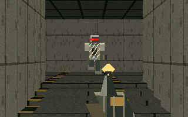
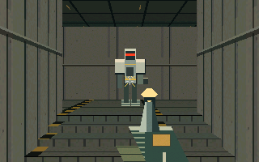
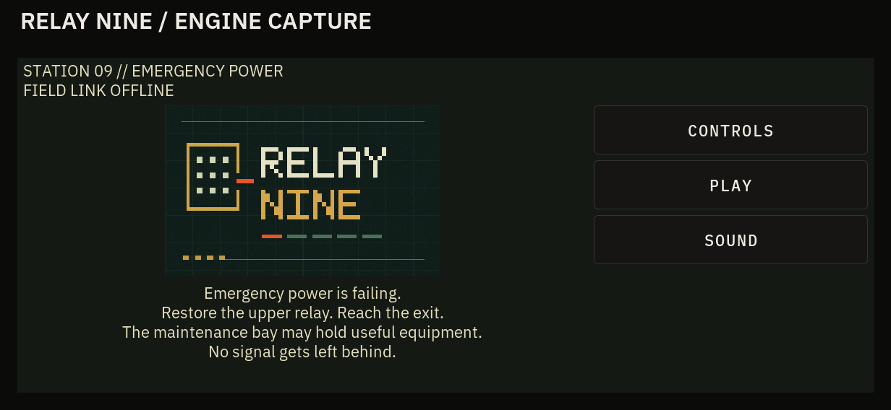
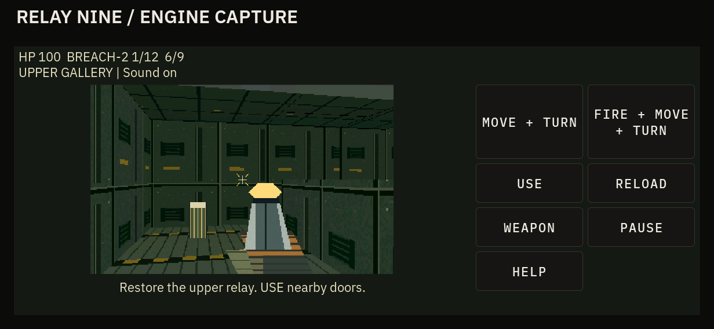
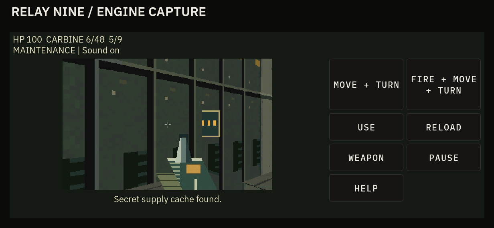

<!-- Copyright (c) 2026 PocketOS authors. SPDX-License-Identifier: Apache-2.0 -->
# Relay Nine: emergency power

This is the implemented polish/content update on the existing draft PR #104,
after `4d5a0ed`. It preserves the sector/portal engine and complete first level.
The original industrial identity remains separate from the Doors interface theme.
No target toolchain was installed and no device was accessed.

Open **Games → Relay Nine**. The new static title has an original nine-contact
relay emblem and pixel wordmark, **PLAY**, **CONTROLS** and **SOUND**. There is
no splash delay. Emergency power is failing: restore the upper relay, then USE
the exit. Victory confirms that power is stabilised and the station is transmitting.
Sound opens an in-game panel wired to existing Doors system volume/mute APIs;
changes affect system state and the next effect session, not a separate game gain.
Back returns to the title/pause menu. Controls and help remain scrollable.

## Actual before/after output

All images below are actual software engine/LVGL captures. None is concept art,
a K230 capture or an image-generation mockup. Native images are 320×200 with
no upscaling, postprocessing or retouching. The unchanged baseline captures are
retained in the parent folder. The approved concept is historical direction only.

| Before, `4d5a0ed` | After, this update |
| --- | --- |
|  |  |
| [Original text-only entry screen](relay-nine/landscape-help.png) | [New logo/title in actual app](relay-nine/polish/landscape-title.png) |







[Portrait title](relay-nine/polish/portrait-title.png) ·
[Portrait combat](relay-nine/polish/portrait-slice-combat.png) ·
[Portrait shotgun](relay-nine/polish/portrait-shotgun.png) ·
[Secret entrance](relay-nine/polish/landscape-secret.png) ·
[HDMI 720p shotgun](relay-nine/polish/hdmi720-shotgun.png) ·
[Victory](relay-nine/polish/landscape-victory.png) ·
[Real shell title](relay-nine/polish/shell-landscape-title.png) ·
[Real shell sound controls](relay-nine/polish/shell-landscape-sound.png) ·
[Native title](relay-nine/polish/native-title.png) ·
[Native shotgun](relay-nine/polish/native-shotgun.png).

## What changed

Steel/concrete textures now share a 32-texel-per-metre scale. Broader panels,
finer surface noise, recessed vents/pipes, sparse chips and slim door safety
bands keep detail restrained. Floors use inset tread panels. Raised floors
retain hazard edges. Amber wayfinding arrows, a station 09 badge and three
warning studs on the scored service panel provide landmarks with tiny masked
sprites; they use existing occlusion and do not add a lighting framework.

Guards have pale shoulder/head plates, dark articulated joints, feet grounded
at the sprite cell base and a clearly separated optic and tool weapon. Scavengers
retain their low, six-legged amber silhouette. Walk phases advance with movement;
attack flashes follow actual discharge. Local hit sparks and a brief crosshair
hit confirmation replace the conspicuous striped hit overlay. Wrecks collapse
at floor level. The carbine now has stronger edge highlights, a brass breech,
ribbed grip and gloved hand. Reload visibly lowers the weapon and returns it;
reduced motion suppresses firing recoil and uses a stationary reload pose. Supplies fill their sprite cells
and sit on the floor, with high-contrast medical/ammunition/weapon symbols.

### BREACH-2 shotgun

One original two-tube close-range weapon, found in the optional maintenance bay:

| Property | Carbine | BREACH-2 |
| --- | --- | --- |
| Magazine/load | 24 rounds | 2 shells |
| Reserve | Start 24, cap 120 | Gun supplies 4, cap 20 |
| Fire interval | 250 ms | 850 ms |
| Reload | 900 ms | 1,500 ms for up to two shells |
| Damage | 25, nearest visible target | Five bearings at −0.07, −0.035, 0, +0.035, +0.07 radians; 24 damage/pellet below 3 m, 14 below 5 m, 7 below 7 m |
| Reach | 40 m trace | Strictly below 7 m horizontal distance |

Every pellet independently uses the existing height-aware portal LOS and chooses
its nearest visible body. Doors, machinery, floors and ceilings still block it.
Pellet placement is deterministic, with no new random generator or particle
system. The two weapons have separate ammunition. A reload transfers rounds only
on completion; switching cancels an unfinished reload. Switching retains firing
cooldown, so it cannot bypass the slower shot interval. Shells collected before
the gun are retained. Picking up the gun equips it once.

**Q** or the new **WEAPON** button changes acquired weapons. The touch pads keep
their previous size and compound actions; USE/RELOAD/WEAPON/PAUSE/HELP remain at
least 64 pixels in all tested layouts. Keyboard selection is a press action,
independent of held movement/turn/fire; it does not repeat while held. Consecutive
touch and keyboard requests work without requiring an idle simulation tick.
Release, lost focus, lock, screen-off and pause retain existing clearing rules.
Q is opt-in only; legacy text behavior remains unchanged without a subscriber.

### Level additions and pacing

The level now has **49 convex sectors**, still below the existing 96-sector /
512-edge bounds, with nine enemies and nine supplies. One pump-hall scavenger
moves into the maintenance bay, easing the first hall encounter and guarding
the optional equipment route. Both original height-changing routes remain.

```text
C gallery +0.75 ---- compressor +0.75 ---- stairs ---- relay control +1.50
     ^                                                        |
 original west stairs                                  original return stairs
     |                                                        v
B pump hall 0.00 ---- relay-unlocked shortcut --------------- return ---- exit
     |
 optional maintenance bay 0.00: scavenger, BREACH-2, shells
     |
 six NEW 0.125 m steps reconnect to C gallery +0.75
     +-- USE scored west panel at +0.50 --> SECRET supply cache
                                            shells and medical cabinet
```

The detour enters west of the hall, south of the original gallery. Its six
steps rise around the corner to the gallery; the secret is a separate side
recess reached through a lifting scored panel, marked by three warning studs.
USE near that panel reveals it; no key or relay state is required. A short
message confirms discovery. Main progression and victory never require this
route, the secret or the shotgun. Ammo is on the bay approach and inside the
cache; the original gallery/compressor/return supplies remain available.

### Sound and bounds

The same helper and four-voice mixer now generate ten cues: the original eight
IDs retain their meanings, with appended shotgun shot/reload IDs 8 and 9. The
carbine has a short mechanical crack; the shotgun has a lower, longer transient
and separate breech/shell clacks. Hit, empty, enemy wind-up/discharge, door and
pickup recipes are refined. Ambience is deliberately omitted to preserve the
four voices for essential feedback. Restoring an already-live relay does not
replay its motor cue. No permanent daemon, per-shot process, new audio backend
or dependency. Expiring nonblocking commands, volume/mute, ownership, clipping
and stop/reap/recovery remain on the existing path. See [API](../api/audio-effects.md).

## Focused validation

The completed baseline is retained in [the original handoff](RELAY_NINE.md).
Only affected checks were built/run for this update:

- **29,813 engine/renderer/mixer assertions**, including both weapons, separate
  ammo and pre-gun shells, switching/reload, nearest hit, shotgun range/falloff,
  closed-door and solid-pump pellet occlusion, enemy damage, terminal guards,
  reachable stairs/secret/main route and mixed sample bounds/distinct recipes.
- Complete input-only production-logic tour, no teleport/state edits: **4,621
  steps / 46.21 simulated seconds**, nine kills, shotgun acquired and fired,
  secret found, relay restored and exit reached, HP 100, carbine 24/76.
  A separate ordinary route wins in 4,141 steps without shotgun or secret.
  Scripted times are not human play-time estimates.
- ASan + UBSan pass the affected engine/renderer/mixer suite. Leak detection
  remains disabled because this executor cannot run LeakSanitizer under tracing.
- **739 real LVGL assertions**, Small/Medium/Large × portrait/landscape/720p:
  title, sound volume/mute, controls, usable button bounds, real touch and
  keyboard selection (including adjacent presses), compound movement/turn/fire,
  release/press-lost, pause, source loss, redirects, lock/screen-off, death,
  restart, victory and twelve playing/held closes with child/timer cleanup.
- **21 actual SDL adapter checks** including Q with simultaneous movement/turn/
  fire and releases; **80 existing input regression checks** pass. Unchanged
  physical-key/keymap baseline results are reused, not claimed as newly rerun.
- **26 actual audio-service checks** pass with both new weapon cues sent to an
  ALSA file/null sink: nonzero limited PCM, mute, exclusivity, EOF/SIGTERM,
  SIGKILL/recovery and stale-event silence. This verifies software output,
  **not physical speaker playback or latency**.
- Real shell smoke passes portrait, landscape and 720p at Large: title/SOUND/
  CONTROLS, gameplay, physical raw chord/release, pause, Back/Home and reopen.
  All three gameplay layout audits have zero issues. Focused architecture and
  diff whitespace checks pass. Native and app captures were visually inspected.

One bounded final review fixed pre-gun shell retention, repeated relay audio,
selection across touch/keyboard events, floor anchoring/readability of supplies
and a helper build rule that could pass dependency headers to the linker.
No unrelated apps, vendor files or baseline failures were changed. The existing
missing-SPDX failure on `tests/hw/mesh_explicit_path_rf.sh` remains known; the
unrelated broad audit was not rerun for this update.

## Comparable host cost

| Fixed-scene host CPU time | Baseline `4d5a0ed` | Updated |
| --- | --- | --- |
| Median p50 | 2.237 ms | 2.226 ms |
| Median p95 | 2.317 ms | 2.472 ms |
| Median p99 | 3.226 ms | 2.732 ms |

`tests/relay_render_bench.c`, GCC `-std=c11 -O2`, same host and representative
slice, 20 warm-up renders then 400 timed frames over the same twenty yaw angles;
three alternating before/after runs, no audio/LVGL/flush in this benchmark.
The baseline source/headers come directly from `4d5a0ed`; the final source is
this update. The table reports the median of each run's percentiles. This is
an observation under these host conditions, not a speedup guarantee. Host tails
vary between runs; these numbers do not establish any K230 frame rate or latency. No
increased resolution, extra framebuffer, external engine or expensive light pass.

The pure game allocation grows **21,144 → 21,312 bytes**; color/depth frame stays
**256,016 bytes** including counters, and the six cached textures stay 49,152
bytes. The fixed helper mixer grows **307,288 → 384,096 bytes** for two additional
sample banks; four voices, 32-command reads and 960-frame writes remain fixed.
The UI coalesces at most ten 8-byte events/frame. The logo reuses the existing
framebuffer. Map capacities and per-column traversal cap remain unchanged.

## Reproduce and remaining local checks

Use the host commands in [the handoff](RELAY_NINE.md#reproduce-on-a-prepared-host).
Set `RELAY_SHOTS=docs/apps/relay-nine/polish` and
`SHOTS_DIR=docs/apps/relay-nine/polish` to regenerate the new captures. The new
benchmark builds with:

```sh
gcc -std=c11 -O2 -Wall -Wextra -Werror -Iapps/neon-outpost -Icore \
  tests/relay_render_bench.c apps/neon-outpost/relay.c \
  apps/neon-outpost/relay_render.c apps/neon-outpost/relay_art.c \
  -lm -o out/relay-nine/render-bench
out/relay-nine/render-bench
```

The pinned Xuantie V3.0.2 toolchain remains absent here. The exact remaining
local package build is unchanged: set `POCKETOS_VENDOR_DIR` to the prepared
pinned WSL checkout, run `platforms/k230/scripts/apply_to_sdk.sh`, then
`platforms/k230/scripts/build_image.sh "" pocketos-rebuild`. Verify DRM shell
and `/usr/bin/pos-audio-effects` in the package. No replacement toolchain,
installation or deployment is part of this update.

**Update 2026-10-22:** the first K230 build and unit B device pass are recorded in
[RELAY_NINE_DEVICE.md](RELAY_NINE_DEVICE.md); the paragraph below is the state before it.

The hardware gate remains **UNVERIFIED for this update**: actual K230 renderer +
LVGL/flush timing tails and memory; keyboard rollover including Q with movement/
fire; single-pointer release/focus handling; physical speaker playback, both
weapon cues, volume/mute, onset tails, underruns and audio-owner recovery.
Host CPU and file/null audio cannot establish those. No device access,
deployment, merge or release was performed.

## Provenance

The new logo, lettering, materials, enemies, weapons, supplies and signs are
original hand-authored first-party pixel recipes in `relay_art.c`, under
Apache-2.0. No generated concept pixels, game assets, copied Doom material or
external asset pack is used. Existing Doors chrome/fonts retain their terms.
The logo PNGs are captures of that recipe in the actual app, not source rasters.
All PNGs follow the existing `docs/apps/*` CAPTURE inventory rule.

[effects.wav](relay-nine/polish/effects.wav) is revised original mixed PCM from
the production service on a host ALSA file/null sink. Its sequence is carbine,
shotgun, carbine reload, shotgun reload, impact, empty, wind-up, attack, door,
pickup. The deterministic source seed remains `0x52454c41 + kind*117` in
`core/audio_effects/effects.c`. Inventory explicitly marks it ORIGINAL.
SHA-256: `955c702c270c2754688c3fd6011cc1f0481144fc72cf10aac2b4397909911ffc`.
This is software output evidence, not a device recording or onset benchmark.
