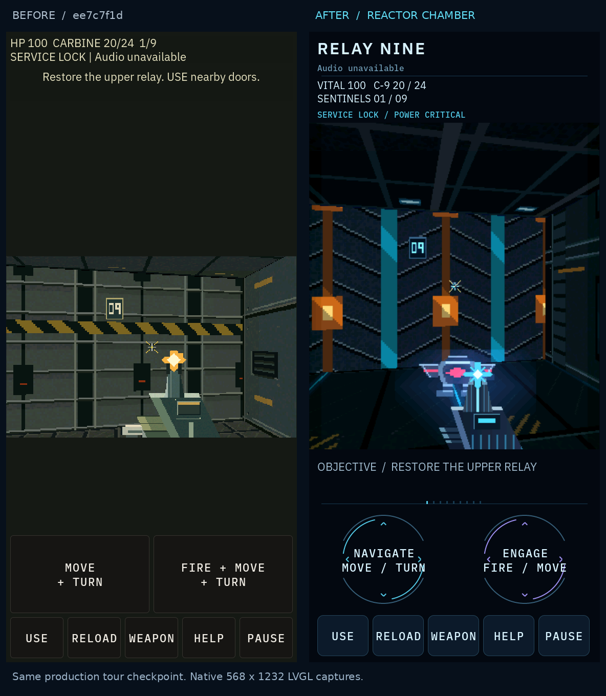
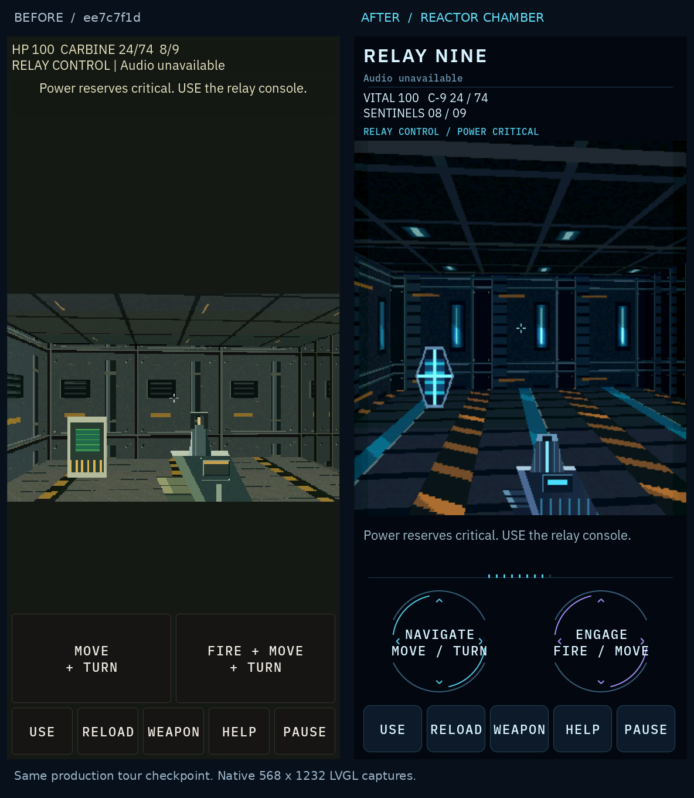
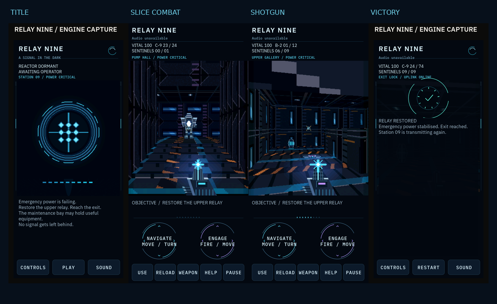
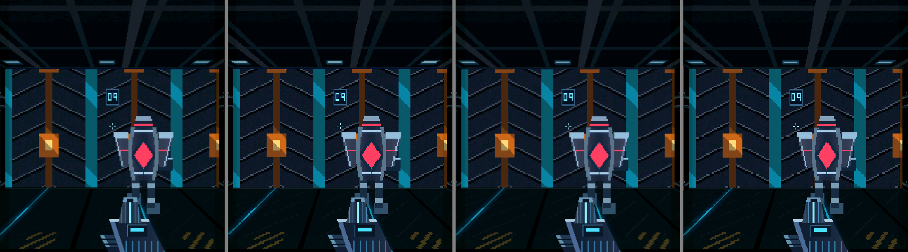
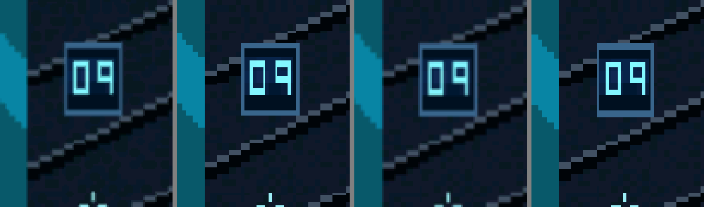

<!-- Copyright (c) 2026 PocketOS authors. SPDX-License-Identifier: Apache-2.0 -->
# Relay Nine — Reactor Chamber visual remake

Implemented 2026-11-15 against `ee7c7f1d`. This document describes the current
presentation; earlier Relay Nine design and performance sheets describe their
recorded versions. **Merged in PR #133 and released in Doors 0.4.0; measured
on unit A ("K230 measurements" below).**

## Game and art direction

The actual game is a first-person sector shooter, with height-aware sightlines,
working stairs, moving doors, windup telegraphs, two weapons, optional equipment
and a secret route. Restoring the upper relay unlocks the return journey to the
exit. Its mechanics, world geometry, collision, enemy navigation, damage, ammo,
sound events and fixed 10 ms simulation remain in the unchanged `relay.c`.

The new direction is an optical chamber inside an emergency reactor: black
basalt, layered ceramic armor, blue superconducting spines, violet machinery,
exposed sentinel cores and amber locks. It replaces every material recipe,
weapon, pickup, machine silhouette and title illustration. Cyan communicates
current, pink hostile cores/damage, amber windup/locks, green recovery and restored
power, and violet the second weapon. These cues supplement the written HUD.

The portrait viewport changes from 320×200 to **320×360 RGB565**. The horizontal
projection and optical center stay the same; the camera sees more ceiling and
floor. It is scaled uniformly into the portrait optical chamber, with readable
instruments above, an objective strip below, two circular compound touch pads,
and a separate action row. Landscape and HDMI have side consoles. There is no
stretching, crop, altered aiming or change to touch axes. Touchable pad rectangles
retain their full area; the circles are visual affordances. Action targets are
at least 80 px tall in gameplay, 72 px in menus.

The typography uses the existing generated IBM Plex fonts. No font, image,
engine, SDK or runtime dependency is added. The six albedo/emission maps and
original procedural silhouettes are first-party recipes in `relay_art.c`.

## Rendering decision

| Approach | Benefit | Cost / decision |
| --- | --- | --- |
| Existing portal renderer + LVGL | Already handles real sector heights, doors, per-pixel sprite occlusion and display handoff | Retained and extended locally to the game |
| Individual LVGL world objects | Crisp interface shapes | Does not solve textured 3D visibility; creates many objects and invalidations |
| GPU / replacement engine | Potential richer lighting and geometry | No verified accelerated game API or compatible engine in the pinned build; new dependencies and display integration would need separate justification |
| Full-resolution software scene | More fine detail | 568×1232 color/depth alone would be 2.67 MiB and over six times this scene's samples; unjustified before device measurement |

The renderer still draws into one owned image and depth buffer. The shell's
DRM, evdev and audio ownership are unchanged. The existing game style extension
in `pos_styles.c` holds the cockpit roles and authored ink palette; unrelated
application styles are unchanged. No direct
hardware access or worker thread is introduced.

## Motion, light and load control

- Cached 64×64 albedo and independent emission maps retain light in dark rooms.
  A bounded current sweep follows surface texture coordinates. It uses the
  simulation clock, freezes on pause, and becomes static with Reduced Motion.
- Room tint, integer distance haze and edge falloff give spatial separation.
  A 4×4 light-cell field spreads short cyan halos from bright sources; there is
  no full-resolution convolution, shadow solver or per-frame heap allocation.
- Nine depth-tested impact particles disperse from the original impact point.
  Muzzle light, the redesigned shot crown, segmented glove, recharge/ejection
  poses, reticle and broader damage edges respond to existing game timers.
- Sentinel carapaces expose red cores, amber windups and pale hit responses.
  The existing directional, gait, attack and collapse states select the art.
- Success/failure get distinct rings, a check or fractured cross, and a 1.4 s
  eased expansion. Restart/menu input stays active. Reduced Motion shows a
  static emblem. These effects reuse the existing app timer.
- Four scene renders over 24 ms, or eight gameplay intervals over 45 ms, enable
  economy mode. It samples alternate world columns, reconstructs their depth,
  omits the optional halo pass and scales the scene nearest-neighbour instead
  of filtered (see "App-side scene scaling" below). Sprites, weapon,
  reticle, interaction and simulation retain their resolution and cadence.
  Full detail is probed again after a quiet run of 180 frames: intervals of at
  most 40 ms **and** renders under 14 ms. Renders in economy are cheap by
  construction, so a render-only exit (the first version) returned to full
  detail every 180 frames even when full detail was what made the intervals
  long. When economy returns within 300 frames of a probe, the next quiet run
  needed doubles, up to 2,880 frames (~96 s); 900 frames of full detail reset
  it. `apps/neon-outpost/relay_economy.h` holds the rules and
  `tests/relay_engine_test.c` drives them, including the load that made the
  first version cycle. `DOORS_RELAY_STATS` reports `economy=` (frames drawn in
  economy) and `entries=` per window. Thresholds are conservative **ASSUMED
  device tuning**, not a K230 performance claim.
- Static labels, styles, title art and framing are only invalidated when their
  values or geometry change. Animated scene pixels still invalidate their own
  image; in steady play that rectangle is the only dirty area
  (`neon_app_test` records LVGL's invalidations). The portrait kill ticks lie
  outside every widget that changes in play, so a kill or the relay
  invalidates their strip explicitly; before, they stayed stale until
  something else repainted it. Audio and input continue through the existing
  foreground lifecycle.

## Visual evidence

These are actual LVGL captures at the same production-tour checkpoints, using
Large text at native 568×1232. The old 8:5 viewport and the new tall viewport
are intentionally shown at their real sizes. They are not concept art.







[Production renderer motion](relay-nine/remake/gameplay.gif) and
[fixed-camera surface current](relay-nine/remake/energy-current.gif) are captured
from the actual rendering functions. The first follows the deterministic pilot;
the second advances only the visual clock in a fixed camera fixture. GIF timing
illustrates animation and is not a measured device frame rate.

The comparison shows a different world material language, object silhouettes,
weapon construction, camera composition, lighting and control presentation.
The remaining deliberate limitation is software-rendered detail at 320 pixels
across. Filtered scaling softens fractional magnification, but this does not
establish final on-glass quality or readability. (These captures predate
app-side scaling; its output against LVGL's is compared below.)

## Host performance and memory (VERIFIED here)

GCC 14.2.0, `-O2`, Linux x86-64, process CPU time; 400 timed frozen-state renders
following 20 warmups and identical view bearings. Full replay: 2,027 frames per
variant, including the full tour, two 360° sweeps, both reloads and Reduced Motion.
All variants finish the tour in **4,621 steps**, health 100, nine kills and ammo
24/76. The optional-free main route still wins in **4,141 steps**.

| Frozen state | Before p50 / p95 ms | Full detail p50 / p95 ms | Economy p50 / p95 ms |
| --- | --- | --- | --- |
| Stairs | 1.20 / 1.71 | 3.51 / 6.12 | 1.95 / 2.66 |
| Closed door | 1.13 / 1.44 | 3.30 / 5.56 | 2.00 / 2.63 |
| Shotgun discharge | 1.26 / 1.61 | 3.48 / 5.59 | 2.07 / 2.67 |
| Gallery | 1.22 / 1.57 | 3.64 / 5.89 | 2.15 / 2.97 |
| Upper control | 1.21 / 1.54 | 3.41 / 4.28 | 2.01 / 2.63 |

The new frame contains 1.8× as many pixels and additional light/effect work.
This is a quality/cost tradeoff, not a speedup over the old art. Raw results:
[before](relay-nine/remake/before-timing.txt),
[full detail](relay-nine/remake/after-timing.txt),
[economy](relay-nine/remake/economy-timing.txt).

The isolated antialiased LVGL image bench measures 4.05 ms p50 / 4.84 ms p95 at
400/256 scale with a no-op flush ([raw](relay-nine/remake/image-bench.txt)). It
excludes the rest of the cockpit, DRM and physical scanout. Larger test scales
may clip to that bench's 1280×720 display. These numbers cannot predict K230 FPS.

## K230 measurements (Unit A, Doors 0.3.9, 2026-11-15; VERIFIED there)

The renderer was then made cheaper without changing a pixel: no libm
`floor()` call per texel (on rv64gc it is not inlined), a floor/ceiling row's
plane distance and shade computed once per sector run instead of per pixel,
the depth test before shading, texture and emission from one lookup, and a
haze pass that skips unchanged pixels. The replay hashes are unchanged on the
host and on the K230 (`frame-fnv1a=53b28074aadd6072`; both-mode hash
`809124e4961f0715` / `49ece37a076c24f5`).

| `relay_render_replay`, K230, `-O3`, CPU ms p50 | First version | Now |
| --- | ---: | ---: |
| Stairs / closed door / shotgun | 28.8 / 30.8 / 31.3 | 19.0 / 18.3 / 19.6 |
| Gallery / upper control | 33.9 / 33.2 | 20.7 / 19.3 |
| Tour average, full detail / economy | 29.0 / 15.8 | 18.3 / 11.3 |

In the shell, on the Relay Nine gate's route (`rn-drive.py`, in-play 5 s
windows, same session as a master control run):

| | master | first version | now |
| --- | --- | --- | --- |
| frame interval p95 | 44.0-44.2 ms | 58.4-62.9 ms | 52.9-56.6 ms |
| scene render p50 | 10.4-10.7 ms | 16.6-18.7 ms | 11.9-12.8 ms (economy) |
| LVGL draw p50 | 7.2 ms | 13.4 ms | 14.0 ms |

Economy now enters once per session and stays (`entries=0` after the first
window): no on/off cycling. What still holds the interval above master is
LVGL drawing the taller scaled image: 568×639 against master's 568×355, the
1.8× of its draw time. Antialiasing is about 2 ms of it (an experiment build
with it off throughout: draw p50 12.0 ms, interval p95 50.8-52.5 ms).

### App-side scene scaling

LVGL's software image transform resamples every pixel through a generic
per-pixel inverse mapping. The app now scales the 320×360 frame itself
(`apps/neon-outpost/relay_scale.c`) into a buffer of exactly the drawn size,
and LVGL draws that unscaled: on the K230's RGB565 display it is a line copy.

- Sampling is pixel-centre aligned (a same-size target is an exact copy).
  Full detail is bilinear with 1/32 weights on packed RGB565, rounded, in two
  separable passes; each filtered source row is computed once. Economy is
  nearest-neighbour, copying repeated rows. These replace LVGL's antialiased
  and non-antialiased transforms, which full detail and economy used before.
- The buffer is rescaled only when a new frame was rendered or the view
  changed size; the title and menus are not rescaled every frame.
- If the buffer cannot be allocated, the app falls back to LVGL's transform of
  the native frame at the same placement. `DOORS_RELAY_LVGL_SCALE=1` selects
  that path on purpose, for A/B measurement with one binary.
- `DOORS_RELAY_STATS` adds `scale_ms` (the app-side scaling).

Isolated, `tests/relay_scale_bench.c`: the portrait view (567×638 at
454/256) on a 568×1232 RGB565 DIRECT-mode display, no-op flush, CPU ms p50 at
two view bearings ([raw](relay-nine/remake/scale-bench-k230.txt)):

| Unit A, `-O3` | Full detail | Economy |
| --- | ---: | ---: |
| LVGL transform | 21.7-25.5 (antialiased) | 12.5-14.0 (nearest) |
| App scaling + LVGL copy | 5.9 (filtered) | 1.8 (nearest) |
| of which app scaling | 5.4 | 1.4 |

Fidelity against LVGL's output at the same placement (inner area, 8-bit
units): filtered vs LVGL antialiased differs by 1.5-1.9 on average (PSNR
32.7-34.2 dB), less than LVGL's own nearest vs antialiased (1.6-2.2,
30.3-32.7 dB). The differences are sampling phase (LVGL does not centre-align
pixels), not a different filter. Bit-identical on host and K230. Against an
exact floating-point bilinear reference, `relay_engine_test` bounds the
filtered output to three steps per channel, 0.25 steps on average (the
integer rounding itself), with no overshoot past the four source neighbours.





In the shell on Unit A (Doors 0.3.9 image, master `06975053` with #131 and
#132 merged, plus this PR). Gate route, fully playing 5 s windows at
t = 20/25 s, two interleaved runs of each in one session. "LVGL scaling" is
the same binary with `DOORS_RELAY_LVGL_SCALE=1`:

| | master | LVGL scaling | app scaling |
| --- | --- | --- | --- |
| frame interval mean | 34.1-34.3 ms | 35.1-35.6 ms | 30.6-30.9 ms |
| frame interval p95 | 42.7-44.2 ms | 49.7-54.9 ms | **33.3-35.7 ms** |
| frame interval max | 46-63 ms | 57-67 ms | 43-54 ms |
| scene render p50 | 10.4-11.3 ms | 11.2-12.9 ms (economy) | 11.9-12.8 ms (economy) |
| scaling p50 | - | - | 1.32-1.37 ms (nearest) |
| LVGL draw p50 / p95 | 7.2 / 14.8-15.5 ms | 12.0 / 23.7-27.4 ms | 0.48-0.49 / 0.80-0.85 ms |
| shell CPU in play, average / 0.5 s peak | 21-23% / 72-74% | 27-28% / 90-92% | 21% / 64-66% |

Standing still in full detail until the sentinels win (24.35 s of game time,
the same in every run): scene 21.2 ms p50, filtered scaling 5.4 ms, draw
0.5 ms, interval p95 32.4-32.8 ms (master in the same phase: 33.8-35.1 ms).

Economy entered once per route session, when combat started (t ≈ 15 s), and
stayed (`entries=0` in every later window, no exits); it never entered in the
standing sessions. The thresholds in `relay_economy.h` are unchanged.

End of run: the emblem's 1.4 s expansion redraws only its own square. In the
5 s window after a death on the route (no play frames in it), those frames
draw in 2.19-2.25 ms p50, 2.47-3.08 ms p95, with app scaling, over the menu's
20%-opacity scene. With LVGL scaling the death fell inside a window with play
frames, so its emblem frames could not be separated; the first version's
whole-screen redraw was not re-measured.

| Memory | |
| --- | ---: |
| Scaled buffer, portrait 567×638 | 723,496 B |
| Maps, packed source row and two filtered rows | 11,872 B |
| Total, while the app is open | 735,368 B |
| Shell RSS high-water in play, LVGL / app scaling | 16.1-16.3 / 17.1-17.2 MB |
| Shell RSS after 5 open/play/close cycles | flat in every run |
| Unit A MemAvailable | 928 MB |

| Fixed allocation | Before | After |
| --- | ---: | ---: |
| Game state | 21,312 B | 21,312 B |
| Color + depth + counters | 256,016 B | 460,816 B |
| Material and shading tables | 68,448 B | 117,600 B |
| Sum above, excluding LVGL/audio/objects | 345,776 B | 599,728 B |

The added fixed storage is 253,952 B. The light-cell field uses a bounded 7,200 B
local array; GCC's [stack report](relay-nine/remake/relay_render.su) gives 7,176 B
for that function after optimization. This is compile-time/host evidence, not a
measurement of total device RSS, CMA or frame high-water marks.

## Validation and reproduction

VERIFIED on this host:

- Full SDL shell build; focused changed code compiles with `-Wall -Wextra -Werror`.
  Initial full-shell build reports existing warnings in unrelated applications.
- `make CC=gcc relay-nine-test`: engine 32,201 checks (including the scaler:
  same-size copies, flat colour, nearest picks, the bilinear reference bound,
  no overshoot, size limits); visual invariants 745 checks; actual
  service/ALSA file-output audio 26 checks.
- `make CC=gcc relay-nine-san-test`: both engine and visual checks pass under
  AddressSanitizer/UndefinedBehaviorSanitizer.
- `neon_app_test`: 1,280 checks without captures across Small/Medium/Large,
  568×1232, 1232×568 and 1280×720; touch movement/turn/fire, releases,
  focus/lock/screen-off, switching, pause/restart, title/help/sound, full
  route, death/victory, repeated close/reopen, timer/event cleanup and load
  fallback. In play the drawn image is checked pixel for pixel against
  `rn_scale` of the current frame; LVGL's path (`DOORS_RELAY_LVGL_SCALE`)
  puts the scene in the same place in play and in a menu; a steady frame
  invalidates only the scene; a kill invalidates the kill-tick strip (this
  check fails without the fix).
- `relay_sdl_input_test`: 21 physical key translation/held-input checks.
- `neon_shell_test.sh`: real-shell all-layout/all-text-size overlap audits,
  full-screen/menu transitions, pointer, physical key path, Back/Home and reopen.
  A final Large run also passes after the layout and redraw refinements.
- Rendering remains deterministic, does not mutate the game, preserves depth
  while animating current, freezes that current under Reduced Motion, and
  retains sentinel occlusion behind low walls in both detail modes.
- `text_size_ui_test`: 199 shared style checks, zero failures.
- `style_lint.sh`, `neon_outpost_lint.sh`, `license_audit_test.sh` and
  `git diff --check` pass. (Merged with current master, `license_audit_test`
  reports master's own unclassified PR #130 screenshots, as master does.)

Normal simulator commands from a host with the documented development packages:

```sh
cmake -S ui/shell -B work/relay-shell -DCMAKE_BUILD_TYPE=Release
cmake --build work/relay-shell --target pocketos-shell neon_app_test \
  relay_visual_test relay_sdl_input_test relay_image_bench relay_scale_bench -j6
make CC=gcc relay-nine-test
make CC=gcc relay-nine-san-test
mkdir -p work/relay-shots
RELAY_SHOTS="$PWD/work/relay-shots" work/relay-shell/neon_app_test
SDL_VIDEODRIVER=dummy work/relay-shell/relay_sdl_input_test
SHELL_BIN="$PWD/work/relay-shell/pocketos-shell" TEXT_SIZES='small medium large' \
  bash tests/neon_shell_test.sh
```

Here the required Debian development headers and CMake executable were unpacked
under `work/` because the managed machine lacked them. Runtime libraries, pinned
LVGL and the application dependency versions were unchanged. Frozen renders use
`tests/relay_render_replay.c`; the reference sources were exported from
`ee7c7f1d` into `work/` and compiled separately, never swapped into the live tree.

## Remaining device gate

VERIFIED on Unit A (Doors 0.3.9 image `c03795ce`; shell cross-built with the
pinned SDK in sysroot mode and run from a kit through the
[isolated Relay Nine gate](../hardware/relay-nine-gate/rn-start.sh), nothing
under `/usr` changed, restored after each run): the RISC-V/DRM build, frame
pacing and draw cost on the gate route and standing to death, economy
behaviour, end-of-run redraw, shell RSS over repeated open/play/close, audio
helper lifecycle, pause, and leaving while keys are held. Input was injected
through `shell.key`, the physical keyboard's path after the matrix read.

**Not verified** (needs a person at the panel): AMOLED appearance of the
filtered scaling, the circular pads under a finger, and Small/Large text on
glass. The 0.3.9 image has `LV_USE_SNAPSHOT 0`, so no panel captures were
possible; the scaling comparison above is from LVGL's own renderer on the host
and the K230 bench. Thermal behaviour over long sessions was not measured.

To repeat a device run: build the exact candidate snapshot with the pinned
SDK, keep the installed binary and its hash, stage a separate kit, start it
with `rn-start.sh` and restore with `rn-restore.sh`. Use `DOORS_RELAY_STATS`
for interval/render/scale/draw/flush windows and `DOORS_RELAY_LVGL_SCALE=1`
for LVGL's scaling in the same binary; unset it before `rn-restore.sh`, which
restarts the installed service from the calling environment. There is no
reason to reflash the SD image for this app-only gate.
