<!-- Copyright (c) 2026 PocketOS authors. SPDX-License-Identifier: Apache-2.0 -->
# Relay Nine rendering and native artwork

Host evidence, 2026-10-22. Base: verified `origin/master` `7ee12b3e` (merged
PR #104). Performance-only source: `6018dbf`; artwork: `9068361`. The existing
[device baseline](RELAY_NINE_DEVICE.md) and [content handoff](RELAY_NINE_POLISH.md)
remain the history of their respective runs. No device access, deployment,
toolchain installation, merge or release was performed in the host pass; the
later local K230 comparison on unit B is in
[its own section](#k230-comparison-on-unit-b-2026-10-26).

## Changes and measured costs

Sampling `gprof` on the existing stair/combat slice attributed approximately
33% of sampled self time to `rn_texture`, 15% to `put`, and 7% to room tinting.
Instrumentation changes absolute timings; these proportions only identified
candidates. Uninstrumented comparisons below determine the retained changes.

- Two fixed channel tables replace the exact integer shade arithmetic for
  RGB565's 32/64 component levels and 201 supported light values. Material
  recipes, clamping, texture wrapping and room tinting retain their output.
- Wall spans calculate constant depth and texture U once per column, and
  reject hidden pixels before texture work. Plane row bounds, portals, depth
  units, sprite occlusion and traversal caps are unchanged.

These changes do not add a framebuffer or per-frame allocation. The tables
add exactly **19,296 bytes** of static storage, initialized with the six existing
textures. Game allocation remains **21,312 bytes**, frame **256,016 bytes**,
textures **49,152 bytes** and helper mixer **384,096 bytes**. No audio code,
simulation, map, controls, frame cap or resolution changed.

The final artwork refines recessed steel vents, pipe collars, bolt highlights,
warmer stained concrete, door ribs and quieter floor trim. Raised edges keep
their existing hazard markings. Guard shoulders/head have bevels, recessed
optics and visible knee plates; scavengers have articulated foot tips and a
beveled shell. Both weapons have distinct barrel/sight/receiver construction,
glove seams, a compact hot-core muzzle crown and an open chamber/breech during
reload. Reload lowering is restrained so the open mechanism stays visible.
Existing simulation timers select every pose; reduced motion keeps a fixed
reload pose and suppresses recoil as before. The world palette remains
independent of the DOORS theme.

## Comparable host measurements

| Scene | Base p50 / p95 / p99 | Performance only | Final artwork |
| --- | --- | --- | --- |
| slice | 1.260 / 1.559 / 3.209 | 1.024 / 1.496 / 2.898 | 0.999 / 1.279 / 1.664 |
| closed-door | 1.161 / 1.555 / 2.401 | 0.908 / 1.195 / 2.265 | 0.907 / 1.101 / 1.359 |
| shotgun | 1.307 / 1.611 / 2.413 | 1.074 / 1.423 / 1.827 | 1.079 / 1.487 / 2.440 |
| gallery | 1.235 / 1.529 / 1.989 | 1.018 / 1.315 / 1.707 | 1.023 / 1.411 / 1.862 |
| upper | 1.136 / 1.376 / 1.524 | 0.930 / 1.175 / 1.467 | 1.046 / 1.389 / 2.698 |
| carbine-reload | 1.325 / 1.608 / 2.369 | 1.116 / 1.633 / 2.012 | 1.121 / 1.405 / 1.705 |
| shotgun-reload | 1.327 / 1.690 / 2.134 | 1.164 / 1.547 / 1.828 | 1.086 / 1.406 / 1.962 |

Values are medians of each run’s percentiles, in milliseconds. Final p50
is 8–22% lower across these fixtures. The stair-slice p50 run range is
1.210–1.318 ms before and 0.994–1.115 ms final; its p95 range is
1.541–1.841 → 1.208–1.575 ms. Tails overlap and are not uniformly improved:
upper-room p95 is essentially unchanged (1.376 → 1.389 ms) and its median
p99 is worse (1.524 → 2.698 ms), with overlapping run ranges of
1.472–4.192 → 1.436–4.080 ms. No uniform tail-latency win is claimed.

Replay peak RSS: base **1,404 KiB** in all three runs; performance only
**1,428 KiB**; final **1,428–1,436 KiB**. This is the replay process, not shell
or device memory. Static replay BSS is **433,152 → 452,448 bytes**; the exact
difference is the 19,296-byte channel tables. Code text grows separately;
[section sizes](relay-nine/render-polish/size.txt) retain all three binaries.

CPU timings use GCC 14.2.0, `-std=c11 -O2 -Wall -Wextra -Werror`, on the same
AMD EPYC 9V74 host. Each frozen scene uses the same camera, gameplay state and
twenty yaw offsets, 20 warm-up renders, then 400 timed frames. Seven fixtures
cover closed doors, stairs/robot, shotgun discharge, gallery, raised control
room and both reload poses. Three rounds alternate baseline → performance →
final, then reverse order, then forward order. No builds or other test suites
run concurrently. CPU time excludes hashing, captures, LVGL, flush and audio.
Host scheduling/cache conditions still vary; tails are reported, not selected
away. The raw [runs](relay-nine/render-polish/runs.json) retain every percentile
and peak RSS sample, including the performance-only intermediate version.

LVGL's path was inspected separately: mutable RGB565 source, nearest-neighbor
image scaling with antialiasing disabled, cache invalidation for changed pixels,
and a scale setter that already returns early when its value is unchanged.
The isolated `relay_image_bench` measures actual LVGL draws to the existing
partial RGB888 display buffer with a no-op flush. Release build (`-O3
-DNDEBUG`), pinned LVGL `59dc7e4`, 20 warm-ups and 200 samples, three runs:

| Image scale | Median of run p50 / p95 / p99, ms |
| --- | --- |
| 1× | 0.007 / 0.010 / 0.070 |
| 1.5625× | 0.912 / 1.447 / 2.259 |
| 2.5× | 2.173 / 3.081 / 4.305 |

[Raw LVGL results](relay-nine/render-polish/lvgl.txt). Scaling remains a
substantial cost. A pre-scaled app buffer would add output-sized storage and
another copy, plus exact sampling/rounding obligations; this pass retains the
measured renderer savings without that tradeoff. No LVGL, shared display or
app scaling behavior changed. These isolated costs are not shell/DRM timings,
and do not measure K230 display flush or physical input latency.

## Actual matching engine captures

All paired images are unretouched production renderer output at **320×200**,
saved from identical frozen gameplay states by `relay_render_replay`. Viewport,
camera and game state match; differences are intentional artwork. These are
host engine captures, not concepts or device photographs. Inspect at native
scale as well as enlarged. The stair view shows occlusion, tread edges
and the guard; the shotgun view is a production-tour discharge.

| Base `7ee12b3e` | Finished artwork |
| --- | --- |
| 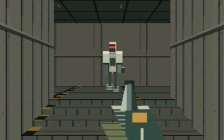 | 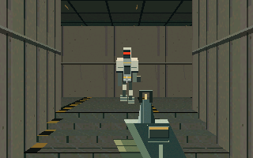 |
| 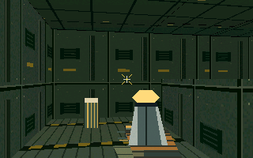 | 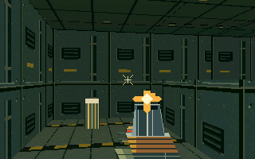 |
| 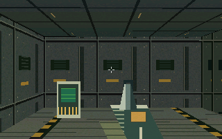 | 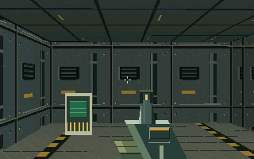 |
| 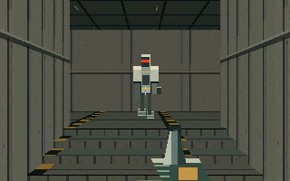 | 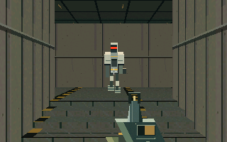 |
| 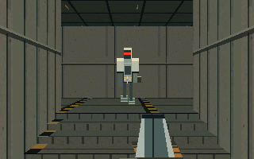 | 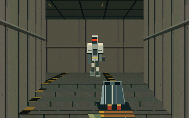 |

Actual final shell output with Large text:
[portrait](relay-nine/render-polish/shell-portrait-gameplay.png),
[landscape](relay-nine/render-polish/shell-landscape-gameplay.png),
[1280×720 HDMI layout](relay-nine/render-polish/shell-hdmi720-gameplay.png).
Shell smoke screenshots use timed input; the exact-state comparisons are the
native pairs above. Layout audits are saved alongside the captures.

## Focused validation

- `relay_render_compare.sh 7ee12b3 6018dbf`: entire color/depth buffers and
  counters match over **2,027 frames**, consisting of 463 sampled full-tour
  frames, two 720-frame 360° sweeps and 124 weapon/reload/reduced-motion poses.
  Frame-byte FNV-1a is `68dd5707179119bc` for both versions. Every material
  texel/light combination, fallback material, clamped lights and wrapped
  coordinates also match the separately compiled original art function.
  This output-preservation claim applies to the performance commit; final
  artwork intentionally changes pixels, silhouettes and masked sprite depth.
- Final engine/renderer/mixer: **29,813 assertions**, including low-wall
  sprite occlusion, door/pump shot occlusion, near portals, stairs and
  equivalent simulation tick schedules. Final ASan + UBSan run passes the
  same suite (`ASAN_OPTIONS=detect_leaks=0`; no LeakSanitizer claim).
- Complete input-only production tour: **4,621 fixed steps / 46.21 simulated
  seconds**, nine kills, shotgun acquired/fired, secret found, relay restored,
  exit won, HP 100 and carbine 24/76. Ordinary route also wins in 4,141 steps
  without shotgun or secret. Both remain identical to the base run. These
  are scripted simulation times, not human completion estimates.
- Final real LVGL app: **748 assertions**, Small/Medium/Large × portrait /
  landscape / 720p, including both weapons, touch and keyboard compound
  controls, pause/restart, source loss and held close/reopen cleanup. The
  existing 26 actual audio-service file/null checks pass; audio source is
  unchanged and no physical speaker result is claimed.
- Actual shell smoke passes all three layouts: title/sound/controls,
  gameplay, raw physical-key translation/release, pause, Back/Home, reopen;
  three layout audits have zero issues. Native frames and app/shell captures
  were inspected. Focused architecture lint and diff whitespace checks pass.

No unrelated app tests or baseline-failure cleanup were added. The
unrelated SPDX failure seen in the host pass has since been fixed on master
(merged here; `license_audit_test` passes).

## Reproduce

Use the existing prepared host activation from [the handoff](RELAY_NINE.md).
No target toolchain is required. For the exact output-preserving comparison:

```sh
bash tests/relay_render_compare.sh 7ee12b3 6018dbf
make CC=gcc relay-nine-test
ASAN_OPTIONS=detect_leaks=0 make CC=gcc relay-nine-san-test
```

For each of `7ee12b3`, `6018dbf`, `9068361`, export its `relay.c`, `relay.h`,
`relay_render.c` and `relay_art.c` into a separate `work/<variant>/` directory,
then compile the current replay harness against those exact sources:

```sh
gcc -std=c11 -O2 -Wall -Wextra -Werror -Iwork/<variant> -Itests \
  tests/relay_render_replay.c work/<variant>/relay.c \
  work/<variant>/relay_render.c work/<variant>/relay_art.c \
  -lm -o work/<variant>/replay
python3 tests/relay_render_measure.py work/measure \
  before="$PWD/work/before/replay" perf="$PWD/work/perf/replay" \
  final="$PWD/work/final/replay"
```

The harness captures PPM pixels without resampling. Committed PNGs are
lossless RGB conversions of those PPMs. `size` records static executable
sections; the measurement driver samples Linux `/proc/<pid>/status` VmHWM
every 5 ms for process peak RSS (page granularity, excludes shell/helper).

```sh
cmake -S ui/shell -B out/relay-measure -DCMAKE_BUILD_TYPE=Release \
  -DPOCKETOS_DISPLAY=sdl -DLVGL_DIR="$PWD/vendor/lvgl"
cmake --build out/relay-measure --target relay_image_bench -j4
out/relay-measure/relay_image_bench
```

Use the existing `neon_app_test` / `neon_shell_test.sh` commands with
`RELAY_SHOTS` / `SHOTS_DIR` to regenerate app/shell captures. The host shell
and app validation build uses the existing default CMake configuration;
its timings are not substituted for the optimized CPU comparison.

## K230 comparison on unit B (2026-10-26)

Local follow-up after the cloud pass. Evidence classes follow AGENTS.md;
**VERIFIED** below means measured or captured on unit B in this session.

### Integration and build

The branch was brought up to date with `origin/master` `efc55d43` (#108
Doors 0.3.8, #110 RIFT TRAFFIC) by merge commit `777d48aa`, not a rebase. No
textual conflicts: `ui/shell/CMakeLists.txt` auto-merged with master's RIFT
scope sources and this branch's `relay_image_bench`; master's `neon_app.c`
style roles (`POS_STYLE_GAME_SCENE` / `POS_STYLE_GAME_HUD_TEXT`) and this
branch's `relay_art.c` / `relay_render.c` do not overlap. Focused checks on
the merged tree: engine/renderer **29,813 checks pass** and the ordinary route
still wins in 4,141 steps; `style_lint`, `neon_outpost_lint` and
`license_audit_test` pass. `relay_audio_test.py` cannot reach READY on this
WSL host (no ALSA device); the audio source is unchanged and the target
helper is byte-identical (below).

Both shells were cross-built with the PR #104 helper exactly as in
[RELAY_NINE_DEVICE.md](RELAY_NINE_DEVICE.md#reproduce): pinned Xuantie GCC
14.1.1, BSP `bb831ab3` / SDK `22d02c6b`, Neon `f398ecb` QR-LVGL sysroot,
CMake Release, DRM. Source by `git archive`; `BUILD_ID` written first and
found in each binary. 0 warnings each.

| Build | Source / BUILD_ID | `doors-shell` sha256 |
| --- | --- | --- |
| Baseline | master `efc55d43` (the master merged here) | `38b8df37ea6b3ef2dad5f329e720f810898f07091989c1d0e9733c4b468dd923` |
| PR | merge `777d48aa` | `4e7e2d1c3383bf9bc9c951470f61cca4dea8b442d6e38582c01de374f657a69e` |

`pos-audio-effects` from both trees is `53f3f9fb…`, identical to the PR #104
kit helper. **Runtime compatibility (VERIFIED):** each shell has 524
undefined dynamic symbols and the helper 87; all resolve, with their symbol
versions, against libraries copied read-only from unit B (highest required
GLIBC_2.33, which unit B provides). No device library was staged or replaced.

### Device, kit and method

Unit B was inspected read-only first: Doors 0.3.6 (`BUILD_ID=9ad64a1`),
installed `doors-shell` `86d7b017…` (Neon f398ecb) under `pos-supervise`,
`liblvgl.so.9.5.0` `2c4fd81b…`, `settings.conf` `b040ab0c…` (landscape,
Large text, Neon). The panel was held only by the installed shell; there was
no audio owner, effect helper or other temporary session. This matches the
PR #104 kit record, so the existing [kit](../hardware/relay-nine-gate/) was
reused unchanged in `/root/relay-nine-efc55d43` and `/root/relay-nine-777d48aa`
(`rn-start.sh` / `rn-restore.sh`, `DOORS_RELAY_STATS`, `rn-measure.sh`,
`rn-drive.py`). The alternating driver is
[rn107-compare.sh](relay-nine/render-polish/device/rn107-compare.sh): each run
starts that kit's shell, opens the game, plays one keyed route through
`shell.key`, then restores the installed shell.

- **Stairs/combat**: `DOORS_RELAY_SLICE=1` with the PR #104 slice route (up
  the west stairs, gallery machine killed, reload), 26 s measured.
- **Heavier full level**: the PR #104 full-route opening (pump hall, USE
  door, maintenance bay with its ribbed panels and guards), 36 s measured.

The order was base/PR/PR/base, then reversed, then forward again: three runs
per build per scene, 12 runs. Same device, orientation, Large text, Neon
theme, build flags and input. Sound was **muted for all 12 timed runs** (the
owner asked for the sound off during the session; see Restoration), so both
builds ran the helper at volume 0. Stats windows are 5 s; only windows with at
least 90% gameplay frames count. In every full-level run the player dies in
the bay at about 17 s in both builds (same keyed route), so that scene has
two gameplay windows per run. Captures were taken in separate runs so that
screenshot cost does not enter the timing.

### Results (VERIFIED, unit B)

Median over windows of each window's p50 / p95, in ms; brackets give the
range of those window values. See the
[summary](relay-nine/render-polish/device/summary.txt) and the
[raw stats and samples](relay-nine/render-polish/device/stats/).

| | Stairs/combat base | Stairs/combat PR | Full level base | Full level PR |
| --- | --- | --- | --- | --- |
| Scene render p50 | 12.74 [11.43–13.85] | **10.47** [9.09–11.69] | 12.99 [12.79–13.41] | **10.67** [10.37–10.92] |
| Scene render p95 | 23.41 [21.55–28.39] | **20.61** [15.55–25.89] | 24.30 [19.31–26.86] | **18.87** [17.32–20.04] |
| LVGL draw p50 / p95 | 6.27 / 14.23 | 6.30 / 13.67 | 6.29 / 14.38 | 6.30 / 14.65 |
| Flush p50 / p95 | 2.22 / 5.33 | 2.21 / 4.85 | 2.22 / 5.12 | 2.21 / 5.03 |
| Frame interval p50 | 33.17 | 33.17 | 33.13 | 33.06 |
| Frame interval p95 | 47.09 [43.60–50.15] | 44.25 [41.67–46.26] | 45.75 [44.31–47.86] | 43.95 [41.80–47.48] |
| Mean frames/s | 28.84 | 29.31 | 29.00 | 29.37 |
| Shell CPU, run average | 67–69 % | 60–64 % | 22 % | 20–21 % |
| Shell RSS / HWM, MB | 15.2–15.9 / 16.1–16.6 | 15.5–15.9 / 16.4–16.8 | 15.6–15.9 / 16.5–16.6 | 15.5–15.7 / 16.3–16.6 |
| Stalls > 100 ms | 0 | 0 | 0 | 0 |

- **Scene render is about 18% faster on K230 at p50 in both scenes**, and the
  per-run values do not overlap (p50 12.37–13.63 → 10.42–11.53 ms stairs,
  12.97–13.10 → 10.63–10.68 ms full level). p95 is lower too (−12% stairs,
  −22% full level), with overlapping window ranges on the stairs.
- **Frame rate did not change at the median.** The frame interval stays at
  LVGL's 33 ms refresh (about 30 fps). Interval p95 is 2–3 ms lower and mean
  frames/s rises by about 0.4, but those window ranges overlap; no FPS
  improvement is claimed. LVGL drawing (the scaled image) and flush are
  unchanged, as expected: this PR does not touch them.
- Shell CPU drops by about 6 points during stairs/combat. Memory: RSS/HWM
  differences are within run-to-run variation; the 19,296-byte table is not
  visible at page granularity. No stall, auto-pause or crash.
- **Audio**: the timed runs were muted (no PCM opened, by design). Before the
  owner's mute, one sound-on stairs/combat run per build completed with
  `pcm_stream_starts=1` each (one stream start, no underrun restart) and
  helper CPU ≤ 4 %. The audio code and helper binary are unchanged.

### Device captures (VERIFIED, unretouched kmsgrab, 1232×568)

| Base `efc55d43` | PR `777d48aa` |
| --- | --- |
| 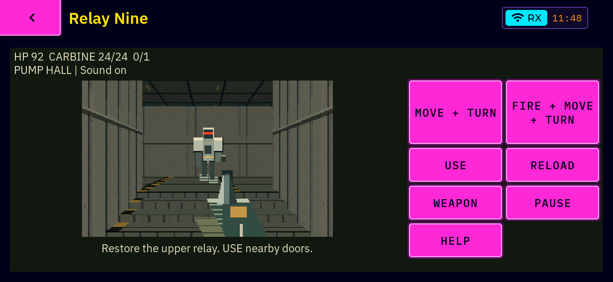 |  |
| 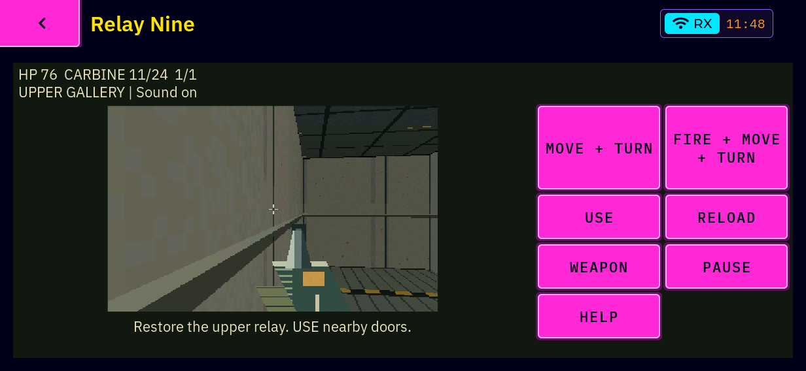 |  |
| 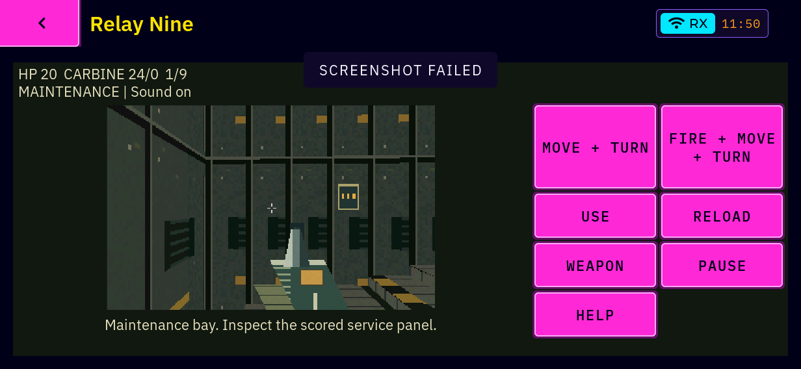 | 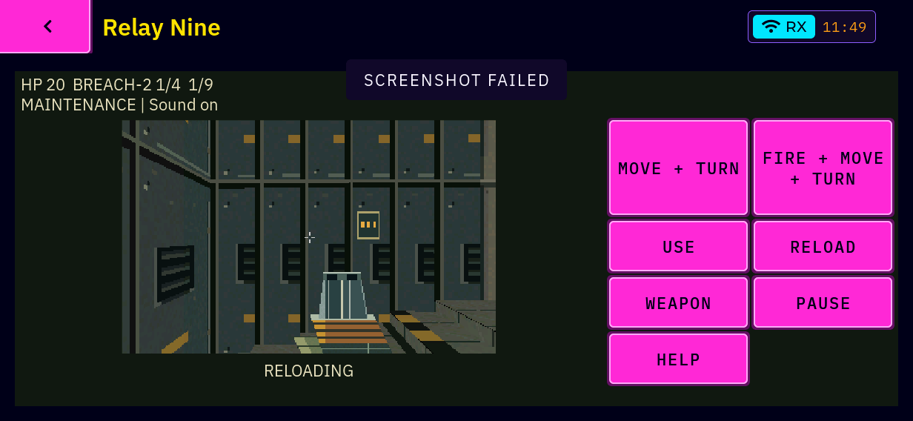 |

The opening slice view is the identical game state (HP 92, guard, camera).
The gallery after the stairs matches in HP, ammo and kills, with a slightly
different camera because injected key timing varies. On the panel the PR shows
the guard's knee plates and bevels, the carbine's distinct receiver and sight,
warmer stained concrete and quieter floor trim. Native 320×200
nearest-neighbour scaling, the hazard markings and the industrial palette are
unchanged, and nothing reads as noise or blur at device scale. The
maintenance-bay pair is **not** the same state: in that capture run the PR
route picked up the BREACH-2 and the base route did not, so the PR image shows
the open shotgun breach during reload on the device and the base shows the
carbine. Both bay captures carry a "SCREENSHOT FAILED" toast from the previous
rapid screenshot; it appears equally in the baseline and is not caused by
this PR.

### Restoration (VERIFIED)

Every run ended with `RESTORE: OK`. Final state: exactly one
`/usr/bin/doors-shell` (`86d7b017…`), supervised, with no `DOORS_*` or
`LD_LIBRARY_PATH` in its environment. It alone holds the panel; there is no
audio owner and the PCM is closed. No kit shell, `pos-audio-effects`,
`rn-measure`, `rn-drive` or driver process remains. `liblvgl` is `2c4fd81b…`,
and the ALSA mixer and screenshot list are identical to the pre-session
baseline. meshcored (same PID since boot) and other services were not
touched; no radio was used.

Two deliberate differences from the pre-session state:

- **`settings.conf` now has `audio_muted=1`** (`ce9d9e37…`). During the
  session the owner lowered the volume on the device and asked for the sound
  off. The kit restore had reverted that change, so the installed shell was
  muted through `shell.volume`. Both kits were re-baselined to the muted
  settings; their earlier sound-on backups and logs stay beside them as
  `backup-sound-on/` and `log-sound-on/`. Unmuting restores 100 %.
- `/run/pocketos/audio.lock` (0 bytes, tmpfs), created by the first sound-on
  test session, was removed after confirming that no process held it; it was
  absent before the session.

Both kit directories remain on unit B, inactive, as evidence (about 9 MB;
the root filesystem is 90 % used).

### Limitations

- Not run here (out of scope): a full playthrough, shotgun acceptance,
  physical keyboard, the portrait/HDMI/text-size matrix and acoustic latency.
  The PR #104 device limitations still apply to those.
- The timed runs are muted; sound-on evidence is one pre-mute run per build
  plus the unchanged helper.
- Input is injected through `shell.key` with wall-clock holds, so routes are
  repeatable but not frame-exact. Window statistics are compared, not
  frame-exact pairs.
- No owner visual or playability confirmation was requested.

## Provenance

All revised material, enemy and weapon pixels are original hand-authored
first-party recipes in `relay_art.c`, Apache-2.0. No image generation,
external assets, concept pixels, palette imported from the shell theme or
new dependency. PNGs are actual engine/shell captures covered by the existing
`docs/apps/*` CAPTURE inventory rule. Existing fonts/chrome keep their terms.
