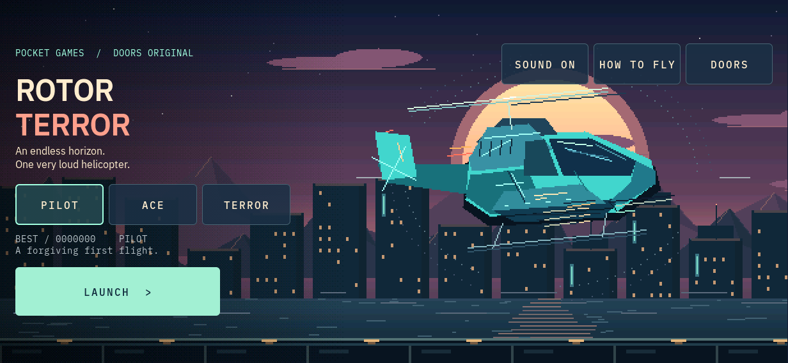
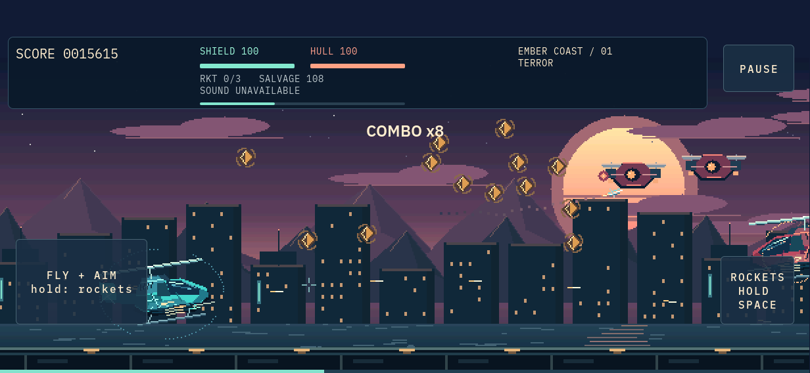
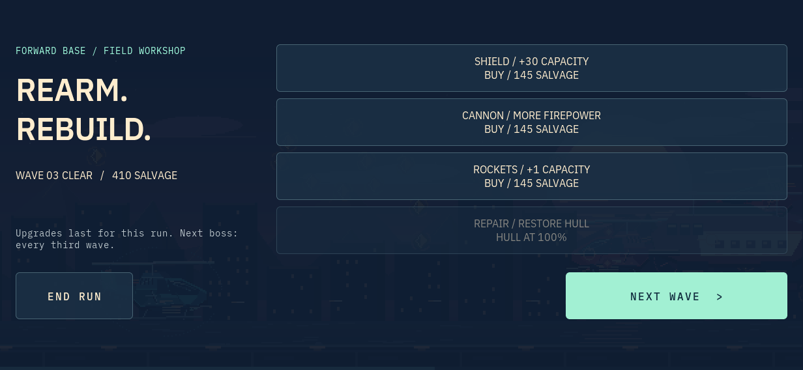

<!-- Copyright (c) 2026 PocketOS authors. SPDX-License-Identifier: Apache-2.0 -->
# RotorTerror

An original helicopter arcade game for Doors on the LILYGO T-Display K230.
Open **Games → RotorTerror**, choose **PILOT**, **ACE** or **TERROR**, then
**LAUNCH**. This is a new implementation for review, not a released device image.



The Kestrel flies continuously across Ember Coast, Violet Ridge and Ion City.
Automatic cannon fire follows its nose; rockets steer toward enemies ahead.
Collect gold salvage, chain kills into score multipliers, evade mines and
turrets, and fight a heavy gunship every third wave. The backdrop has an
original sunset palette, layered city and mountain silhouettes, water,
rotor animation, missile trails and bounded explosion particles.



## Visual refinement

The current PR adds a protected cockpit panel, independent shield/hull gauges,
a rocket reload meter and prioritized shield-down/critical-hull warnings.
An aiming cross follows the cannon angle. The heavy gunship health meter sits
next to the enemy instead of competing with the cockpit. Damage lights the
scene corners without a full-screen flash.

Aircraft have layered engine cowling, cockpit glazing, a nose sensor and missile
racks. Drones use articulated twin rotor pods; tracked turrets, shield cells,
rocket cells and salvage each have distinct silhouettes. Violet Ridge has a
terraced dry canyon, while Ion City has a canal and elevated bridge; scenery
moves in independent depth layers. The title backdrop fades behind the menu
with ordered RGB565 rounding to reduce banding.

The gallery is regenerated from the real LVGL test. Additional captures are
included in the PR workflow artifact;
`ridge`, `city` and `damage` cover the new scenery and warnings.

[Violet Ridge](rotorterror/ridge-landscape.png) ·
[Ion City](rotorterror/city-landscape.png)
Combat uses scripted input and temporary invulnerability. The added sector and
warning captures use the same combat state with fixture wave/shield/hull values.

**VERIFIED on the host, 2026-11-01:** the updated SDL shell builds; the engine
and renderer pass 103,159 checks and ASan/UBSan (local LeakSanitizer disabled
under ptrace); the real audio client passes 14 checks; the LVGL suite passes
2,173 checks across all three resolutions and text sizes. Shared style checks
pass. No hardware throughput or device sound claim is made.

## Controls

| Input | Action |
| --- | --- |
| W / S or Up / Down | Climb / dive |
| A / D | Move forward / back within the scrolling scene |
| Left / Right | Tilt the nose and aim the cannon |
| Hold Space | Fire regenerating guided rockets |
| P / Esc | Pause / resume |
| Enter | Launch, resume, retry, or continue to the next wave |
| H | Open / close the flight manual |
| 1 / 2 / 3 on the title | Choose difficulty |
| 1 / 2 / 3 / 4 in the workshop | Buy shield / cannon / rockets / repair |
| Touch FLY + AIM | Drag vertically to fly and horizontally to aim; the same held finger launches rockets |
| Touch ROCKETS | Hold to launch rockets without moving |

The touch pad combines flight, aim and rockets from one pointer. It does not
require simultaneous touches. Releasing or losing the press clears its actions.
The cannon always fires during flight. **PAUSE** remains visible in fullscreen.
Back first closes the manual or pauses flight; leaving the app ends the run.

## Shield, salvage and progression

- Shield absorbs damage before the hull. Its broken arc loses segments as
  charge falls, flashes on impact and rebuilds while recharging.
- After 2.5 seconds without damage it recovers five units per second, more
  with shield upgrades. Shield cells restore 32 charge immediately.
- Gold awards score and 12 salvage each. Salvage is spent separately from
  the score, so buying an upgrade preserves the leaderboard result.
- Normal waves last 26 seconds. A boss wave continues until its gunship is
  destroyed. Clearing a wave grants salvage and some shield charge.
- The workshop upgrades shield capacity/recharge, cannon damage/rate, or
  rocket capacity/recharge/damage; hull repair is available when damaged.
  Each upgrade has four levels. Upgrades last for the current run.
- Rockets replenish automatically; rocket cells refill the magazine.
- Enemy frequency, speed, damage and score rewards follow the selected
  difficulty. Pressure also rises with the wave number.
- Each difficulty keeps its own local high score. Records use a versioned,
  checksummed file at `$POCKETOS_STATE_DIR/rotorterror/scores.bin`, defaulting
  to `/var/lib/pocketos/rotorterror/scores.bin`. Replacement is atomic; a failed
  write is reported on the result screen. A damaged record yields empty scores.



## Sound and lifecycle

Seven original synthesized recipes append IDs 10–16 to the existing
`audio.effects` bank: cannon, rocket, explosion, salvage, shield, rotor and
a minor-key arpeggio. The first ten recipes keep their existing IDs and samples.
Four voices mix through the existing foreground `pos-audio-effects` process
and its pocketaudio ownership/volume/route policy (ADR-014). No app code opens
ALSA, GPIO or a microphone, and no process is started per shot.

Pause, loss of focus, a system overlay, screen-off, lock and leaving suspend
play and end the audio session. A delayed frame longer than 250 ms pauses
instead of simulating an unseen burst of combat. System mute/volume are
respected; the app's sound switch affects this game. Busy or unavailable audio
is visible in the cockpit and does not interrupt flight. Abnormal service death
uses the existing recovery command before another session starts.

## Implementation and build

`apps/rotorterror/rotor.c` is a pure fixed-step simulation, separated from
`rotor_render.c` (original RGB565 artwork), `rotor_app.c` (Doors/LVGL),
`rotor_audio.c` (nonblocking service client) and `rotor_store.c` (records).
The game is registered in the shell and Games folder and included in the
existing SDL and DRM CMake source list. Its helicopter launcher icon is
first-party SVG, with reproducible tint masks and a portal asset.

The renderer uses a uniform scale: 616 logical pixels across and 240–720
vertically. Portrait reserves a lower control area; landscape fills the
display. No aspect-ratio stretching is used. Pools are bounded at 40 enemies,
224 projectiles, 64 pickups and 384 particles; no game-loop allocation occurs.
The frame buffer is at most 887,040 bytes. Reduced motion suppresses camera
shake, reduces particles and stops the title animation.

Use the dependencies and pinned LVGL from [BUILD_ENVIRONMENT](../BUILD_ENVIRONMENT.md):

```sh
make CC=gcc rotorterror-test
make CC=gcc rotorterror-san-test
cmake -S ui/shell -B out/rotor-shell
cmake --build out/rotor-shell --target pocketos-shell rotor_app_test -j4
mkdir -p out/rotor-shots
ROTOR_SHOTS="$PWD/out/rotor-shots" out/rotor-shell/rotor_app_test
out/rotor-shell/pocketos-shell --no-lock --open rotorterror --rotation landscape
```

Build/install the updated `pos-audio-effects` along with the shell; an older
helper does not have the appended sound recipes. The existing package and
deploy lists already include this helper and the runtime icon directory.

## Validation and physical-device gate

**VERIFIED on the host, 2026-11-01:**

- Complete Doors SDL shell and actual LVGL app compile successfully.
- Engine test: combat and aimed projectiles, shield depletion/regeneration,
  salvage, capped upgrades, boss-gated progression, deterministic fixed-step
  timing, long-frame pause, checked score files and renderer bounds. The
  endurance pilot completes 24 workshops and reaches wave 25 with 1,751 kills.
- Engine and renderer pass AddressSanitizer and UndefinedBehaviorSanitizer.
  LeakSanitizer is disabled only for the local managed executor because its
  ptrace environment is unsupported; the CI sanitizer target keeps defaults.
- Real LVGL pointer and keyboard tests pass 2,056 checks across 568×1232,
  1232×568 and 1280×720, with all three text sizes: safe corners, non-overlapping
  64-pixel-or-larger touch targets, compound input, pause/lock/focus/stall,
  purchases, next wave, retry, records, timer cleanup and child reaping.
- The new client is tested against the actual sound service with ALSA null:
  event delivery, ownership refusal, pause/close, mute, killed-service recovery
  and subsequent reopening. The existing file-backed sound regression also
  exercises all 17 recipes, stale-event rejection, sample limits and cleanup.
- Existing Relay Nine simulation/audio regressions and launcher layout checks
  pass. Shared-style rules pass. The dependency and SDK pins are unchanged.

The gallery contains actual production-renderer/LVGL output. Combat shots use
scripted input and temporary invulnerability; the workshop uses fixture salvage,
and the boss capture advances the wave clock to exercise that state. These are
host test captures, not device photographs or concept art.

[Portrait flight](rotorterror/combat-portrait.png) ·
[Heavy gunship](rotorterror/boss-landscape.png)

**DOCUMENTED hardware baseline:** the display and audio paths are described in
[T-DISPLAY-K230](../hardware/T-DISPLAY-K230.md); this change uses the existing
Doors interfaces. **UNVERIFIED for this game:** a physical K230 build/run,
display throughput, physical sound onset/underruns and sustained thermal load.
The pinned RISC-V toolchain is unavailable in this executor; no SD image was
built and no device was accessed or flashed.

Before releasing on hardware, build the package with the pinned toolchain;
install the matching shell/helper/assets; verify both orientations, keyboard
holds and one-finger touch, shield recharge and a boss/workshop cycle; measure
frame pacing under Terror combat; check sound/mute/volume and that audio/card
ownership end on pause, lock and leaving. Keep the previous package for rollback.
