<!-- Copyright (c) 2026 Doors authors. SPDX-License-Identifier: Apache-2.0 -->
# Games Hub - design exploration and implementation record

**Status: Concept C, Poster Wall, is implemented on branch
`feature/games-hub` as DS §60 (PROPOSED). The owner chose the concept and
settled decisions 2-6 on 2026-11-16. Built and tested in the SDL simulator
and cross-built for riscv64; gated on Unit A on 2026-11-17 with a
non-persistent kit (`docs/hardware/GAMES_HUB_GATE.md`: steps 1-5 PASS, the
look on the glass still for the owner).** See "As built" below.

The images in `mockups/` are design mockups drawn by `tools/gen_mockups.py`,
not screenshots of Doors. The images in `captures/` are real captures of the
shell in the simulator.

## As built

| Portrait | Landscape |
| --- | --- |
| 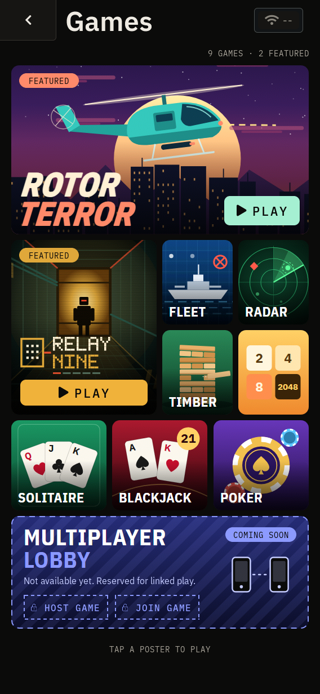 | 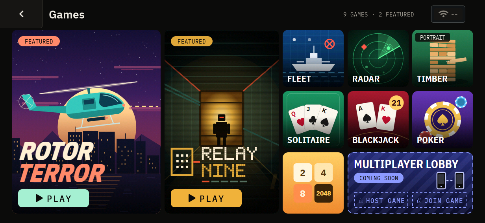 |
| Night mode: 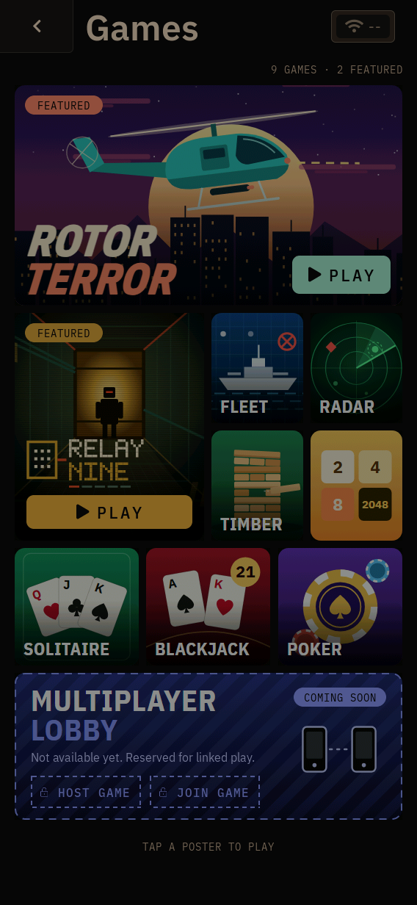 | The key focus on Radar: 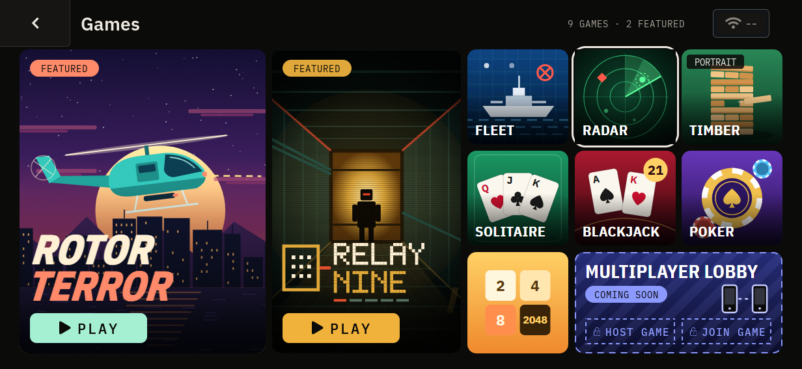 |

Captured from `pocketos-shell` (SDL, `--theme doors`, 568 x 1232 and
1232 x 568) by `shell.folder id=games` and `pos shell screenshot`. The
simulator's panel is rectangular: the glass's rounded corners are not in
the pictures.

On Unit A (frame-buffer captures from the gate; the strip at the foot is the
unit's debug overlay):

| Portrait | Landscape |
| --- | --- |
| 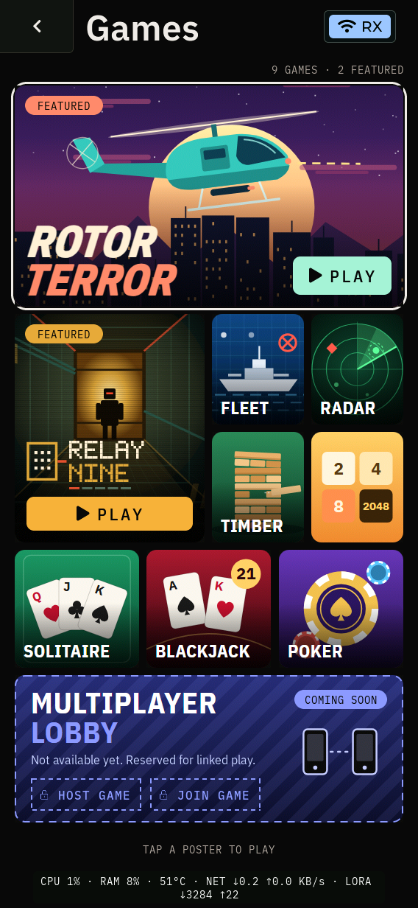 | 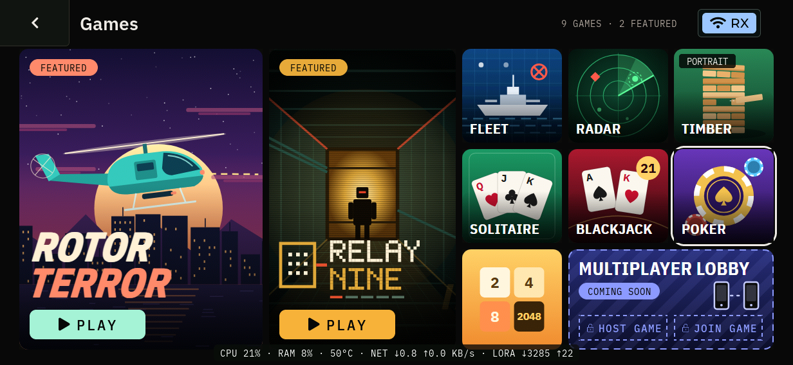 |

- The specification is **DS §60** (`docs/design/POCKETOS-DS-v0.1.md`); its
  §60.9 lists every difference from the Concept C mockups and why.
- Geometry: `ui/shell/hub_layout.c` (pure C; `tests/hub_layout_test.c`).
  Drawing: `ui/shell/hub.c`. The launcher opens it from the existing Games
  folder entry (`home_folder_open`, `ui/shell/home.c`) and falls back to the
  folder page when the nine games, the room or the art are not all there.
- Art: `tools/design/gen_games_hub.py` draws the posters into `art/`
  (PNG, plus the two wall SVGs); `tools/design/gen_doors_ui.py` makes the
  twenty `ui/assets/doors/hub-*.bin` from them.
- Not built: hold-for-details (no details surface exists), and anything
  behind the Multiplayer Lobby, which is a preview only.

Today, **Games** on the launcher opens an ordinary folder page of nine icon
cells (DS §39, §47.2; `ui/shell/home_layout.c`). This package proposes
replacing that page with a dedicated Games Hub and offers three directions.

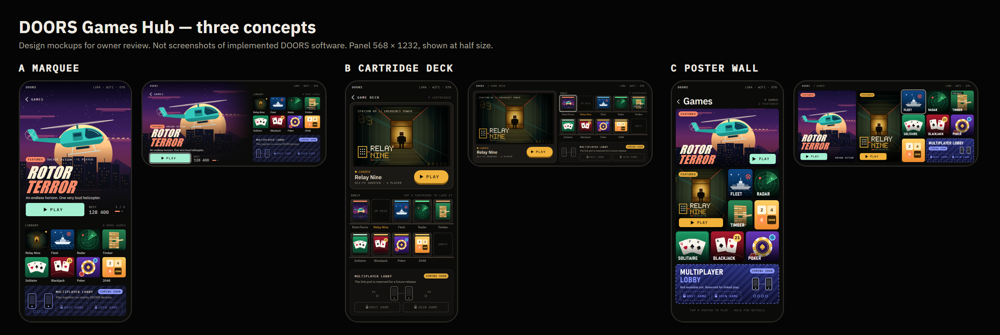

## The games (verified in `home_layout.c`, origin/master `ebe8b2bc`)

| Game | Hub identity | Key colours |
| --- | --- | --- |
| RotorTerror (featured) | Arcade action: sunset skyline, the teal Kestrel, heavy italic wordmark | coral `#ff8a6a`, mint `#a5f0d2`, indigo |
| Relay Nine (featured; id `neon-outpost`) | Industrial sci-fi: emergency-lit corridor, sentry in the relay door, the game's own pixel wordmark | amber `#e0a83a`, signal red `#e5502e`, green-black |
| Fleet | Warship on a plotting grid, hit marker | navy, cyan `#5cc8ff` |
| Radar | Phosphor scope, sweep, hostile contact | green `#5dff9b` |
| Timber | Block tower on baize, one block leaving | wood `#e9b06a`, baize green |
| Solitaire | Fanned Q-J-K on felt | emerald, cream |
| Blackjack | Ace and King, a gold 21 | crimson, gold `#ffd166` |
| Poker | Gold chip, spade | violet, gold `#f2c14e` |
| 2048 | The tiles themselves | amber to orange |

The two featured identities follow the games' existing title screens
(`docs/apps/rotorterror/title-landscape.png`,
`docs/apps/relay-nine/polish/landscape-title.png`). The mockup artwork is
representative; production art should be redrawn from the games' own
renderers and palettes.

## Concept A - Marquee

| Portrait | Landscape |
| --- | --- |
| 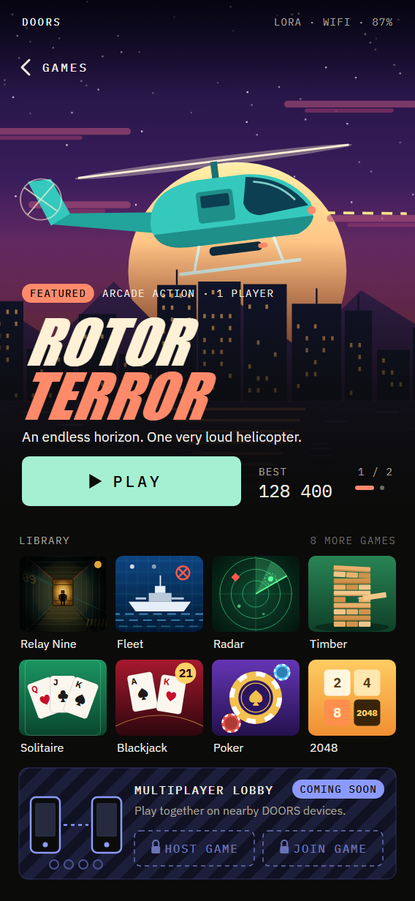 | 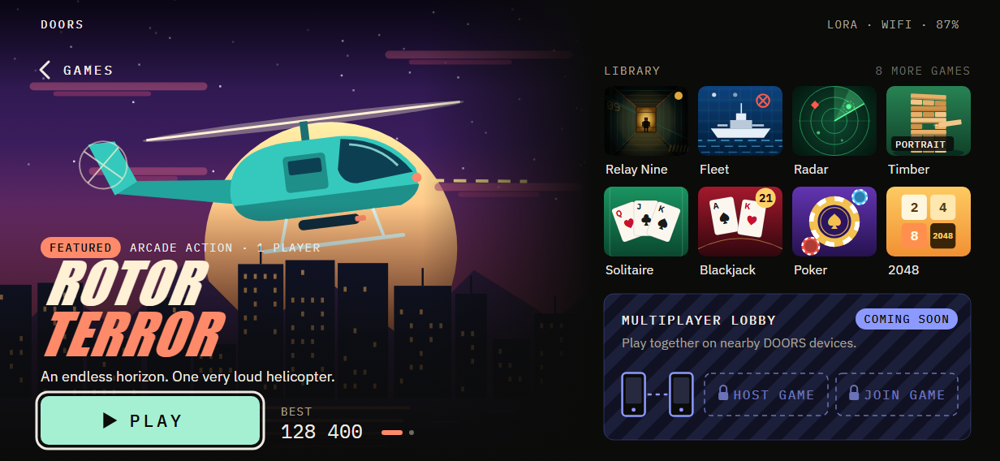 |

A console dashboard. One featured game owns the top of the screen as
full-bleed key art with its logo, tagline, best score and a large PLAY slab.
Swiping the hero (or Left/Right) turns to the other featured game. Below it
the library lists the other eight games as artwork cards, and the
Multiplayer Lobby is a strip at the foot.

- **Portrait:** hero 568 x 700, library 4 x 2 (cards 120 x 104 plus label), lobby strip 516 x 152.
- **Landscape:** hero fills the left 730 px and fades into the page; library 4 x 2 and lobby in the right column.
- **Interaction:** PLAY launches the hero game; a library card launches on tap. Keys: Enter = PLAY, arrows move focus, Left/Right on the hero turns the page.
- **Character:** cinematic, one clear call to action.

## Concept B - Cartridge Deck

| Portrait | Landscape |
| --- | --- |
| 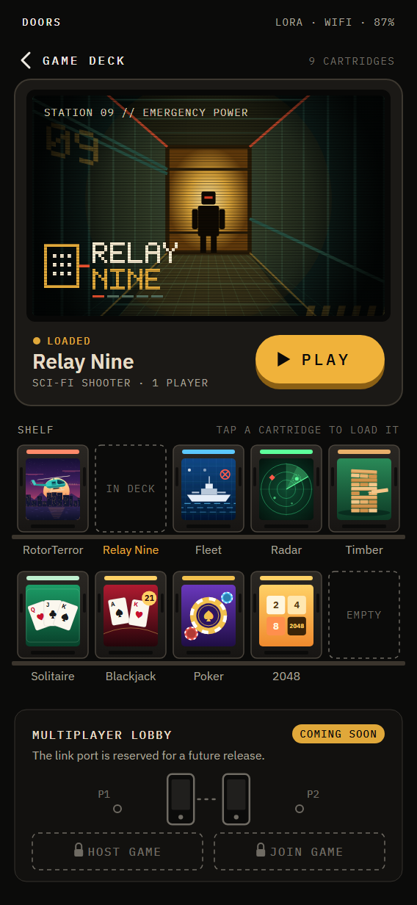 | 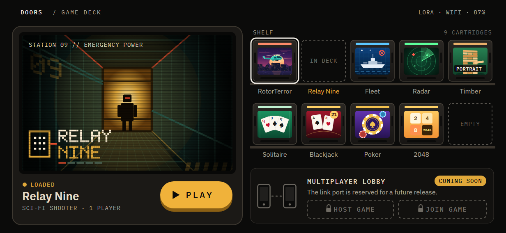 |

The hub is a small console. Games are cartridges on a shelf; tapping one
loads it into the deck, whose screen shows that game's attract art and name,
and the round PLAY button starts it. The loaded cartridge leaves a marked
gap on the shelf. The Multiplayer Lobby is the console's "link port".

- **Portrait:** deck 528 x 444 (screen 480 x 300), two shelves of five (cartridges 96 x 118), lobby panel 528 x 234.
- **Landscape:** deck left (screen 512 x 330), shelves and lobby right.
- **Interaction:** tap cartridge = load, PLAY = start (two taps; tapping the loaded screen also starts). Keys: arrows along the shelf, Enter loads, Enter again plays. The last loaded game is remembered.
- **Character:** tactile, warm, sits naturally on the default `doors` theme's warm accent.

## Concept C - Poster Wall

| Portrait | Landscape |
| --- | --- |
| 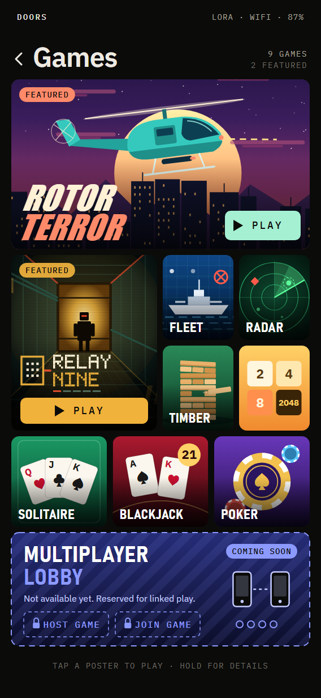 | 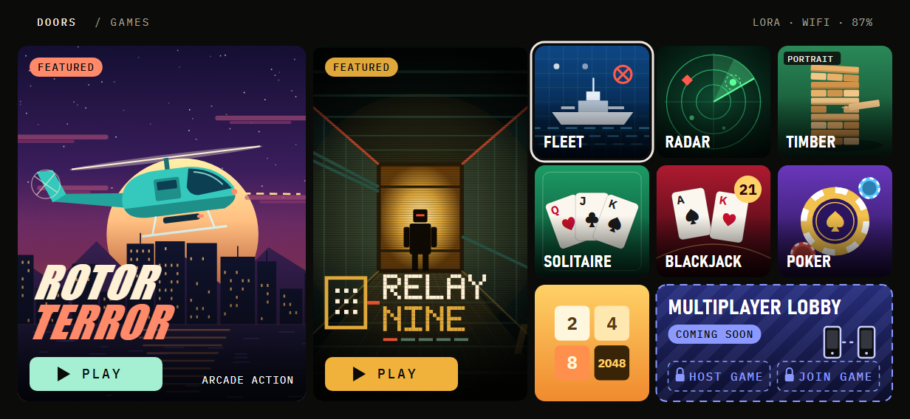 |

Every game is a poster on one asymmetric wall. RotorTerror and Relay Nine
are large posters with their own PLAY buttons; the other seven are bold
colour tiles with condensed poster lettering. The Multiplayer Lobby is a
full poster of its own with a dashed "reserved" border.

- **Portrait:** RotorTerror 528 x 300, Relay Nine 258 x 310, four tiles 125 x 150, three tiles 169 x 160, lobby 528 x 200.
- **Landscape:** two tall featured posters (390 and 290 x 482), a 3 x 2 block of 155 x 152 tiles, 2048 and the lobby on the bottom row.
- **Interaction:** tap any poster = play (one tap for all nine); hold = details. Keys: arrows move the focus frame across the wall, Enter plays.
- **Character:** colourful, editorial, everything visible at once; no scrolling and no hidden state in either orientation.

## Shared specification

- **Shell-owned screen** that replaces the Games folder page only. The Games cell on the launcher, `shell.folder {"id":"games"}`, Back/Home, the back corner (DS §48), Lock/Controls and the rotation resume (`DOORS_LAUNCHER_FOLDER`) keep their meaning.
- **Theme independence.** Like the DOORS environment (DS §31.1), the hub has a fixed palette and its own art, so it looks the same in `doors`, Neon and every other theme. Chrome text uses the `doors` tokens (`#0b0b0a`, `#eeeae2`, `#a8a399`).
- **Type.** UI text uses existing bitmap sizes only (mono 14 / 16 medium / 22 medium / 24, sans 16 / 20 / 28 semibold / 48 semibold). Game logos and Concept C's condensed poster names are part of the artwork, not fonts. The 12 px "PORTRAIT" badge in the mockups would be mono 14 on the device.
- **Touch.** Smallest launch target is 96 x 118 (B cartridge); PLAY is at least 134 x 46 and up to 300 x 68. Safe area: nothing interactive inside the 30 px portrait corners or the 50 px landscape top corners (DS §21.1).
- **Timber** is portrait-only (DS §53); in landscape its tile carries a PORTRAIT badge and launching it turns the display as today.
- **Multiplayer Lobby is a preview only.** It always shows COMING SOON; HOST GAME and JOIN GAME are drawn disabled (dashed, padlock), take no tap and no key focus, and no networking, discovery or session code is part of this work. The panel is one self-contained widget so that a later phase can make it live without re-laying out the hub. Player and device marks are illustrative and promise no player count.

## Technical feasibility

Evidence classes per AGENTS.md. Nothing below was built or measured for this package.

- **DOCUMENTED** - Runtime art already works this way: RGB565 `.bin` files read on demand by `ui/shell/art.c` from `/usr/share/doors/ui`, generated by `tools/design/gen_doors_ui.py` (DS §31.6). The home photograph is 1.4 MB and stays loaded; the hub's art would be loaded only while the hub is open.
- **ASSUMED** - Memory while open, RGB565 at 2 bytes per pixel, one orientation loaded at a time:

| Concept | Portrait | Landscape | On disk (both orientations) |
| --- | --- | --- | --- |
| A Marquee | hero 795 KB + 8 cards 200 KB = ~1.0 MB | hero 829 KB + cards 143 KB = ~1.0 MB | ~3.6 MB (two heroes each way) |
| B Cartridge Deck | screen 288 KB + 8 labels ~100 KB = ~0.4 MB | screen 338 KB + labels = ~0.45 MB | ~5.8 MB (nine attract screens each way) |
| C Poster Wall | ~0.8 MB | ~1.0 MB | ~1.8 MB |

- **ASSUMED** - Rendering: every concept is static images plus a handful of LVGL labels, rectangles and one focus outline. Gradients, scrims, scanlines, rounded corners and logos are baked into the art against the fixed hub background, so no runtime gradient, blur, alpha blending of large areas or image scaling is needed. No animation is required; A's hero page turn can be an instant swap (and must be under reduced motion, DS §12).
- **ASSUMED** - Text size (DS §46) and Night/Outdoor modes need a rule for this screen. The environment's precedent is to dim the art in Night; labels under cards (A, B) must tolerate Medium/Large, which C avoids because its names are in the art.
- **Design-system impact.** DS §1-§2 forbid gradients and large bright fills in app UI. The hub therefore needs a DS amendment in the manner of §31 (a shell-owned, art-led screen). This is an owner decision.
- **Open risks:** art decode time when the hub opens on the K230 (not measured); A's best-score line needs the shell to read a game's store, which no shell screen does today (it can be dropped).

## Comparison

| | A Marquee | B Cartridge Deck | C Poster Wall |
| --- | --- | --- | --- |
| Visual strength | Most cinematic; the largest single piece of artwork | Most original and charming; strongest "console" metaphor | Most colourful; every game has presence |
| Featured games | One at a time; the second is a swipe away or a small card | One at a time (whichever is loaded) | Both, always, side by side with distinct treatments |
| Taps to play | 1 (hero or card) | 2 (load, then PLAY) | 1 for all nine |
| Finding a game | Good; names under cards | Good; names on the shelf rail | Best; all nine large, no state |
| Multiplayer teaser | Compact strip | Thematic "link port", largest in portrait | A poster in its own right; most visible |
| Landscape | Strong | Strong | Strongest use of the wide screen |
| Implementation | Medium: hero pager, two heroes per orientation, optional score | Highest: load state, nine attract screens per orientation, most art | Lowest: a static grid of image buttons |
| Main risk | Second featured game is under-exposed | Extra tap; most artwork to produce | Lettering baked into art (a name change means new art) |

## Recommendation

**Concept C, Poster Wall**, as the strongest overall direction: it gives
RotorTerror and Relay Nine equal, permanent prominence with clearly
different identities, keeps all nine games one tap away without scrolling
in both orientations, gives the Multiplayer Lobby the clearest reserved
place, and is the least complex to build and to keep fast. A's full-bleed
hero is the more dramatic single image, and B is the most characterful; if
the owner prefers more drama, C can adopt A's larger hero for the top
poster at a later step without changing its structure.

The owner chose Concept C on 2026-11-16. Concepts A and B are kept here as
the record of the alternatives.

## Decisions for the owner

1. Which concept (A, B, C, or a named combination). **Decided 2026-11-16: C, Poster Wall.**
2. Whether the hub may use a fixed palette and art in every theme, as the environment does, with the DS amendment that requires. **Decided 2026-11-16: yes, a fixed palette in every theme (DS §60.2, PROPOSED).**
3. Featured set and order (proposed: RotorTerror, then Relay Nine) and the order of the other seven. **Decided 2026-11-16: RotorTerror, Relay Nine; then Fleet, Radar, Timber, Solitaire, Blackjack, Poker, 2048, placed as the Concept C mockups place them.**
4. Wording of the lobby preview ("COMING SOON", HOST GAME / JOIN GAME) and whether any player-count marks should appear. **Decided 2026-11-16: as mocked - MULTIPLAYER LOBBY, COMING SOON, disabled HOST GAME / JOIN GAME - with the two illustrative device marks and no player count.**
5. Whether production artwork is redrawn from the games' renderers, or commissioned separately. **Decided 2026-11-16: generated in the repository (`tools/design/gen_games_hub.py`), replaceable later through the same pipeline.**
6. For C: poster names baked into art, or drawn as live text in an existing font. **Decided 2026-11-16: baked into the art.**

## Implementation outline (carried out 2026-11-17; kept as the record of the plan)

Steps 1-5 are done on `feature/games-hub`. Of step 5, the captures at
Small/Medium/Large are covered by the layout audit in
`tests/launcher_groups_shell_test.sh` rather than by pictures: the hub's
type does not follow the text size (DS §60.3), so the three are the same
picture. Step 6: both builds succeed; the hardware gate is open (DS §60.8).

1. DS amendment for the hub (PROPOSED), citing the chosen mockups as its reference.
2. Art pipeline: extend `tools/design/gen_doors_ui.py` (or a sibling) to emit the hub's RGB565 `.bin` files and `MANIFEST.txt` entries for both orientations; extend `tests/doors_ui_assets_test.sh`.
3. Geometry model as pure C with a host test (like `ui/shell/controls_model.c`): tile rectangles for both orientations, overlap, fit and safe-area checks.
4. Hub screen in `ui/shell/` behind the existing folder entry point for `games` (`home_folder_open`), with a fallback to the present folder page when art is missing; touch, focus order and keys; disabled lobby widget.
5. Update the launcher tests that assert the Games folder page (`tests/launcher_folder_shell_test.sh`, `tests/home_folder_test.c`, `tests/launcher_groups_shell_test.sh`) and add captures at Small/Medium/Large and Normal/Night/Outdoor.
6. Build for the SDL simulator and riscv64; then a hardware gate on a unit for open time, memory while open and after close, touch targets and rotation in an open hub.

## Files

- `mockups/*.png` - the six mockups at panel size (568 x 1232, 1232 x 568) and `overview.png`.
- `mockups/*.svg` - their vector sources.
- `captures/*.png` - the hub as built, captured from the simulator.
- `art/hub-*.png`, `art/wall-*.svg` - the poster art's sources (drawn by `tools/design/gen_games_hub.py`); the device's `.bin` files are made from the PNGs.
- `tools/gen_mockups.py` - regenerates both (Python 3 standard library; PNG rendering needs Edge or Chrome; fonts fall back to system faces without network access to IBM Plex).
