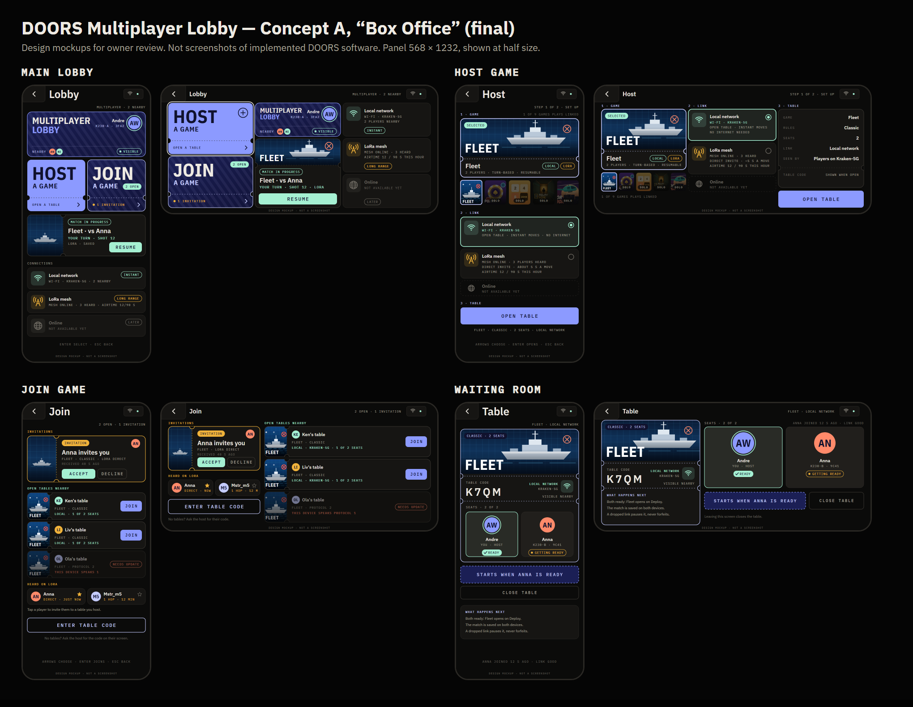

<!-- Copyright (c) 2026 Doors authors. SPDX-License-Identifier: Apache-2.0 -->
# DOORS multiplayer platform - M1 design package

**Status: PROPOSED, 2026-11-20. Design and documentation only. Nothing here
is implemented, built, deployed or accepted, and no accepted ADR or Design
System section is changed by it.** The images are mockups, not screenshots.

| Document | Holds |
| --- | --- |
| this file | vision, the recommendation in brief, first playable, other games, decisions, alternatives, risks, roadmap, approval checklist |
| [ARCHITECTURE.md](ARCHITECTURE.md) | what exists, the options, ownership, interfaces, lifecycle, transports, identity, security, self-review |
| [UX.md](UX.md) | the two concepts, the chosen design screen by screen, interaction, memory |
| [M2-PLAN.md](M2-PLAN.md) | after the owner's conditional approval: the four open questions resolved, work packages, hardware gate |
| [ADR-PROPOSALS.md](ADR-PROPOSALS.md) | drafts: peerd and its security; Fleet link profile and a save per transport |
| [PROPOSALS.md](PROPOSALS.md) | every change to an accepted record this would need |
| [mockups/](mockups/) | eight final screens, the states sheet, concept B, two overview sheets, SVG sources |
| [tools/gen_mockups.py](tools/gen_mockups.py) | regenerates the mockups |

## 1. Vision

Two people with a Doors device should be playing together within a few
taps, wherever they are: across a table on Wi-Fi, across a valley on LoRa,
later across the internet. The lobby is the one place that happens. It
feels like a console's party screen, not a network settings page:

- **One lobby, every game.** A game says what it can do linked; the lobby
  does the finding, inviting and waiting.
- **Honest links.** Local is instant. LoRa is slow, far-reaching and
  rationed. Online is not there yet. The lobby says so in plain words and
  never pretends one is another.
- **A match is never lost to a link.** Saved before it is sent, paused by
  silence, resumed from the lobby - Fleet's verified behaviour, made the
  platform's promise.
- **Quiet by default.** Nothing is announced or transmitted until the
  player asks.

## 2. Recommendation in brief

**Sessions belong to games. The lobby belongs to the shell. Transports
belong to services.** (ARCHITECTURE §3.)

- A **shell-level lobby with small game adapters** - no multiplayer daemon
  and no session API. Fleet's protocol, fairness, persistence, reconnection
  and airtime control are kept as verified on units A and B; the lobby
  drives Fleet's own handshake rather than adding one.
- **Fleet's existing link seam becomes the platform's.** A transport is
  "lossy datagrams between proved identities"; games bring their own
  reliability, because surviving a restart requires it anyway.
- **One new, small service, `peerd`**, carries IP datagrams with the same
  surface meshcored has for LoRa. It keeps untrusted network input and
  cryptography out of the shell and keeps packets across a rotation.
- **The handoff from lobby to game is the game's save file**, so starting a
  match and resuming one are the same verified path.
- **No transport switching.** A match lives on the link it began on.

UX: **Concept A, "Box Office"** - tables, invitations and matches as
tickets, continuing the hub's poster wall (UX.md).

## 3. First playable (M2): Fleet over the local network

The smallest reliable step, and deliberately not the lobby:

1. **peerd**: identity, signed beacons, sealed UDP datagrams, inbox;
   `peer.*` over pocketipc; host tests in the manner of meshcored's.
2. **`fleet_link_peer.c`**, a sibling of `fleet_link_mesh.c`.
3. **A link profile** in the match: the mesh profile is today's constants
   (the simulator must reproduce today's figures); the LAN profile has
   short link waits, patient human waits and no airtime budget.
4. **Fleet's existing lobby screen gains one choice**, LOCAL or LORA. No new
   screens. A saved match picks its own link.
5. **A hardware gate on units A and B**: a full match over Wi-Fi and one over
   Ethernet; close/reopen, rotation, peerd restart, reboot after FIRE, a
   network cut; then the LoRa gate's core steps again to show nothing moved.

LoRa is untouched: no change to meshcored, the packets, `match.v1` or the
governor's LoRa values. What M2 proves is the transport, on hardware, before
any lobby is built on it.

## 4. Other games (assessment only; nothing below exists)

All four are single-player today with no network code.

| Game | Today | Could be | Links | Effort | Note |
| --- | --- | --- | --- | --- | --- |
| **2048 Race** | solo puzzle | same seed, first to a tile or best score in a time; exchanges a seed, occasional scores, a result | Local live; LoRa as a duel of a few frames | low | the natural second game: tiny protocol, tolerant of loss, proves the shared table |
| **Poker** | Hold'em against three bots | 2-6 players at a table, bots filling seats | Local first; LoRa only if the airtime of N players is acceptable | medium-high | hidden cards need a dealer everyone trusts (the host) or heavy cryptography; needs ordered delivery and N seats |
| **RotorTerror** | solo arcade | score attack on a shared seed; real-time co-op later | Local; LoRa for results only | low for score attack, high for co-op | real-time play needs a deterministic simulation or state sync that does not exist |
| **Relay Nine** | solo first-person level | timed runs compared; co-op is a different game | Local; LoRa for results only | low for timed runs, very high for co-op | not a candidate for live multiplayer in M2-M5 |

## 5. Decisions and alternatives

| Decision | Chosen | Alternative | Why not |
| --- | --- | --- | --- |
| Where sessions live | in the game | a session daemon (`gamed`) | one game is not enough evidence for a session API; ADR-008 set `gamed` aside as not needed for a persisted turn-based match |
| Where the LAN socket lives | a small service | a UDP module in the shell (about a third of the code, no init script) | untrusted input in the display-owning process; sockets lost on rotation; nowhere for cryptography (ADR-007) |
| LAN reliability | the game's own, over datagrams | TCP | a connection dies with every shell restart and would need a resume protocol on top; the datagram contract is already verified |
| Pre-game protocol | the game's own for Fleet; a shared one in M4 | a shared table protocol now | speculative with one game; extra LoRa airtime for no gain |
| Lobby to game | the save file | passing a live session in memory | a second, unverified path; fragile across rotation |
| Discovery | one signed broadcast beacon | mDNS / DNS-SD | not in the image; more than one message needs |
| Identity | one key per transport | one key for everything | meshcored's key is not available when it is off, and cannot be proved over IP today |
| Background invitations | the shell listens, never answers | a daemon; or none | the shell is always running and has notices; "none" leaves invitations unseen |
| First step | transport in Fleet's own lobby | the whole lobby at once | proves the risky part on hardware first |
| Visual concept | A, Box Office | B, Orbit | UX.md: B is the better picture and the worse tool |

## 6. Risks

| Risk | Class | Handling |
| --- | --- | --- |
| peerd's cryptography is new first-party security code | design | its own ADR and review in M2; OpenSSL primitives only |
| Retry counts double as human patience; a LAN profile could give up on a person in seconds | design | split link waits from human waits; simulator proof that LoRa figures do not move |
| Broadcast discovery blocked by client isolation or between Wi-Fi and Ethernet segments | ASSUMED | table code fallback; a plain message; measure on the owner's networks in M2 |
| A LAN match disturbing a LoRa save | resolved | a save file per transport; `match.v1` untouched (M2-PLAN §1.1-1.2) |
| Ethernet's random MAC and unmanaged routes | DOCUMENTED | the endpoint follows the key; peerd answers on the interface it heard |
| Two identities per player confuse people | design | the link is shown beside every name |
| Lobby art and open time on the K230 | ASSUMED | about 0.6 MB by the hub's method; gate it as the hub was |
| A shared table protocol on LoRa costs airtime | design | LAN first; any LoRa use justified per frame |
| Online needs a server, hosting and abuse handling | future | M5 is an ADR and a prototype, not a service |
| Fifteen ports | design | registry; one port per game |

## 7. Roadmap

| | Goal | Delivers | Exit |
| --- | --- | --- | --- |
| **M2** | Fleet on the local network | §3 above; ADRs for peerd and the link profile | hardware gate A + B over Wi-Fi and Ethernet; LoRa regression |
| **M3** | The lobby | the play library (seam and registry promoted from Fleet), the lobby's four screens for Fleet, the live hub tile, resume cards, table codes, the DS amendment and art | simulator and unit gate: host, join, table, handoff, resume on both links, both orientations, keys and touch |
| **M4** | Invitations and a second game | the shell's invitation listener and notices, remembered players, the shared table protocol (port 2), 2048 Race on Local | two games in one lobby; an invitation answered from another app |
| **M5** | Online, decided | an ADR for the relay route, accounts-by-key and the server's scope; a prototype relay with Fleet across two networks | owner decision to build, defer or drop |

Each milestone is a separate proposal; none starts without approval.

## 8. Approval checklist

Direction (needed before M2):

- [ ] **1. Architecture**: shell lobby with game adapters, sessions owned
      by games, no session daemon.
- [ ] **2. `peerd`**: one new transport service for IP, OpenSSL linked into
      it, in place of a socket in the shell.
- [ ] **3. M2 scope**: Fleet over the local network through Fleet's
      existing lobby first; the new lobby in M3.
- [ ] **4. Visual concept**: A, Box Office, as the direction for the lobby.
- [ ] **5. Background invitations**: the shell may read invitations while
      no game is open and show a notice, never answering by itself
      (PROPOSALS item 3; M4).

Smaller points, answerable later:

- [ ] ADR-008's status and the stale line in `FLEET_MULTIPLAYER.md` (PROPOSALS 1).
- [ ] One key per transport, and no transport switching.
- [ ] Wording: Lobby, Host, Join, Table, Local network, LoRa mesh, Online.
- [ ] The table code as the manual join.
- [ ] 2048 Race as the second game.
- [ ] Whether Online stays on the roadmap at all.
