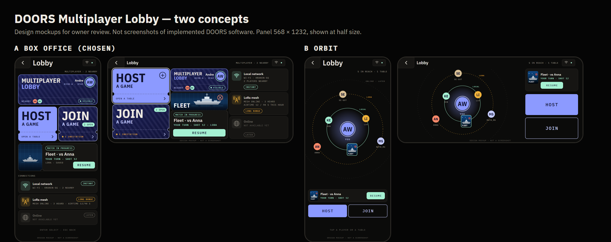
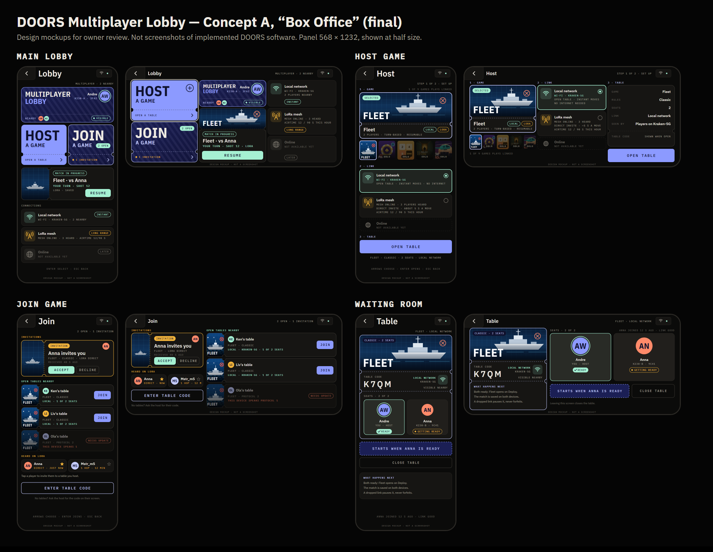
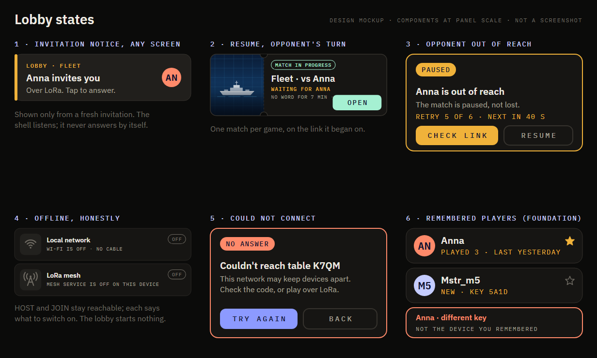

<!-- Copyright (c) 2026 Doors authors. SPDX-License-Identifier: Apache-2.0 -->
# Multiplayer Lobby - experience and visual design (M1, PROPOSED)

**Every image in `mockups/` is a design mockup drawn by
`tools/gen_mockups.py`. None is a screenshot of Doors; each frame carries a
MOCKUP tag.** Names, networks and counts in them are illustrative.

## Two concepts

| | A - Box Office (chosen) | B - Orbit |
| --- | --- | --- |
| Idea | The hub is a wall of posters; the lobby is where you get a ticket. Tables, invitations and matches are tickets: art stub, perforation, seats | You are the centre; players sit on rings by link (Local inside, LoRa outside); tables are nodes among them |
| First impression | Editorial and confident; continues the hub's print language | The most "alive" single image |
| Honest about links | A card per link with plain words: INSTANT, LONG RANGE, LATER, airtime | Rings suggest distance and direction that a LAN does not have and LoRa does not report |
| Keys | Rows and columns; the hub's geometric focus rule works unchanged | Free-floating targets; arrows have no natural order |
| Touch | Every target a slab or a whole ticket, 44 px or more | Avatars 48 px, drifting close together as players are heard |
| Text | Names, states and reasons fit on the ticket | Almost none fits; a second panel is needed for everything real |
| Scales to | 8 tables, 8 players, N seats | about 6 marks before it crowds |
| Cost on the K230 | flat fills, one baked texture, discs and dashed lines; no blending, no animation needed | wants motion and glow to work; static, it reads as a diagram, and it echoes Radar's poster |

**A wins.** It carries the information multiplayer actually has (who, which
game, which link, what state, what next), it navigates by keys the way the
hub does, and it costs almost nothing to draw. B is the better picture and
the worse tool. One idea is kept from B: the player's own identity disc, with
a ring that says they are visible.

## The design: Box Office

| Screen | Portrait | Landscape |
| --- | --- | --- |
| Main Lobby | [final-lobby-portrait.png](mockups/final-lobby-portrait.png) | [final-lobby-landscape.png](mockups/final-lobby-landscape.png) |
| Host Game | [final-host-portrait.png](mockups/final-host-portrait.png) | [final-host-landscape.png](mockups/final-host-landscape.png) |
| Join Game | [final-join-portrait.png](mockups/final-join-portrait.png) | [final-join-landscape.png](mockups/final-join-landscape.png) |
| Waiting Room | [final-table-portrait.png](mockups/final-table-portrait.png) | [final-table-landscape.png](mockups/final-table-landscape.png) |
| Other states | [states-sheet.png](mockups/states-sheet.png) | |

### Visual language

- **The ticket.** A rounded card with one or two perforations and their
  notches. The stub carries the game's art; the body carries who and what;
  the tear-off carries the action. On the device a notch is a disc in the
  ground colour and a perforation a dashed straight line - both things LVGL
  already draws for the hub.
- **The reserved poster comes alive.** The hub's lobby tile has a dashed
  border because it is reserved (DS §60.4). In the lobby the same indigo
  field and diagonal weave return with a solid border.
- **Palette: the hub's, fixed in every theme** (DS §60.2). Lobby blue
  `#8c9aff` / `#c5ccff` for the lobby itself and its primary action; mint
  `#a5f0d2` for ready, local and go; amber `#f0b23a` for LoRa, waiting and
  invitations; coral `#ff8a6a` for failure. PROPOSED additions: three indigo
  grounds (`#12143a`, `#1b1f55`, `#2a2f78`) and an ink `#10122e` for text on
  bright fills.
- **Colour is never alone.** Every link has an icon and a word; every state
  has a word; READY has a tick.
- **Type.** Live text uses faces the shell already has: sans 48 / 28 / 20
  semibold, sans 16, mono 14 / 16 / 22 (DS §60.3). The table code is sans 48,
  so it needs no new font. HOST, JOIN, A GAME, MULTIPLAYER LOBBY and the
  game wordmarks are condensed poster lettering baked into art, as the hub's
  names are.
- **Identity.** A disc in the player's identity hue with two letters, the
  name, and four hex digits of the key - the form Fleet's lobby already uses.

### Main Lobby

Top to bottom (portrait) or left to right (landscape): who you are and who
is near; **HOST** and **JOIN**, the two things to do; the match you already
have; what each link can do right now.

- HOST is the filled ticket and takes the first key focus. JOIN carries the
  counts that make it worth opening (2 OPEN, 1 INVITATION).
- The resume ticket appears only when a game reports a saved match. It says
  whose turn it is and which link the match lives on.
- CONNECTIONS is status, not settings: Local network (INSTANT), LoRa mesh
  (LONG RANGE, with the hour's airtime), Online (LATER). A link that is off
  says what is off (states sheet, 4); the lobby switches nothing on.

### Host Game

Three numbered steps on one screen, so nothing is hidden behind a wizard.

1. **Game.** The chosen game as a large ticket with what it supports
   (players, turn-based, resumable, LOCAL / LORA). Under it, the other
   games: those that cannot be played linked are dimmed and say SOLO. The
   mockup tells the truth for M3: one of nine.
2. **Link.** A card per link the *chosen game* supports, each saying what
   hosting on it means. Local: an open table anyone nearby can ask to join,
   instant moves, no internet. LoRa: a direct invitation to one player,
   about 5 s a move, and the airtime left this hour.
3. **Table.** OPEN TABLE. In landscape a summary ticket spells out what is
   about to be opened and who will see it.

On LoRa, step 3 reads INVITE A PLAYER and leads to the players the mesh has
heard: there is no open table to announce without spending airtime.

### Join Game

- **Invitations** first, in amber: who, which game, which link, how long
  ago, ACCEPT and DECLINE.
- **Open tables nearby**: one ticket per table with the game's stub, the
  host, seats and a JOIN slab. A table this device cannot join stays in the
  list, dimmed, and says why (NEEDS UPDATE, the two protocol versions).
- **Heard on LoRa**: players, not tables. Tapping one starts a host flow
  with that player chosen. A star marks a remembered player.
- **ENTER TABLE CODE**: the fallback when discovery is blocked.
- Empty states are sentences with one next step, never a spinner alone.

### Waiting Room ("Table")

One large ticket: the game's art, the table code and link, then the seats.

- A seat shows the player, what they are (YOU · HOST, device and key), and
  one state: INVITED, JOINED / GETTING READY, READY, LEFT.
- The main slab says what will happen rather than offering a START nobody
  can press yet: STARTS WHEN ANNA IS READY. For a game with more seats and
  a host-controlled start it becomes START when the minimum is ready.
- WHAT HAPPENS NEXT states the promises the platform keeps: the game opens
  by itself on both devices, the match is saved, a dropped link pauses.
- For Fleet the seats are two and the states are Fleet's own handshake
  (INVITE -> INVITED, ACCEPT -> READY, START -> handoff). On LoRa the foot
  line carries Fleet's own words, "no answer yet (try 3 of 6)".
- The seat grid is 2 x 1 here and is laid out for up to 2 x 3.

### Invitations, resume, failure, offline

1. **Invitation notice**: the shell's existing notice banner, over any
   screen. A tap opens the lobby on the invitation. Nothing is answered
   until the player answers.
2. **Resume**: the same ticket in each state the game reports - your turn,
   waiting, paused, finished and not yet put away.
3. **Out of reach**: Fleet's own promise, "paused, not lost", with CHECK
   LINK. The lobby never shows a forfeit caused by silence.
4. **Offline**: each link says what is off. HOST and JOIN stay reachable.
5. **Could not connect**: one cause the player can act on, TRY AGAIN, BACK.
6. **Remembered players**: a star, a short history, and a plain warning when
   a known name arrives with a different key.

## Interaction

| | |
| --- | --- |
| Entry | the hub's lobby tile (DS §60.4), which becomes one tap target and one key stop; back returns to the hub with the focus on the tile |
| Touch | every action is a slab at least 44 px tall, or a whole ticket. Smallest target in the set: 96 x 48 (JOIN) |
| Keys | the hub's rule (DS §60.4): the first arrow shows a 3 px frame; arrows move by geometry; Enter or Space acts; Esc, Backspace and the back corner go one level back. On HOST, Left/Right change the game and Up/Down the link |
| Codes | four characters, typed on the keyboard base or the touch keyboard |
| Safe area | nothing interactive in a corner square (30 px portrait, 50 px landscape top; DS §21.1). Landscape keeps the hub's 30 px side margins and 72 px header row |
| Text size | fixed, as the hub's is (DS §60.3): the screens are laid out to the pixel |
| Night / Outdoor | the hub's rules (DS §60.2) |
| Motion | none required. A table ticket may appear with the launcher's existing transition; reduced motion applies the end state (DS §12) |
| Words | sentence case for sentences, capitals for labels, a reason and a next step in every failure. The game's own wording is used for the game's own states |

## Memory and rendering

ASSUMED until measured on a unit (figures follow DS §60.6's method, RGB565):

| Art | Size | Bytes |
| --- | --- | --- |
| Lobby field texture (hero, JOIN) | 528 x 230 per orientation, one loaded | about 243 KB |
| HOST / JOIN lettering | two plates of about 230 x 130 | about 120 KB |
| Game stub, large (table and host ticket) | 528 x 200 per multiplayer game, one loaded | about 211 KB |
| Game stub, small | the hub's own tile, already on disk | 37 KB each |

About 0.6 MB while the lobby is open, nothing after, loaded by `ui/shell/art.c`
as the hub's art is. Everything else is rectangles, discs, dashed lines and
labels. No blending of large areas, no scaling, no gradients at run time.
The lists are bounded (8 tables, 8 players) and redraw only when the model's
revision changes, as Fleet's screens do.

## Self-review

One pass over the eight screens, and what changed or stays open.

- Fixed while drawing: HOST's mark and JOIN's count collided with the
  lettering on the narrow portrait tickets; the resume ticket's third line
  ran under RESUME; notches cut into section labels; the LoRa link card
  overflowed in portrait and now has three lines.
- The Host screen shows eight dimmed SOLO games. That is honest for M3 and
  will look sparse until a second game arrives; the row could instead be
  hidden until two games play linked. Owner's taste.
- The mockups use IBM Plex at browser sizes. The device's bitmap faces are
  slightly wider in mono; every mono line here was kept under 90 % of its
  box, but the layout model must be host-tested as the hub's was.
- "Table", "Link" and "Local network" are proposals. "Link" in particular
  collides with Fleet's "Check link"; CONNECTION is the alternative.
- Not drawn: the LoRa host flow's player list, the code entry field, N-seat
  tables, and Night mode. They follow from the parts shown.
- Not checked: any of this on the AMOLED under the glass.
