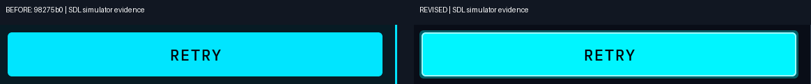
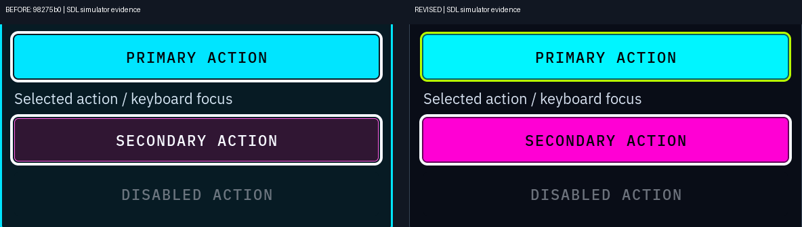

# Neon-sign / arcade revision

**Visual approval is pending.** The owner approved the system-wide direction,
but found `98275b07d47ca5ba50500b6f3943c638b9c94911` insufficiently Neon. This
proposal supersedes the earlier screenshots; their files and history remain
preserved. Neon is still optional through **Settings → Appearance → Neon**.
Doors remains the default and fallback.

## What makes this visibly different

- **Actual colour coverage:** primary/selected actions are solid electric
  cyan `#00f5ff`; secondary actions are hot magenta `#ff00d4`, with dark
  readable labels. Lime `#b8ff00` marks selection and positive state.
- **Neon tubes:** selected decorative edges have a crisp 2 px light core and
  a darker coloured outer band. This is LVGL's existing one-pixel shadow
  kernel with only 2–3 px spread: a small static layered edge, not a broad
  soft glow. No body-text shadow, full-screen blur or animation is used.
- **Launcher identity:** Neon shows existing app A8 masks and familiar
  folder symbols on illuminated magenta tiles. Selected tiles turn cyan
  with lime selection edges; keyboard focus adds a separate light frame.
  This replaces the appearance of the old portal artwork in Neon, rather
  than putting another rectangular border around it. The original artwork
  stays loaded for instant restoration in other themes. No user/content
  image is recoloured.
- **Reading hierarchy:** panels return to near-black interiors and quiet
  boundaries. Actual section headings are cyan signs; ordinary metadata,
  labels and longer text stay neutral near-white. New shared semantic roles
  distinguish headings, button glyphs and compound reading controls. RIFT
  scan rows and route pills keep dark reading surfaces so their explicit
  text/status roles remain readable; no routing or layout logic changes.
- **Distinct states:** lime selection, cyan primary/selected fills, magenta
  secondary actions, and a separate 4 px light keyboard-focus ring. Warning
  and error retain yellow/red plus words and symbols. All accessibility
  sizes and hit boxes stay unchanged. Touch press keeps the underlying fill
  and adds a light ring, preserving dark button glyphs and selected labels.

The change uses the existing registry, resolver, role styles and notification
lifecycle. Theme conditions remain in the theme/shared-style layer; app and
shell call sites select semantic roles without Neon conditionals.

## Matched rendered evidence

Both sides are **actual LVGL/SDL simulator captures**. Before is `98275b0`;
after is this revision. Both use the same fixture, size, orientation, mode
and state. Shell time is fixed at 2026-10-19 08:00 UTC using the existing
host-only capture fixture; RIFT uses its deterministic synthetic fixture.
No radio or network operation was performed. Nothing was brightened,
recoloured, sharpened or given a halo after capture.

| Full-resolution before/after pair | Portrait | Landscape |
| --- | --- | --- |
| Launcher | [Native pair](launcher-portrait-before-after.png) | [Native pair](launcher-landscape-before-after.png) |
| Settings controls | [Native pair](display-portrait-before-after.png) | [Native pair](display-landscape-before-after.png) |
| Populated synthetic Activity | [Native pair](activity-portrait-before-after.png) | [Native pair](activity-landscape-before-after.png) |
| Selection/focus/disabled/warning/error fixture | [Native pair](states-portrait-before-after.png) | [Native pair](states-landscape-before-after.png) |

[HDMI 1920×1080 pair](hdmi-before-after.png) ·
[Compact overview](compact-overview.png) ·
[Individual before frames](before/) · [Individual after frames](after/)

Native crops copy pixels without scaling; only the compact overview resizes:

- [Tube core and coloured band](native-tube-edge.png)
- [Selected action and keyboard focus](native-controls.png)
- [Launcher symbol/selection treatment](native-launcher-focus.png)
- [Dense reading text](native-reading.png)

Capture naming: `<orientation>-<size>-<screen>.png`,
`activity-<orientation>-<size>.png`, and `states-<orientation>-<size>.png`.
Sizes are Small/Medium/Large, both portrait 568×1232 and landscape 1232×568.
HDMI files use `hdmi-large-...`; Activity uses `activity-hdmi-large.png`.
Mode fixtures include `states-night-...` and `states-outdoor-...` at every
size/orientation. Inspection included both full frames and native crops;
this is not a contact-sheet-only proposal.

## Readability and modes

The main reading canvas is `#03040a`, panels `#090d17`, primary text
`#f7faff`, secondary text `#d3ddec`. No font size is reduced. Existing IBM
Plex faces supply the type; symbols reuse existing masks/fonts. Long names
retain existing ellipsis, and existing scrollable pages still scroll.

Neon's Night treatment is intentionally more readable than the rejected
version: text is dimmed 22%, accent/status fills 12%, without the old warm
50% dimming. This **Neon-only** resolver rule keeps solid magenta button
labels and information readable. All other themes retain their exact Night
rules; Outdoor retains the existing transform and body-size floor.

[Actual composited PNG measurements](composited-state-checks.json) cover 18
state captures. Normal: body/panel **18.56:1**, secondary text **14.17:1**,
cyan-action labels **15.12:1**, magenta-action labels **6.05:1**, warnings
**14.67:1**, errors **6.67:1**, disabled **3.95:1**. Night: body **11.42:1**,
secondary **8.82:1**, magenta labels **4.89:1**, warnings **11.62:1**, errors
**5.44:1**, disabled **2.74:1**. These are actual opaque ink and composited
surface samples, not claims about antialiased edge pixels. State checks
also find the coloured band, lime selection and full 4 px keyboard ring.

## Focused validation actually run

- Host simulator and relevant UI test targets build successfully with pinned
  LVGL `59dc7e436ae97a25e32656739ea6a943f9f11b6a`.
- Theme tests: **1,369 checks, 0 failures**, including explicit Neon Night
  information/action-label contrast. Settings persistence test: **0 failures**.
- Existing Settings suite with Neon page/focus matrices: **1,563 checks,
  0 failures**, including compound reading-control contrast and six pressed-action/tab
  regressions across all three modes.
- Existing launcher folder/lifecycle suite: **169 checks, 0 failures**.
  Additional actual Neon tile touches and keyboard return in both
  orientations: [6 checks pass](launcher-touch-checks.txt).
- Existing Neon shell test: **56 checks each before/after, 0 failures**;
  all six size/orientation cases plus HDMI, selection, restart persistence,
  switching back, lock-time changes and screen reopening.
- Bounded populated RIFT/state proof: **92 checks, 0 failures**, with
  Normal/Outdoor/Night state fixtures and unchanged opaque white QR quiet zone.
  Black QR modules and quiet-zone roles were not changed.
- Pixel checks: **18 state fixtures pass**; [15 existing-theme frames are
  identical](existing-theme-checks.txt): Doors/Ice Launcher/Settings in both
  orientations, and Doors Activity at all sizes/orientations plus HDMI.
- [8 live round trips](live-switch-checks.txt) restore exact Doors/Ice pixels
  after Neon in the same process. All six existing theme tables are unchanged.
- Style lint and `git diff --check` pass. One bounded final diff review.

## Cost and limits

Tube treatment adds a bounded 2 px core and a single one-pixel-kernel band
with 2–3 px spread on action surfaces, selected items and heading signs.
Reading panels/rows have no halo. There is no animated glow or large blur
area. No rendering dependency or bitmap glow asset was added.

The launcher adds four small LVGL objects per cell: a legacy-art wrapper,
a themed well, a symbol and a focus frame. Ten root cells therefore add
40 objects. Existing masks are reused; legacy art remains resident for live
switch-back. Destruction and folder cycles pass the existing lifecycle test.

[One host cost observation](host-cost-observation.json), PNG snapshots off,
ran the bounded RIFT UI proof before/after: **3.0499 s → 3.2395 s** elapsed
(about 6% higher), with **9,344 KiB peak RSS** in both. This includes test,
layout and lifecycle work, excludes the launcher, and is not isolated frame
profiling. It is **not evidence of K230 performance**. The bounded flat-edge
approach was chosen instead of a larger blur; target draw cost still needs
measurement.

The pinned K230 toolchain/SDK are absent. None was installed or changed;
no cross-build, device access, deployment, merge or release occurred. Target
DRM compilation, AMOLED/HDMI colour/luminance, hardware input and rendering
cost remain unverified. The PR remains draft for owner visual approval.

Reproduce with the existing build/test commands in the prior revision record,
using `tools/design/neon_arcade_images.py <capture-root>` for this revision's
comparisons/state sampling. Compile the before binaries from `98275b0` and
run the same capture commands into `before/`; use the current binaries for
`after/`. `RIFT_THEME_PROOF=1 RIFT_STATE_MODES=1` bounds the RIFT test. The
host-only fixed-clock fixture and Pillow evidence tooling are unchanged.
