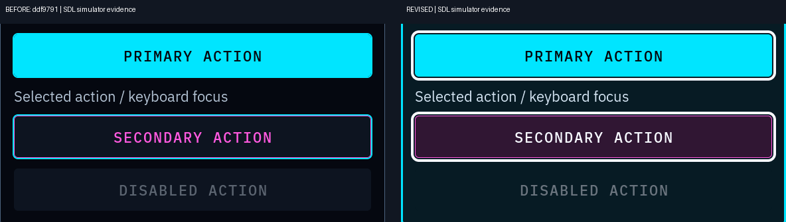
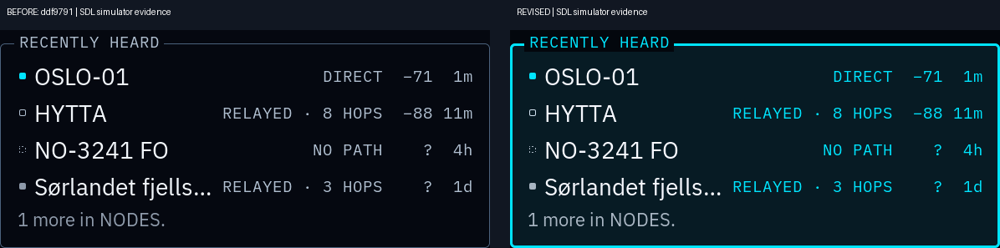

# Visual revision after owner feedback — SUPERSEDED

This `98275b0` proposal is historical and was not visually approved. See the
[current neon-sign / arcade proposal](../arcade/README.md) and its direct
before/after renders. The evidence and commands below describe `98275b0`.

**Simulator evidence. Implementation visual approval is pending.** The owner
approved an optional system-wide Neon direction, but rejected the appearance
of `ddf979105b1a90a308b7483acc3728fecc02332f` as weak, thin and difficult to read.
This is one revised proposal on the same PR branch; the original artwork and
all prior commits remain intact. Doors is still the default.

## What was weak, and what changed

The original vivid RGB values rarely occupied much screen area. App panels
were transparent and outlined with 1 px grey-blue rules. Secondary controls
mostly contributed coloured text and a hairline. Launcher artwork remained
subdued. A cyan focus line could merge with a cyan filled action. High token
contrast alone did not solve that visual hierarchy.

The revision changes shared Neon styles, without changing app layout:

- Opaque teal panel surfaces with **3 px cyan boundaries** distinguish content
  from the near-black canvas. Ordinary internal dividers stay quiet.
- Secondary controls have **plum fills, 3 px magenta boundaries and near-white
  labels**. Primary actions and selection chips retain solid electric cyan
  fills with dark labels. Status keeps lime/yellow/red and explicit words.
- Focus/selection uses a **4 px light ring with a 2 px separation gap**. It
  remains distinct around bright cyan and dark outlined controls.
- Secondary text brightens from `#b0bfd0` to `#d1e1ef`; primary text from
  `#f1f5fa` to `#f6f8ff`. Cyan captions separate headings/metadata from neutral
  body text. Environment headings have cyan badges and use existing Mono
  Medium at the selected 16/19/22 px size. No offset-copy bolding or font-size
  override is used.
- Portal illustrations remain intact, framed in magenta. No photograph,
  camera pixel, map tile, card suit, detection or identity hue is recoloured.
- Thicker structural/control paint is an **inset outline**. Existing border
  widths, padding, content coordinates, touch sizes and text wrapping remain
  intact. Focus is the deliberate external ring; the state fixture verifies
  its full native width with space around it.

All styling is in the existing registry and shared style pass. No
app-specific Neon conditionals, renderer, animation, glow or blur were added.
Switching themes rebuilds these same styles and removes the Neon properties.

## Matched before/after evidence

**Before is the reviewed `ddf9791` runtime; after is this revision.** Both use
pinned LVGL `59dc7e436ae97a25e32656739ea6a943f9f11b6a`, the same SDL dummy
driver, mode, geometry, Small/Medium/Large preference, state and synthetic
RIFT service fixtures. Shell wall time is fixed to **2026-10-19 08:00 UTC**
by a host-only preload fixture; monotonic time remains real. No system clock
is changed. RIFT already has a deterministic test clock. The new state
fixture is compiled against both versions' styles.

Individual captures are full resolution in [`before/`](before/) and
[`after/`](after/). Comparisons add labels outside the captured pixels.
Native crops copy pixels without resampling. Only the explicitly compact
index resizes. No capture has been brightened, recoloured or sharpened.

| Native before/after pair | Portrait | Landscape |
| --- | --- | --- |
| Launcher | [568×1232](launcher-portrait-before-after.png) | [1232×568](launcher-landscape-before-after.png) |
| Settings controls | [568×1232](display-portrait-before-after.png) | [1232×568](display-landscape-before-after.png) |
| Populated synthetic Activity | [568×1232](activity-portrait-before-after.png) | [1232×568](activity-landscape-before-after.png) |
| Focus, selected, disabled, OK, warning, error | [568×1232](states-portrait-before-after.png) | [1232×568](states-landscape-before-after.png) |

[Representative 1920×1080 HDMI pair](hdmi-before-after.png) ·
[Compact overview](compact-overview.png) ·
[Native button/focus crop](native-controls.png) ·
[Native dense-text crop](native-reading.png) ·
[Native launcher-focus crop](native-launcher-focus.png)





Full-resolution capture naming: `<orientation>-<size>-<screen>.png` for
Launcher, Settings, Display, Appearance, Network, Controls and lock;
`activity-<orientation>-<size>.png` for synthetic Activity;
`states-<orientation>-<size>.png` for the shared state fixture. Orientations
are `portrait`/`landscape`, sizes `small`/`medium`/`large`. HDMI is
`hdmi-large-<screen>.png` and `activity-hdmi-large.png`. Mode proofs are
`after/states-outdoor-<orientation>-<size>.png` and
`after/states-night-<orientation>-<size>.png`.

Visual inspection covered both orientations, all three sizes, HDMI and native
crops. The difference is substantial in panel coverage, boundary thickness,
control surfaces and focus. Long RIFT names/readouts retain the same existing
ellipsis; offscreen Activity content and the seventh Appearance row use the
existing page scroll. No new wrapping or overlap was observed. Night retains
its deliberate low-light dimming; Outdoor keeps its contrast and body-size
floor. Both retain the more visible control and focus geometry.

## Focused checks actually run

| Check | Result |
| --- | --- |
| Host simulator, Settings app test and RIFT app test build | Passed |
| Theme registry/derived tokens/contrast/live selection | 1,364 checks, 0 failures |
| Settings persistence/reload | 0 failures |
| Existing Settings app suite | 1,555 checks, 0 failures |
| Same suite with `SETTINGS_THEME=neon` for page/layout and Wi-Fi/focus matrices | 1,556 checks, 0 failures |
| Existing Neon shell lifecycle test, before and after | 56 checks each, 0 failures |
| Bounded RIFT proof, including all state sizes, mode variants and QR quiet zone | 92 checks, 0 failures |
| Rendered composited-state sampling | 18 native captures pass |
| Existing-theme screenshot comparison | 8 full frames pixel-identical, including clock |
| Live Neon → Doors/Ice screenshot round trips | 8 full frames restored exactly |
| Style lint / final diff whitespace check | Passed |

The rendered-state check samples actual opaque ink colours and actual
composited panel/button pixels in the PNGs, rather than merely checking the
base RGB table. Normal-mode contrast is **16.61:1** for body on panel,
**13.20:1** secondary text, **13.13:1** primary-action labels, **15.36:1**
secondary-action labels, **13.32:1** warning, **6.06:1** error and **3.70:1**
disabled. It checks three cyan boundary pixels and four light focus pixels
at native resolution. [All measurements](composited-state-checks.json).
Night retains the existing reduced-contrast policy; its error text is
2.91:1 and disabled text 1.81:1 on the actual dark panel, deliberately below
Normal. These are not claims of Normal contrast in Night.

The unchanged-theme proof covers Doors and Ice Launcher/Settings in both
orientations with the same fixed wall time: [results](existing-theme-checks.txt),
[individual before frames](existing-before/), [individual after frames](existing-after/).
[Live round trips](live-switch-checks.txt) additionally verify exact rendered
restoration of Doors/Ice Launcher and Settings in both orientations after
switching through Neon in the same process. The existing six theme tables
and the default/fallback are unchanged.

Reproduction uses the simulator prerequisites already documented in
`docs/BUILD_ENVIRONMENT.md`, without changing the SDK/toolchain pins:

```sh
cmake --build out/neon-build --target pocketos-shell settings_app_test rift_app_test -j6
make CC=gcc tests/theme_test tests/settings_test
./tests/theme_test
./tests/settings_test
SETTINGS_THEME=neon SDL_VIDEODRIVER=dummy out/neon-build/settings_app_test
mkdir -p out/neon-revision/after
gcc -shared -fPIC tools/design/neon_capture_clock.c -ldl -o out/neon-capture-clock.so
LD_PRELOAD="$PWD/out/neon-capture-clock.so" \
  python3 tests/neon_shell_test.py out/neon-build/pocketos-shell out/neon-revision/after
SDL_VIDEODRIVER=dummy RIFT_THEME=neon RIFT_THEME_PROOF=1 RIFT_STATE_MODES=1 \
  RIFT_SHOTS_DIR="$PWD/out/neon-revision/after" out/neon-build/rift_app_test
bash tests/style_lint.sh
```

For matched before captures, build `ddf9791`'s runtime in a separate worktree
with this revision's **test fixture source only**, then run the same capture
commands into `before/`. Do not replace the main checkout or vendor sources.
`tools/design/neon_revision_images.py <capture-root>` composes the comparisons
and checks the PNG state samples; Pillow is a host evidence-tool prerequisite,
not a DOORS rendering dependency.

## Remaining limitations

Visual approval of the implementation is **still pending owner review**;
only the optional system-wide direction is approved. PR #98 remains draft.
The pinned K230 toolchain/SDK are absent, so no cross-build was attempted or
installed. Target DRM compilation, actual AMOLED/HDMI colour/luminance,
hardware input and target rendering cost remain unverified. No device,
radio/network operation, deployment, merge or release was performed.
