# Vision screen redesign: before and after

Simulator screenshots (568 x 1232 panel, fake camera, fake detector) from
branch `claude/k230-vision-ui-redesign-ef4926`, 2026-11-12. `before/` is
master dd9b1f64, `after/` this branch. What changed and why:
docs/apps/VISION.md, "The screen".

| Screen | Before | After |
| --- | --- | --- |
| DETECT, upright | 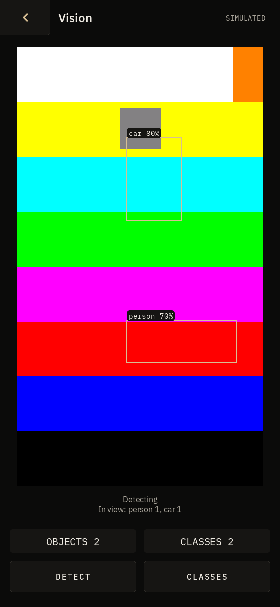 | 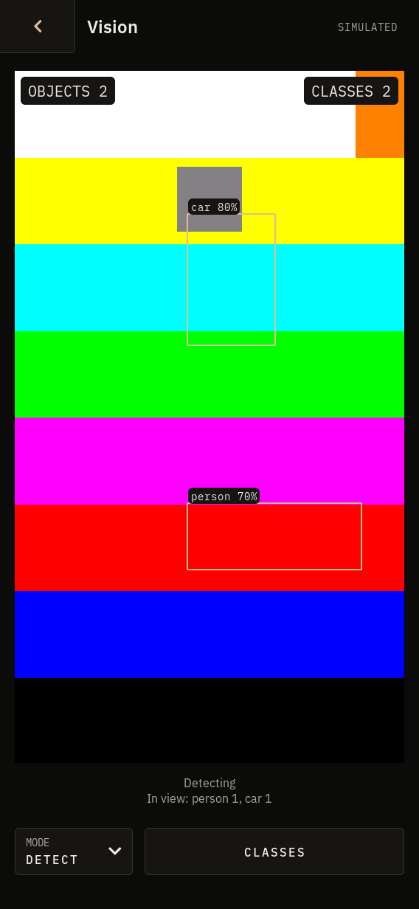 |
| TRACK, upright | 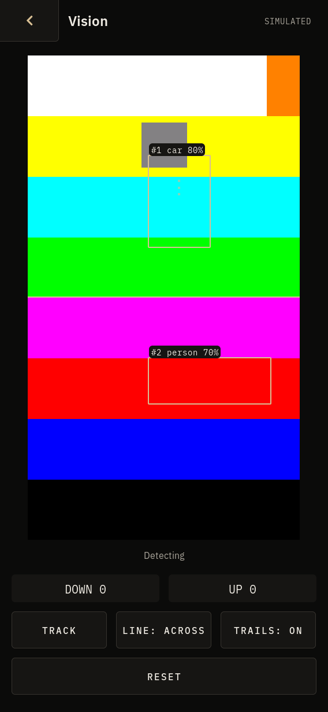 | 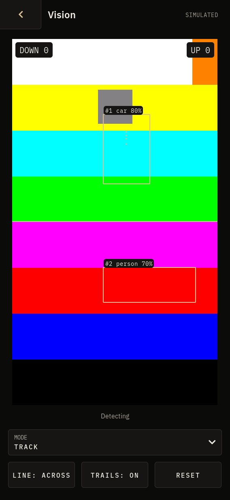 |
| The picker, upright | 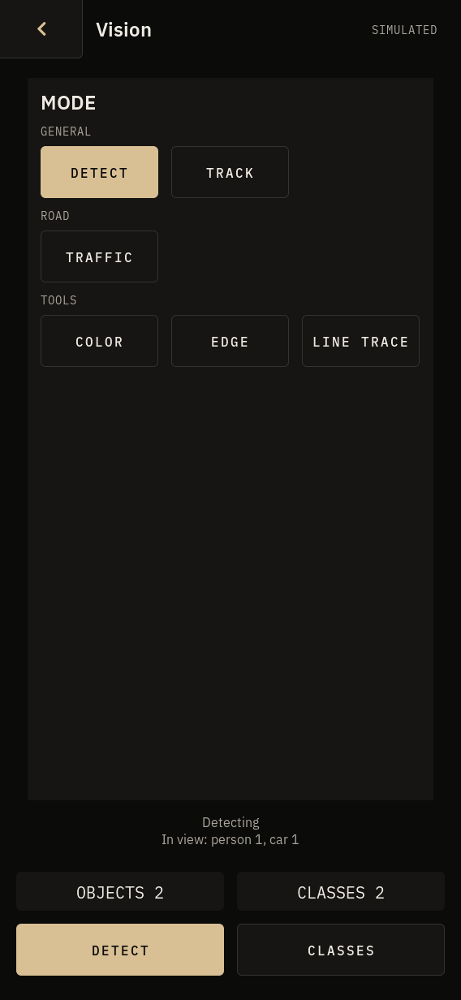 | 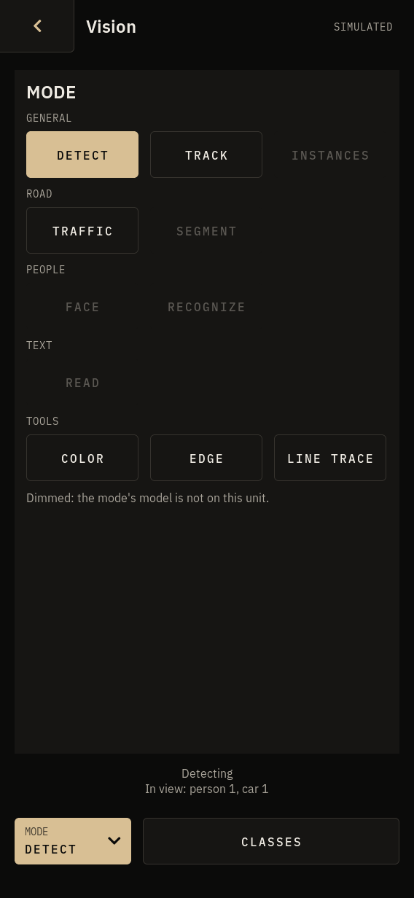 |
| SEGMENT, upright | 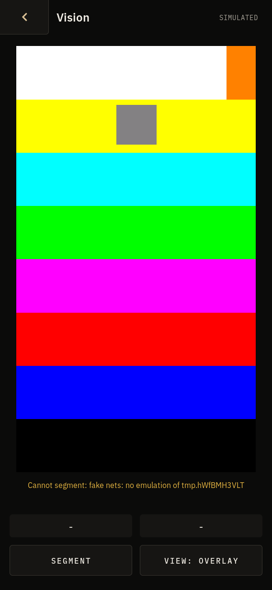 |  |
| COLOR, upright | 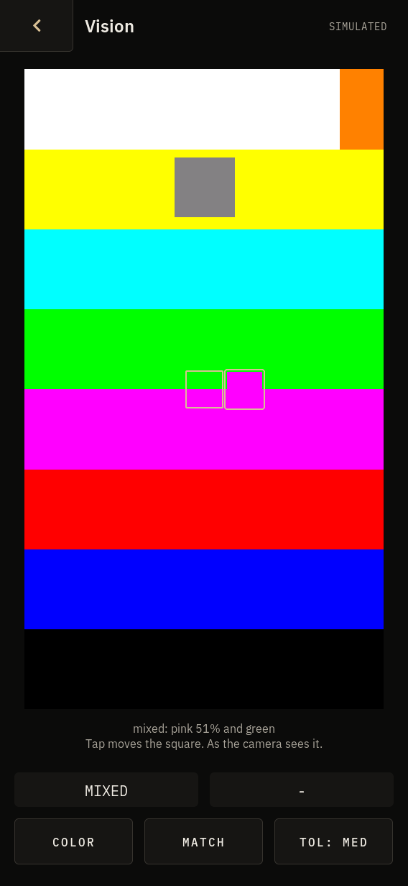 | 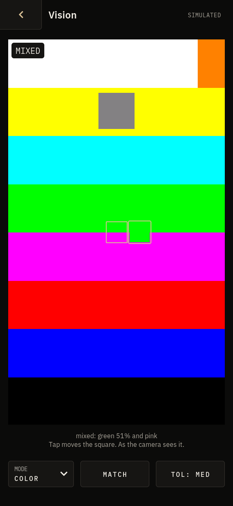 |
| TRAFFIC, wide | 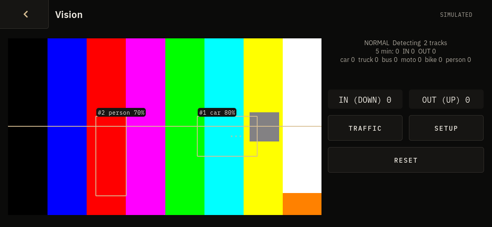 | 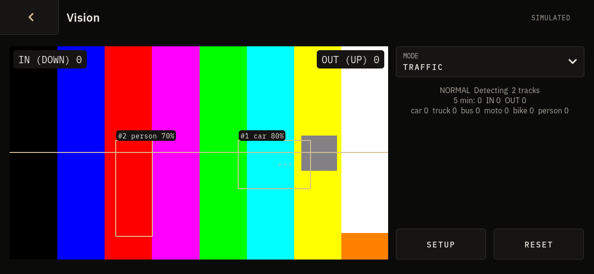 |
| The picker, wide | 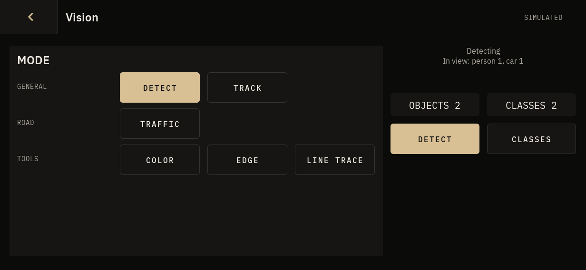 | 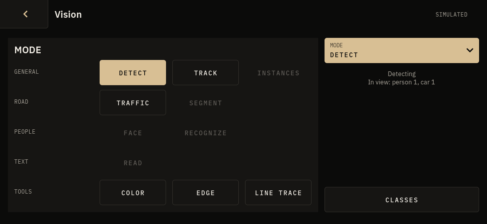 |
| SEGMENT, wide | 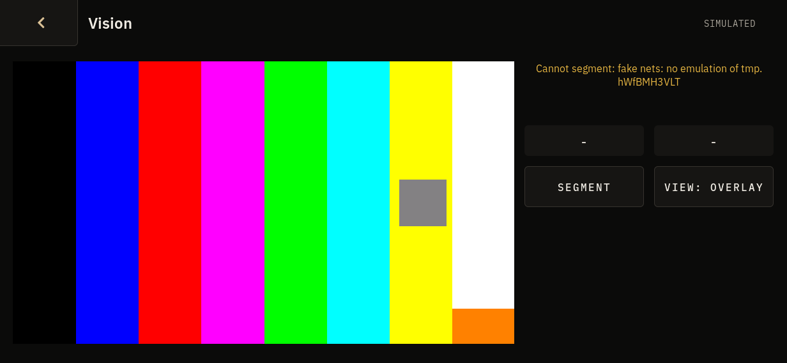 | 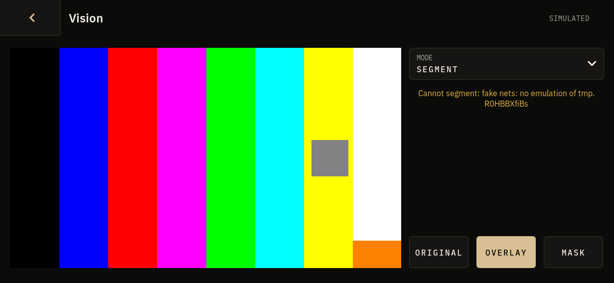 |

The host's fake nets emulate neither segmentation model, so SEGMENT shows
its "Cannot segment" warning here and no key to its colours.
`after/segment-key-portrait-forced.png` shows the key's place and look: it
was taken from a build patched, for that one screenshot only, to feed the
screen the words `road 41%  vegetation 20%  building 12%`. The key with a
real model has not been seen.

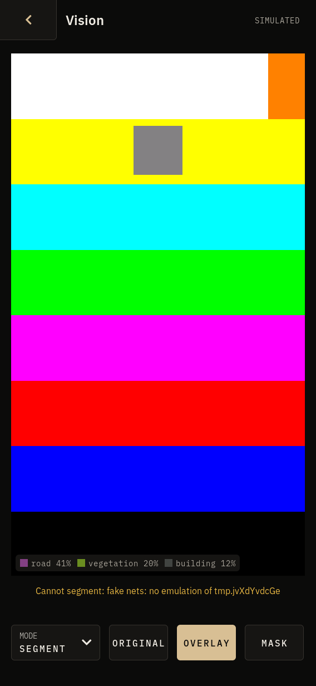
