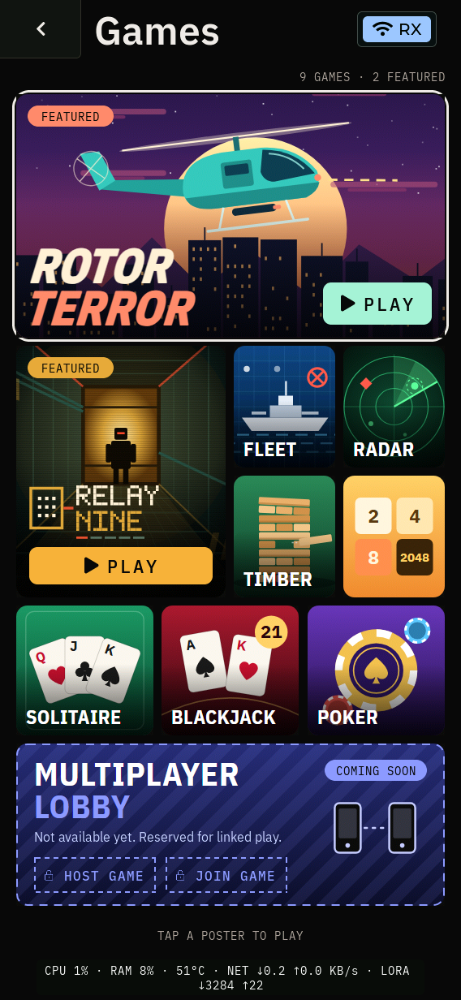
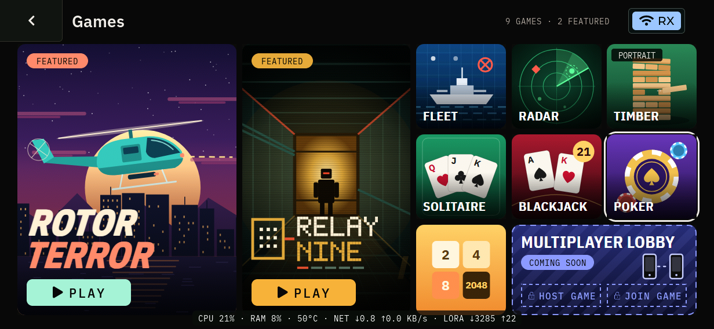

<!-- Copyright (c) 2026 Doors authors. SPDX-License-Identifier: Apache-2.0 -->
# Games Hub (DS §60) - hardware gate, Unit A

**Result: steps 1-5 PASS, step 6 PASS as far as a capture can show it, step
7 approved by the owner on 2026-11-17 from the visual results (see "Not
covered" for what remains unvalidated).** Run on Unit A on 2026-11-17, 05:12-05:18Z, on
the owner's say of the same day, with a non-persistent kit. Unit A was put
back as found and carries nothing of this branch.

- Unit A: wlan0 `88:3b:dc:b7:9e:c7`, Doors 0.4.0 card, installed
  `doors-shell` build `f8939dbb` (sha256 `50786142…`), theme `carbon`, text
  size Large, rotation Automatic, no keyboard base attached, debug overlay
  on - all as found. Unit B was not touched.
- Branch `feature/games-hub`, commit `fa7a45ea` (PR 144).
- Binary: riscv64 DRM shell cross-built from a clean `git archive` of
  `fa7a45ea` against the v0.4.0 SDK sysroot, Release **with
  `POCKETOS_SHELL_TEST_HOOKS=1`** (sha256 `135984f0…`), so `shell.tap` could
  drive it. It is a kit build, not the production binary.
- Method: kit in `/tmp/ghub` (tmpfs), sent over the serial console with
  checksums. The installed service was stopped and the kit shell run in its
  place with `POCKETOS_CONFIG_DIR` and `POCKETOS_STATE_DIR` pointed at kit
  copies and `POCKETOS_ART_DIR` at links to the installed art plus the
  twenty hub posters. Nothing was flashed or installed; nothing under
  `/usr`, `/etc`, `/var` or `/root` was written.
- Inputs: taps by `shell.tap` (an LVGL pointer inside the shell, at the
  centre of each rectangle `shell.info` reports) and keys by `shell.key`
  (the keyboard base's own path through the key map). **No physical finger
  and no physical key was used**, and the touch controller was not in the
  path.
- Scripts, serial logs, the kit and the captures: `C:\K230-artifacts\games-hub\unit-a\`.

## Steps (DS §60.8)

| # | Step | Result | Evidence |
| --- | --- | --- | --- |
| 1 | Open time | **PASS.** The ten art files read in 0-1 ms each and the wall is built 10 ms after the first read begins (05:13:23.431 to .441); `shell.folder id=games` returns in 0.03 s, as `id=apps` does (0.04 s). | `11-t2.log` |
| 2 | Memory | **PASS.** RssAnon 6,196 kB at home; 7,212 kB with the hub open (art held 2,620,936 bytes, of which 1,000,200 the hub's); 6,264 kB after closing; 6,292 kB after twenty more open/close rounds and still 6,292 kB at the end of the whole gate. File descriptors 14 throughout. | `11-t2.log`, `20-restore.log` |
| 3 | Posters, lobby, way back | **PASS.** Each of the nine posters opened its game (RotorTerror, Relay Nine, Fleet, Radar, Timber, Solitaire, Blackjack, Poker, 2048) and home from each came back to the hub. A tap on the lobby, on HOST GAME and on JOIN GAME changed nothing. The back corner (tap at 12, 12), Back and Home each returned to the launcher's page with the focus on the Games cell. | `12-t3.log` |
| 4 | Keys | **PASS.** First arrow shows the focus on RotorTerror; Down Relay Nine; Right Fleet, Radar, then stays at the edge; Down 2048, Poker, then stays above the lobby; Left Blackjack, Solitaire; Up Relay Nine, RotorTerror; Enter played Fleet; Esc and Backspace returned to the Games cell; Enter on it opened the hub again. | `13-t4.log`, `13-t4b.log` |
| 5 | Rotation, Timber | **PASS.** `shell.rotation mode=landscape` with the hub open came back in the hub in landscape ("folder games open again after the restart"), the wall accepted by the layout with the unit's real corner squares. Right five times reached Timber, Down twice Poker. Radar played from the landscape wall and came home to it. Timber from the landscape wall turned the display to portrait and opened; home turned it back to landscape, in the hub. | `14-t5.log` |
| 6 | Modes and themes | **PASS in captures; not judged on the glass.** The hub drew in Normal, Night and Outdoor, and in `carbon` and Neon; the posters are pixel for pixel the same in Neon as in `carbon` (compared over the wall in the two captures; the only difference is the key-focus frame that was showing in the `carbon` one, and the status cluster above). Whether it reads well on the AMOLED, whether the dithered gradients band, and whether the 30 px landscape margins clear the glass's corners needs eyes on the unit. | `15-t6.log`, captures |
| 7 | The posters themselves | **Approved by the owner on 2026-11-17** after reviewing the visual results (Concept C and the final visual design; DS §60 ACCEPTED). This gate did not record an inspection on the unit's AMOLED; that stays open with step 6. | DS §60 |

The kit shell logged no ERROR. Its one WARN is the kit's own: the 0.4.0
image has no `icon-packetshark.bin`, so the Apps folder drew that icon's
fallback.

## Observations

- **The debug overlay covers the wall's foot in landscape.** With
  `debug_overlay=1` (as found on Unit A) the overlay's line lies over the
  last 10 px or so of 2048, Relay Nine and the lobby (see the landscape
  capture). The overlay is drawn over every screen (DS §52.6); nothing was
  changed for it.
- **The key step needs a pause between a key and reading the focus.** In
  the first key run two readings were taken before the key had been
  handled; the run with one second after each key (`13-t4b.log`) is exact.
  This is the harness, not the hub.
- **Open time was measured with the art in tmpfs.** On an installed image
  the files are on the SD card's root filesystem; the first open after boot
  may be slower than the 10 ms here, later ones are served from the page
  cache.
- The text size was Large throughout: the hub's type did not change with
  it (DS §60.3).

## Captures (from the unit's own frame buffer)

| Portrait | Landscape, focus on Poker |
| --- | --- |
|  |  |

Frame-buffer captures (`shell.action action=screenshot`): they show the
panel's full rectangle, not what the rounded glass cuts.

## Restoration

`restore.sh` ended the kit shell and started the installed service from a
clean environment: `/usr/bin/doors-shell` sha256 `50786142…` unchanged,
build `f8939dbb` running; every file under `/etc/pocketos` and
`/var/lib/pocketos` (logs aside) byte-identical before and after
(`STATE-IDENTICAL`); `/usr/share/doors/ui` still 38 files; `/root`
unchanged; `/tmp/ghub` removed. One visible difference: the unit was
showing RIFT when the gate began and shows the launcher now, because the
service was restarted.

## Not covered

A physical finger on the panel and the touch controller's path; the
physical keyboard base; the production (non-hooks) binary; the art read
from the SD card on a cold start; the look on the AMOLED under the glass;
Unit B.
